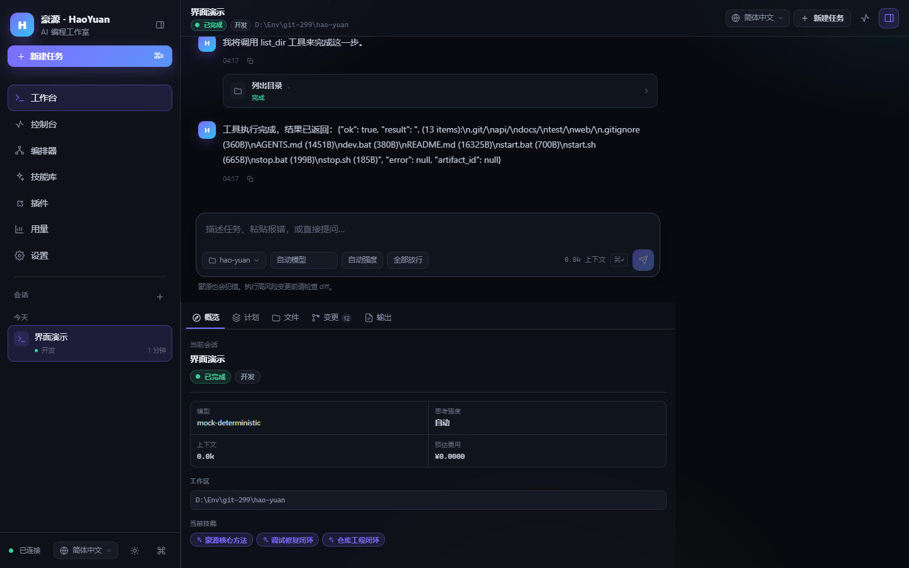
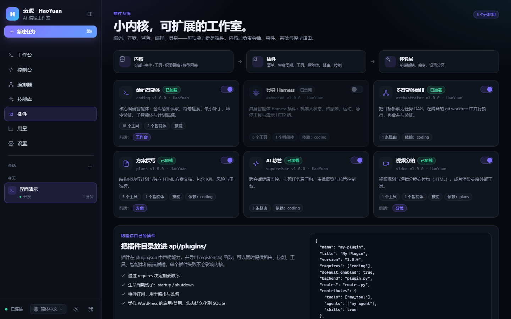
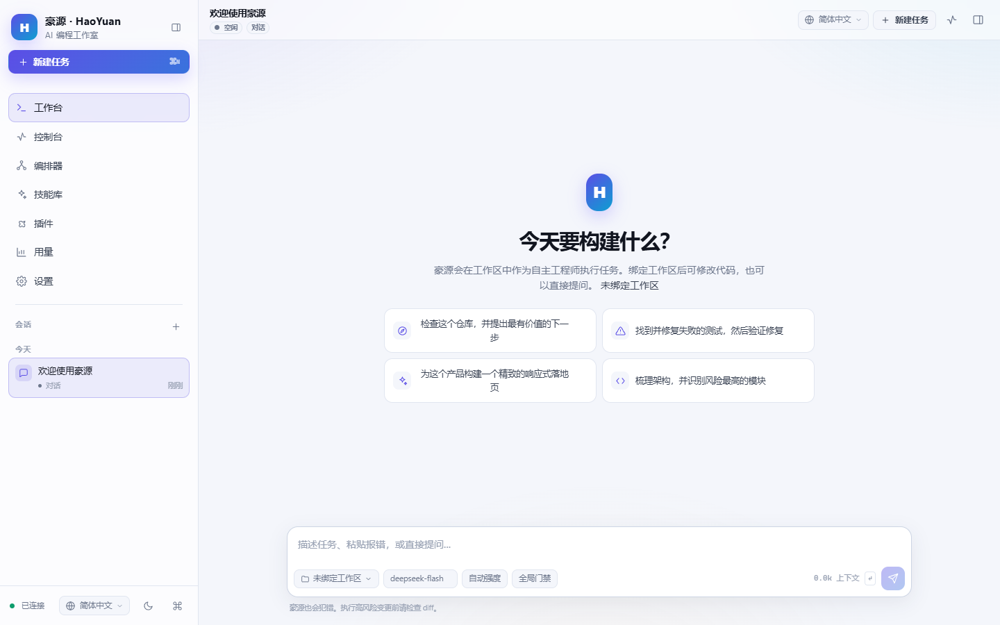
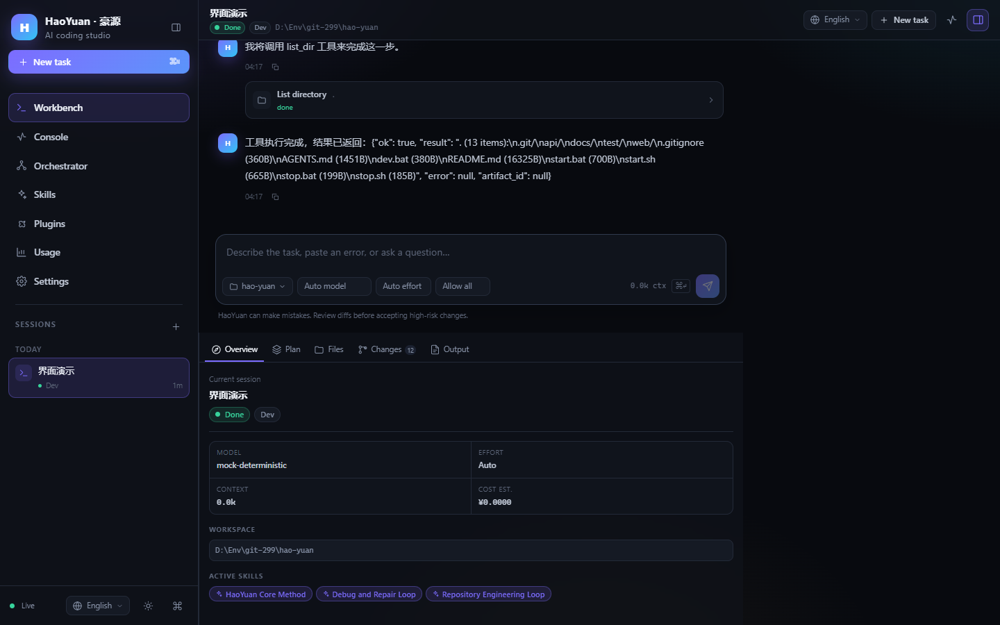
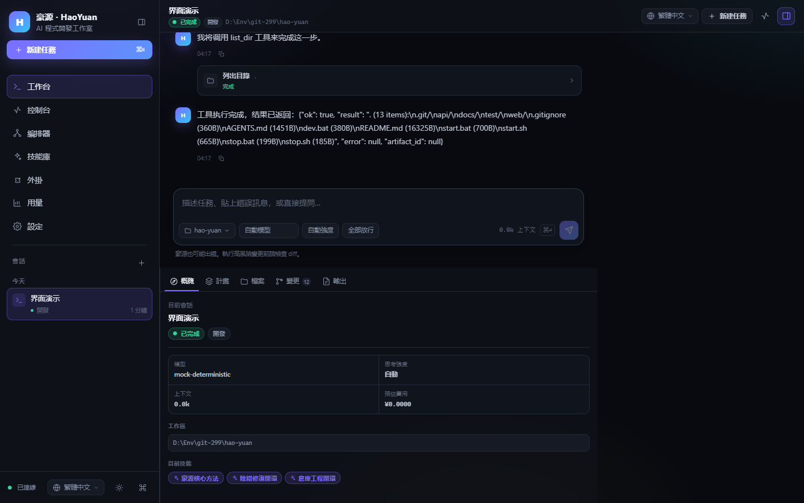
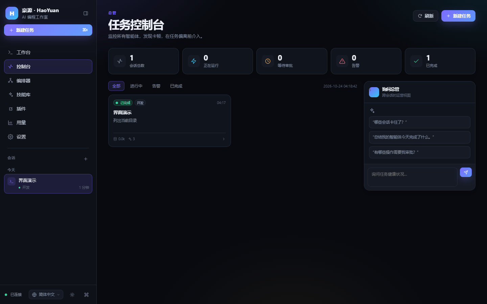
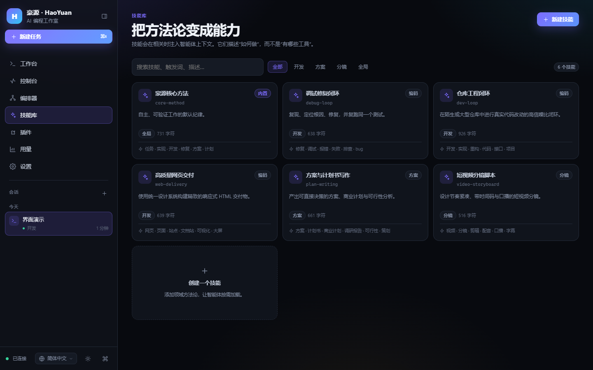
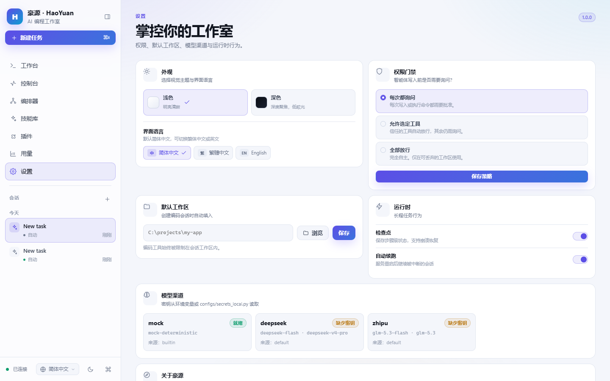
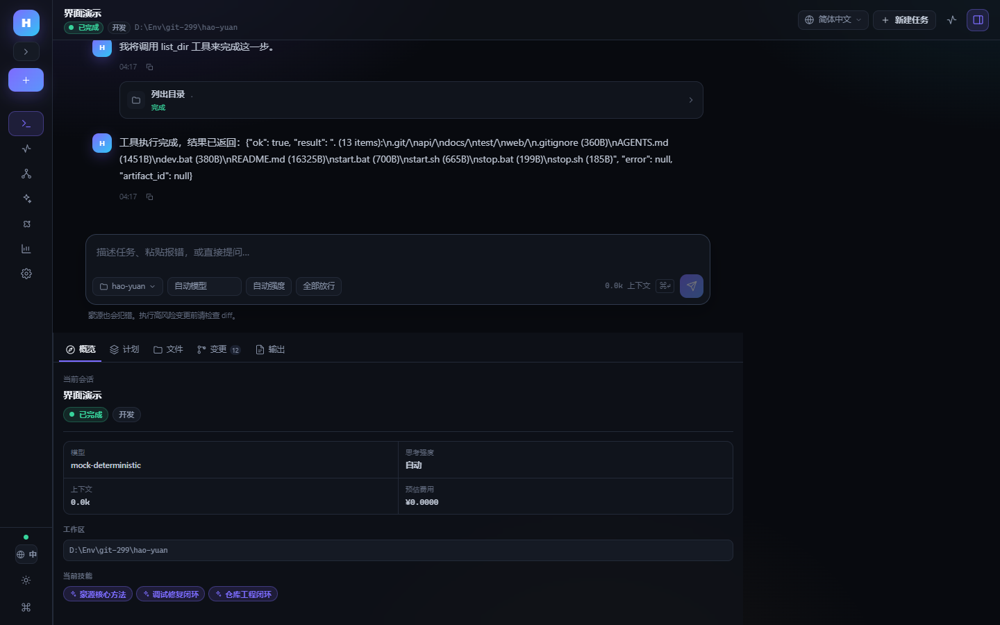
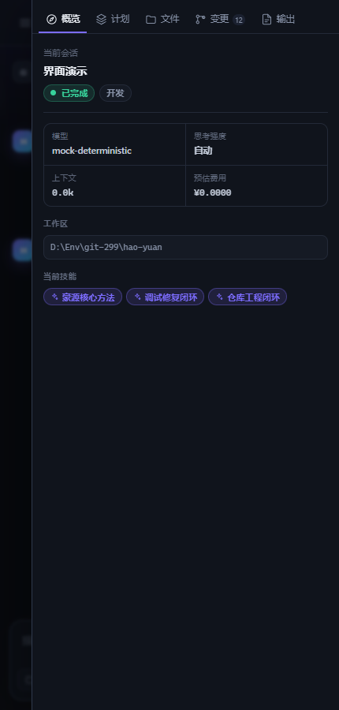

# 豪源 · HaoYuan

> 个人指挥 AI 实现多个 AI 员工异步并行工作的 AI 编程工作室。  
> 一个内核，一组可安装插件，一套可验证的长程编码闭环。

豪源以 **agent-harness** 为后端参考底座重写，保留并强化了 AI 助理的编程能力，同时用插件化架构重新组织了会话、工具、Agent、路由、技能、监督与编排。前端完全重写，目标是把「AI 编程」从聊天窗口升级为可指挥、可观察、可干预的工作台。



---

## 1. 核心特性

### 1.1 真正可用的编码闭环

| 能力 | 实现 |
|---|---|
| 仓库感知 | `project_scan`、`repo_map`、符号索引、`search_symbol` |
| 精准读取 | `read_file`、`read_range`、行号定位 |
| 最小编辑 | `apply_patch`（unified diff / SEARCH-REPLACE）、`edit_file`、`multi_edit` |
| 文件操作 | `write_file`、`glob`、`grep`、`list_dir`、`delete_path`、`move_path` |
| 命令验证 | `run_shell`（UTF-8、超时、结构化错误摘要）、`git` 封装 |
| 验证门禁 | 代码写完后强制要求跑测试/lint/build，避免「只改不验」 |
| 测试修复环 | pytest 失败结构化解析 → 定位行 → 最小修复 → 失败指纹升级策略 |
| 子代理 | `task` 在独立上下文侦察，只回填结论，避免污染主上下文 |
| 上下文治理 | 工具结果老化、结构化摘要、轮内压缩、硬预算裁剪 |
| 长程任务 | 步数预算、自动续跑、检查点、幂等副作用登记（写操作不重复施加） |
| 人机协同 | 高风险写操作/命令弹出 diff 预览，批准或拒绝后才执行 |

### 1.2 多会话异步并行

- 一个会话 = 一个后台 `asyncio.Task`，切窗、关页、断线都不会停止任务。
- 全局并发闸 + FIFO 排队；等待人工审批时自动让出并发槽。
- 会话状态机：`idle → queued → running ⇄ waiting_input → done / error`。
- 刷新页面后从 SQLite 恢复消息、事件、计划、审批与产物。
- 前端实时事件主通道使用 SSE（断线重连、游标续传、无需 WebSocket 也能流式输出）；WebSocket 端点保留用于兼容；REST 支持事件回放。

### 1.3 AI 总管与多智能体编排

- **Supervisor**：跨会话健康巡检、卡死告警、自动中断、控制台对话与调度动作。
- **Orchestrator**：目标 → 任务 DAG → 每个员工独立 git worktree → 并行执行 → 合并验收。
- 员工会话共享契约文件与共享黑板，失败不阻塞同层其它任务。

### 1.4 技能库（Skills）

- Markdown + front-matter，声明 `name / title / description / kinds / triggers`。
- 按任务类型与关键词自动匹配；技能多了自动切 BM25 排序。
- 内置：核心方法论、仓库工程闭环、Debug 闭环、网页交付、方案写作、视频分镜。
- 支持在 UI 中新建、编辑、删除技能，保存即生效。

### 1.5 方案 / 分镜文档

- `make_plan`：生成独立 HTML 方案/计划书，含 KPI、章节、表格、风险、里程碑。
- `make_storyboard`：生成视频分镜脚本（镜头、时长、画面、口播）。
- 产物登记到 `api/data/artifacts/`，工作台右侧可直接预览/下载。

### 1.6 插件化架构

豪源不是「一个巨大的单体」，而是：

```
Kernel（会话 / 事件 / 工具注册 / 策略 / 模型网关 / 审批）
        │
        ├── coding      编码 Agent + 工程工具 + 技能
        ├── plans       方案工具 + Planner Agent
        ├── video       分镜工具 + Video Agent
        ├── supervisor  巡检 + 控制台路由
        ├── orchestrator 任务 DAG + worktree + 合并
        └── embodied    具身 Agent Harness（默认关闭，可安装启用）
```

插件可以贡献：工具、Agent、HTTP 路由、技能目录、事件订阅、生命周期钩子、前端导航/命令元数据。单个插件加载失败不会拖垮内核。



### 1.7 三语言、浅色默认与可收起侧栏

- 默认 **浅色（白色）主题**，可在设置页或侧栏底部切换为深色。
- 默认 **简体中文**，可在 **简体中文 / 繁體中文 / English** 之间切换。
- 语言入口放在三个显眼位置：工作台顶栏、侧栏底部（所有页面可用）、设置页「外观」。
- 选择持久化到 `localStorage`，刷新和重启后保持；同时更新 `document.lang` 与页面标题。
- 侧栏可收起为 76px 图标栏；收起后顶部保留明确的「展开侧栏」按钮，会话列表自动隐藏，恢复后完整还原。
- 右侧洞察面板默认收起，给对话区留出更多空间；点击右上角按钮打开，用户选择会持久化。
- 内置技能标题、描述，插件标题、描述，状态、按钮、提示、审批、计划、用量、编排等 UI 文案均已完成三语言覆盖。

---

## 2. 快速开始

### 环境要求

- Python 3.10+
- Node.js 18+
- Windows / Linux / macOS

### Windows 一键启动

```bat
start.bat
```

脚本会自动：停止 8030 上的旧进程 → 创建 `api/env1` → 安装 Python 依赖 → 安装前端依赖 → 每次重新构建前端 → 启动 API，并打开 <http://127.0.0.1:8030>。这样不会因为旧进程或旧静态资源导致流式事件异常。

停止：

```bat
stop.bat
```

### 桌面控制台（desktop.exe）

双击根目录的 `desktop.exe` 打开图形化控制台（约 20 KB，仅依赖 Windows 自带的 .NET Framework 4.x）：

- **全部启动 / 全部关闭**：一键管理后端与前端开发服务，启动后自动打开产品网页
- **启动 / 停止后端**（8030）、**启动 / 停止前端**（8130）
- **打开产品网页**：优先 `http://127.0.0.1:8030`，仅前端运行时回退 `http://localhost:8130`
- **构建前端**、**打开项目目录**、每秒刷新的服务状态与实时运行日志

关闭控制台窗口不会停止服务，如需停止请点击「全部关闭」或对应的停止按钮。源码位于 `desktop/`，修改后运行 `desktop\build.bat` 可重新编译。

### Linux / macOS

```bash
bash start.sh
bash stop.sh
```

### 手动启动

```bash
# 后端
cd api
python -m venv env1
env1\Scripts\activate           # Linux: source env1/bin/activate
pip install -r requirements.txt
python main.py                  # http://127.0.0.1:8030

# 前端开发模式（热更新，可选）
cd web
npm install
npm run dev                     # http://127.0.0.1:8130
```

生产模式由后端直接托管 `web/dist`，只需要访问 `:8030`。

### 配置模型

```bash
copy api\configs\secrets_example.py api\configs\secrets_local.py
```

编辑 `api/configs/secrets_local.py`：

```python
DEEPSEEK_API_KEY = "sk-..."
DEEPSEEK_BASE_URL = "https://api.deepseek.com"
DEEPSEEK_MODEL = "deepseek-flash"

# 可选：智谱
ZHIPU_API_KEY = ""
```

也可以使用环境变量（优先级高于文件）：

```powershell
$env:DEEPSEEK_API_KEY="sk-..."
```

**未配置任何 Key 时自动使用本地 `mock` 模型**，完整跑通会话、工具调用、审批、事件与前端。

---

## 3. 界面

| 工作台（浅色，默认） | 工作台（英文） |
|---|---|
|  |  |

| 工作台（繁體中文） | 工作台（深色） |
|---|---|
|  |  |

| 总管控制台 | 技能库 |
|---|---|
|  |  |

| 设置与语言入口 | 侧栏收起后的展开按钮 |
|---|---|
|  |  |

移动端右侧洞察面板：  


主要交互：

- `Ctrl / Cmd + K`：命令面板（导航、会话、动作）
- `Ctrl / Cmd + N`：新建任务
- `Ctrl / Cmd + B`：折叠 / 展开侧栏
- `Enter`：发送；`Shift + Enter`：换行（`Ctrl / Cmd + Enter` 同样发送）
- 审批卡片：`A` 批准、`R` 拒绝
- 语言切换：工作台右上角、任意页面侧栏底部、设置页「外观」
- 会话运行中继续输入：作为「追加指令」合并进当前执行，不打断任务
- 右侧面板默认收起；点击右上角按钮展开，包含概览 / 计划 / 文件 / 变更 / 产物，支持拖拽调整宽度
- 文件与 diff 使用大尺寸预览弹层，避免窄栏阅读代码

---

## 4. 架构

```text
hao-yuan/
├── api/
│   ├── main.py                    FastAPI 入口（扩展路由 + 插件路由 + 静态前端）
│   ├── configs/                   配置、模型注册、密钥
│   ├── core/
│   │   ├── contracts.py           Tool / Agent / Policy / ToolContext
│   │   ├── storage.py             SQLite (WAL) 存储层
│   │   ├── events.py              事件总线（广播 + 批量落库 + 回放）
│   │   ├── gateway.py             模型网关（流式 + 降级 + fallback）
│   │   ├── context.py             上下文压缩 / 老化 / 硬预算
│   │   ├── runtime.py             Agent 主循环
│   │   ├── session_manager.py     并发闸 / 排队 / 审批 / 续跑
│   │   ├── policy.py              权限门禁
│   │   ├── tools.py               工具注册与执行
│   │   ├── agents.py              Agent 注册
│   │   └── plugin.py              插件发现 / 依赖 / 生命周期
│   ├── harness/                   沙箱 / 技能 / 符号索引 / 修复环 / 监督 / 编排 / 具身
│   ├── tools/                     builtin / dev / plan
│   ├── adapters/providers/        deepseek / mock
│   ├── plugins/                   coding / plans / video / supervisor / orchestrator / embodied
│   ├── extensions/                系统 / 会话 / 技能 / 设置 / 文件 / 用量 / 插件 / 审批 / 实时事件（SSE / WebSocket）
│   ├── skills/                    核心技能
│   ├── tests/                     16 个后端测试
│   └── data/                      运行时数据（gitignore）
├── web/                           Vue 3 + Vite
├── docs/screenshots/              界面截图
├── start.bat / stop.bat
├── start.sh / stop.sh
├── dev.bat
├── desktop.exe                    图形化桌面控制台（启停服务 / 打开网页）
└── desktop/                       desktop.exe 源码与构建脚本
```

### 数据与边界

- 数据库：`api/data/haoyuan.db`（WAL）
- 产物：`api/data/artifacts/<session_id>/`
- 所有文件工具都受会话工作区白名单约束，拒绝 `../` 与绝对路径越界。
- 高风险工具（写文件、patch、删除、移动、shell、git、机器人运动）必须经审批。
- `run_shell` 对灾难性命令做硬阻断（如 `rm -rf /`、磁盘格式化、关机）。
- 产物 HTML 通过带沙箱 CSP 的接口预览，避免模型生成页面读取本地凭据。
- 密钥只从环境变量或 `secrets_local.py` 读取，不入库、不返回明文。
- 真实 Key 存放在 `api/configs/secrets_local.py`，已被 `.gitignore` 忽略；`git add --dry-run` 验证不会进入仓库。

---

## 5. 插件开发

在 `api/plugins/` 下新建目录：

```
api/plugins/my-plugin/
├── plugin.json
├── plugin.py
├── routes.py        # 可选
└── skills/          # 可选
    └── my-skill.md
```

`plugin.json`：

```json
{
  "name": "my-plugin",
  "title": "My Plugin",
  "version": "1.0.0",
  "description": "What this plugin adds",
  "author": "you",
  "requires": ["coding"],
  "default_enabled": true,
  "backend": "plugin.py",
  "routes": "routes.py",
  "contributes": {
    "tools": ["my_tool"],
    "agents": ["my_agent"],
    "skills": true
  },
  "frontend": {
    "nav": [{ "label": "My Plugin", "path": "/my-plugin", "icon": "puzzle" }],
    "commands": [{ "id": "my-plugin.run", "title": "Run my plugin" }]
  }
}
```

`plugin.py`：

```python
from core.contracts import AgentSpec, ToolSpec


async def my_tool(ctx, args):
    return {"echo": args.get("text", "")}


def register(ctx):
    ctx.register_tool(
        ToolSpec(
            name="my_tool",
            description="Echo text",
            input_schema={
                "type": "object",
                "properties": {"text": {"type": "string"}},
                "required": ["text"],
            },
        ),
        my_tool,
    )
    ctx.register_agent(
        AgentSpec(
            name="my_agent",
            title="My Agent",
            instructions="You are ...",
            tools=["my_tool"],
            kind="dev",
        )
    )
    ctx.add_skill_dir("skills")


async def startup(ctx):
    ...


async def shutdown(ctx):
    ...
```

插件能力：

- `requires` 依赖排序；缺失依赖会被隔离并记录错误。
- `startup / shutdown` 生命周期。
- `ctx.events.subscribe(sink)` 订阅全局事件（编排器就是这样接收员工完成事件的）。
- 启用/禁用状态持久化在 SQLite；启用/禁用后需重启 API 以加载/卸载路由。
- 前端通过 `/api/plugins` 获取 `contributes` 与 `frontend` 元数据。

### 为什么这样设计

参考了 WordPress 的「小内核 + 可安装插件」：内核只负责会话、事件、策略、模型与工具协议；业务能力全部下沉为插件。  
也吸收了 DeepSeek Harness 的「harness 本身可插拔」思路：具身 Agent 就是一个独立 harness 插件，可以继续安装小车、机械臂、人形机器人等不同 harness，而不改内核。

---

## 6. 自测结果

在本次交付环境中已执行：

```bash
cd api
python -m pytest -q
# 16 passed, 1 warning

cd ../web
npm run build
# ✓ built, 83 modules transformed
```

测试覆盖：

- 健康检查、模型、技能、插件、审批列表
- mock 模型完整会话（消息 → 事件 → done）
- 编码会话写文件 → 工具事件 → artifact → 工作区树读取
- 人工审批流程：pending → 批准 → 工具执行 → 文件落盘
- 会话改名 / 隐藏 / 恢复 / 清空 / 彻底删除
- 全局门禁与默认工作区设置、用量与 CSV 导出
- 插件启用状态持久化
- Orchestrator git worktree 端到端（创建 → 派发 → 完成 → 合并）
- 工具级：沙箱越界、读写/编辑/patch/multi_edit、glob/grep/符号、shell、删除/移动
- 危险 shell 命令硬阻断
- 符号索引、repo map、pytest 解析、修复指引
- 方案 HTML 与分镜 HTML 产物生成

另外用 Playwright + 本机 Chrome 对生产构建做了真实浏览器巡检：

- 工作台 / 控制台 / 技能 / 插件 / 设置 / 用量 / 编排页全部加载
- 简体中文、繁體中文、English 三语言切换正常，刷新后语言保持
- 语言入口覆盖工作台顶栏、侧栏底部、设置页三处
- 侧栏 286px ↔ 76px 收起/展开正常，收起后会话列表隐藏且展开按钮可见
- 右侧洞察面板默认收起，展开/收起状态持久化
- 输入框 `Enter` 提交、`Shift + Enter` 换行正常，中文输入法组合态不会误提交
- 深色 / 浅色主题正常
- 430px 移动端布局、侧栏抽屉、右侧洞察抽屉正常
- SSE 实时流：真实 DeepSeek 的思考过程与正文增量在 `done` 之前可见
- 控制台无 JS 错误、无资源 404、无 WebSocket 404（前端实时流主通道已改为 SSE）

> 本次已使用 AI 助理参考的 DeepSeek Key 完成真实在线验证：`deepseek-flash` 返回 `OK`，usage provider/model = `deepseek/deepseek-flash`。Key 仅存放在 `api/configs/secrets_local.py`，已被 `.gitignore` 忽略；仓库只提交 `secrets_example.py` 模板。Mock 回归测试仍保留，断网或无 Key 时可自动降级。

---

## 7. Harness 公平评测结果

> 完整报告：[test/testing/index.html](test/testing/index.html)（2026-10-25，deepseek-flash）  
> 另有硬任务评测（mimo-v2.6-flash）：[test/testing/index-mimo.html](test/testing/index-mimo.html)

**方法**：8 个可自动判分的编码任务（5 基础 + 3 困难）× 每任务 3 轮 × 3 个工具；统一 deepseek-flash、提示词、种子仓库与预算；运行结束后注入隐藏测试，并对 `tests/`、`pyproject.toml` 做 SHA-256 校验，篡改即 0 分。

| 排名 | 工具 | 综合得分（产品加权） | 正确率 | 典型速度 | 尾延迟 | 成本 | 等权得分 |
|---|---|---|---|---|---|---|---|
| 1 | **豪源 HaoYuan** | **96.6** | 100.0 | 100.0（中位 30.3s） | 67.6（P90 159.4s） | 82.2（$0.364） | 95.0（第 2） |
| 2 | OpenCode | 95.1 | 100.0 | 67.6（中位 44.8s） | 100.0（P90 107.7s） | 100.0（$0.299） | 96.8（第 1） |
| 3 | Claude Code | 90.7 | 100.0 | 70.6（中位 42.9s） | 90.7（P90 118.7s） | 55.4（$0.540） | 91.7（第 3） |

综合 = 0.70 × 正确率 + 0.15 × 典型速度 + 0.05 × 尾延迟 + 0.10 × 成本；等权口径将后两项改为 0.10 / 0.10。

- 三者正确率均为 100%，差异集中在速度、尾延迟与 token 成本；豪源产品加权第一，OpenCode 等权反超。
- 豪源任务中位耗时 30.3s 最短，T1/T2/T3/H1 四题中位最快；24 次运行完整性 100%。OpenCode 尾延迟与单任务成本最优；Claude Code token 成本最高。
- 短板：H2 版本迁移中位 159.4s（OpenCode 101.1s），H3 出现过 260s 长尾；后续继续压缩迁移审计与自测回合。
- 局限：仅覆盖 deepseek-flash、每任务 3 轮，任务为自建，不能替代 SWE-bench 等公开基准。
- 自迭代：评测期间修复 Windows 管道适配、空回复/未写入保护、迁移验收审计、轻量 git diff 审计、完成态顺序，并回滚一次「过度自测」的负优化。

复现：

```bash
cd test/bench
python harness_bench.py run --batch final-r1 --tools haoyuan,claude,opencode --tasks all
python aggregate.py
python make_report.py
```

---

## 8. 与 AI 助理的功能对齐

| 能力 | 豪源 | 说明 |
|---|---|---|
| 编码工具链 | ✅ | 定位、最小 patch、验证、修复环、子代理 |
| 上下文压缩 / 长程 | ✅ | 轮内压缩、老化、硬预算、检查点、幂等续跑 |
| 多会话并行 | ✅ | 并发闸、FIFO、后台任务与前端解耦 |
| 权限门禁 / diff 审批 | ✅ | 审批卡片、预览、超时、并发槽让出 |
| 技能库 | ✅ | front-matter + 规则/BM25 + UI 编辑 |
| 方案计划书 | ✅ | 独立 HTML 产物 |
| 视频分镜 | ✅ | HTML 分镜脚本；不包含 ffmpeg 成片渲染 |
| AI 总管 | ✅ | 快照、告警、控制台对话、调度动作 |
| 多智能体编排 | ✅ | 任务 DAG + git worktree + 合并指标 |
| Token / 成本统计 | ✅ | 日聚合、按模型、CSV 导出 |
| 插件机制 | ✅ 增强 | 清单、依赖、生命周期、工具/Agent/路由/技能/前端元数据 |
| 飞书远程指挥 | ⏳ 未纳入本版 | 接口层已解耦，可作为插件补充 |
| ASR / TTS / 视频渲染 | ⏳ 未纳入本版 | 当前聚焦 AI 编程主链路 |
| 权威 Benchmark | ⏳ 公开基准未跑 | 已完成自建 8 任务公平评测（见第 7 节）；SWE-bench 等公开基准未重跑 |

---

## 9. 后续路线（已预留架构）

### 9.1 面向 16GB 显存本地训练的 Skills 库

计划内置：

- Qwen3.5-0.8B 的 SFT 数据构造与训练脚本
- RL（偏好优化 / 可验证奖励）训练脚本
- 显存友好配置：LoRA / QLoRA、梯度累积、小 batch、序列长度控制
- 以「技能」为单位组织：数据模板、训练配置、评估用例、部署说明

豪源当前的 Skill 机制已经是文件级、可版本化的，后续可直接把训练方法论文档作为 Skill 注入 Agent。

### 9.2 插件化具身 Harness

`plugins/embodied` 已演示：

- 机器人状态 / 传感器 / 移动 / 转向 / 急停工具
- 高风险动作审批
- HTTP 演示桥

后续可以在不改内核的前提下增加：

- `embodied-ros2`（ROS2 话题 / 服务）
- `embodied-serial`（Arduino / ESP32）
- `embodied-smolvla`（视觉语言动作模型）
- 小车、机械臂、人形机器人各自的 harness 插件

---

## 10. API 速览

统一前缀 `/api`，响应格式 `{ code, data, message }`。

| 分组 | 主要端点 |
|---|---|
| 系统 | `GET /health`、`GET /info`、`GET /models`、`GET /agents`、`GET /tools` |
| 会话 | `POST /sessions`、`GET /sessions`、`GET /sessions/{id}`、`PATCH /sessions/{id}` |
| 消息 | `POST /sessions/{id}/messages`、`GET /sessions/{id}/messages` |
| 事件 | `GET /sessions/{id}/events?after_id=`、`GET /sessions/{id}/stream`、`WS /ws` |
| 审批 | `GET /approvals`、`POST /approvals/{id}/resolve`、`POST /sessions/{id}/confirm` |
| 技能 | `GET/POST /skills`、`GET/PUT/DELETE /skills/{name}` |
| 文件 | `GET /workspace/tree`、`GET /workspace/file`、`GET /workspace/changes`、`GET /workspace/diff` |
| 设置 | `GET/PUT /settings`、`PUT /settings/gate`、`PUT /settings/workspace` |
| 用量 | `GET /usage/today`、`GET /usage/daily`、`GET /usage/by-model`、`GET /usage/export.csv` |
| 插件 | `GET /plugins`、`POST /plugins/{name}/toggle` |
| 总管 | `GET /supervisor/overview`、`GET /supervisor/console`、`POST /supervisor/act`、`POST /supervisor/chat` |
| 编排 | `POST /orchestrations`、`GET /orchestrations`、`GET /orchestrations/{id}` |

交互式文档：<http://127.0.0.1:8030/docs>

---

## 11. 开发与测试

```bash
cd api
python -m pytest -q

cd ../web
npm run build
npm run dev        # 开发模式，代理 /api 与 /ws 到 8030
```

建议在 `AGENTS.md` 中记录团队的 lint / test / build 命令，豪源会自动把项目记忆注入上下文。

---

## License

Private project. All rights reserved.
