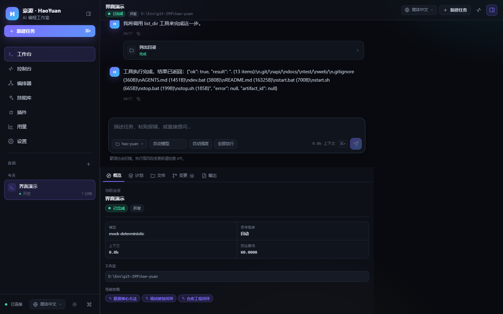

# HaoYuan · 豪源

[简体中文](../../README.md) · [繁體中文](README.zh-TW.md) · [English](README.en.md) · [日本語](README.ja.md) · **Deutsch** · [한국어](README.ko.md)  
[Français](README.fr.md) · [Español](README.es.md) · [Português (Brasil)](README.pt-BR.md) · [Italiano](README.it.md) · [Polski](README.pl.md) · [Alle Sprachen](README.md)

> Ein persönliches KI-Studio, in dem du mehrere KI-Mitarbeiter anleitest, asynchron parallel zu arbeiten.  
> Ein Kernel, eine Reihe installierbarer Plugins und ein verifizierbarer geschlossener Kreislauf für Long-Horizon-Aufgaben.

HaoYuan wurde auf **agent-harness** als Referenzfundament für sein Backend neu geschrieben. Es bewahrt und stärkt die Programmierkompetenz eines KI-Assistenten und organisiert zugleich Sitzungen, Tools, Agenten, Routing, Skills, Überwachung und Orchestrierung rund um eine Plugin-Architektur neu. Das Frontend wurde vollständig neu geschrieben, mit dem Ziel, „KI-Zusammenarbeit“ von einem Chatfenster zu einer Workbench aufzuwerten, die du steuern, beobachten und in die du eingreifen kannst.



---

## 1. Kernfunktionen

### 1.1 Eine tatsächlich nutzbare Coding-Schleife

| Fähigkeit | Implementierung |
|---|---|
| Repository-Verständnis | `project_scan`, `repo_map`, Symbolindex, `search_symbol` |
| Präzises Lesen | `read_file`, `read_range`, Adressierung nach Zeilennummer |
| Minimale Änderungen | `apply_patch` (unified diff / SEARCH-REPLACE), `edit_file`, `multi_edit` |
| Dateioperationen | `write_file`, `glob`, `grep`, `list_dir`, `delete_path`, `move_path` |
| Befehlsverifikation | `run_shell` (UTF-8, Timeouts, strukturierte Fehlerzusammenfassungen), `git`-Wrapper |
| Verifikations-Gate | Tests/Lint/Build sind nach Codeänderungen verpflichtend und verhindern „Bearbeiten ohne Verifizieren“ |
| Test-Fix-Schleife | Strukturierte Analyse von pytest-Fehlern → Zeilenlokalisierung → minimale Korrektur → Eskalation über Fehler-Fingerabdruck |
| Sub-Agenten | `task`-Scouts in einem isolierten Kontext, die nur Schlussfolgerungen zurückgeben, wodurch eine Verunreinigung des Hauptkontexts vermieden wird |
| Kontext-Governance | Alterung von Tool-Ergebnissen, strukturierte Zusammenfassungen, Kompression innerhalb eines Turns, Kürzung nach hartem Budget |
| Kontext-Vorladen | Anforderungsbewusstes `repo_map`-Ranking plus ein `context_pack` für relevanten Quelltext bei komplexen Aufgaben (bis zu ~30 KB), wodurch wiederholtes vollständiges Lesen reduziert wird |
| Long-Horizon-Aufgaben | Schrittbudgets, automatische Fortsetzung, Checkpoints, idempotentes Register für Seiteneffekte (Schreibvorgänge werden nicht erneut angewendet) |
| Human-in-the-Loop | Hochriskante Schreibvorgänge/Befehle zeigen eine Diff-Vorschau und werden erst nach Genehmigung ausgeführt |

Schichtung der Sitzungsintention: Begrüßungen, Small Talk und allgemeine Fragen und Antworten werden direkt beantwortet, ohne den Workspace zu scannen, Tools auszulösen oder zu schreiben; nur explizite Aufgaben wie Coding, Dateiänderungen und das Ausführen von Befehlen gelangen in die Coding-Schleife.

### 1.2 Asynchrone Parallelität mehrerer Sitzungen

- Eine Sitzung = ein `asyncio.Task` im Hintergrund; das Wechseln von Fenstern, das Schließen von Tabs oder das Trennen der Verbindung stoppt die Aufgabe nicht.
- Globales Parallelitätsgate + FIFO-Warteschlange; beim Warten auf eine menschliche Genehmigung wird der Parallelitäts-Slot automatisch freigegeben.
- Sitzungszustandsmaschine: `idle → queued → running ⇄ waiting_input → done / error`.
- Sitzungs-Tab-Leiste oben in der Workbench: Beim Erstellen oder Öffnen einer Sitzung wird automatisch ein Tab hinzugefügt; per Klick lässt sich horizontal wechseln; `×` schließt nur die Ansicht, ohne die Sitzung zu löschen, und Tabs bleiben nach einem Refresh erhalten; per Rechtsklick auf einen Tab die aktuelle / linke / rechte / alle Unterhaltungen schließen.
- Die erste Nachricht einer neuen Sitzung erhält vom Modell in der aktuellen UI-Sprache einen kurzen Titel; wenn eine alte Sitzung noch den Standardtitel hat, wird automatisch eine Zusammenfassung basierend auf der ersten Nachricht angezeigt.
- Jede Sitzung hat ihre eigene URL `/#/s/<session-id>`, die kopiert, neu geladen, geteilt oder direkt über die Adressleiste gewechselt werden kann.
- Nach dem Neuladen der Seite werden Nachrichten, Ereignisse, Pläne, Genehmigungen und Artefakte aus SQLite wiederhergestellt.
- Der Hauptkanal für Echtzeitereignisse verwendet SSE (Neuverbindung, cursor-basiertes Fortsetzen, Streaming auch ohne WebSocket); der WebSocket-Endpunkt bleibt aus Kompatibilitätsgründen bestehen; REST unterstützt Event-Replay.

### 1.3 AI-Supervisor und Multi-Agenten-Orchestrierung

- **Supervisor**: sitzungsübergreifende Health-Checks, Warnungen bei hängengebliebenen Aufgaben, automatische Unterbrechung, Konsolen-Unterhaltungen und Planungsaktionen.
- **Orchestrator**: Ziel → Aufgaben-DAG → ein unabhängiger git worktree pro Mitarbeiter → parallele Ausführung → Merge und Abnahme.
- Mitarbeiter-Sitzungen teilen Vertragsdateien und ein gemeinsames Blackboard; ein Fehler blockiert andere Aufgaben auf derselben Ebene nicht.

### 1.4 Skill-Bibliothek

- Markdown + Front-Matter, das `name / title / description / kinds / triggers` deklariert.
- Automatische Zuordnung nach Aufgabentyp und Schlüsselwörtern; bei vielen Skills greift das BM25-Ranking.
- Integriert: Kernmethodik, Repository-Engineering-Loop, Debug-Loop, Web-Delivery und Vorschlagserstellung.
- Skills können in der UI erstellt, bearbeitet und gelöscht werden; Änderungen werden beim Speichern wirksam.

### 1.5 Plandokumente

- `make_plan`: erzeugt ein eigenständiges HTML-Dokument für Vorschlag/Plan mit KPIs, Abschnitten, Tabellen, Risiken und Meilensteinen.
- Artefakte werden unter `api/data/artifacts/` registriert und können direkt auf der rechten Seite der Workbench in der Vorschau angezeigt oder heruntergeladen werden.

### 1.6 Plugin-Architektur

HaoYuan ist kein einziger riesiger Monolith; es ist:

```
Kernel (sessions / events / tool registry / policy / model gateway / approvals)
        │
        ├── coding       coding agent + engineering tools + skills
        ├── plans        planning tools + Planner agent
        ├── supervisor   health checks + console routes
        ├── orchestrator task DAG + worktree + merge
        └── embodied     embodied agent harness (disabled by default, install to enable)
```

Plugins können bereitstellen: Tools, Agenten, HTTP-Routen, Skill-Verzeichnisse, Event-Abonnements, Lifecycle-Hooks und Frontend-Navigations-/Befehlsmetadaten. Ein einzelnes Plugin, das nicht geladen werden kann, legt den Kernel nicht lahm.


### 1.7 Elf Sprachen, helles Design als Standard und eine einklappbare Seitenleiste

- Standardmäßig **helles (weißes) Theme**; wechseln Sie über die Einstellungsseite oder den unteren Rand der Seitenleiste zum dunklen Theme.
- Standardmäßig **vereinfachtes Chinesisch**; wechseln Sie zwischen **简体中文 / 繁體中文 / English / 日本語 / Deutsch / 한국어 / Français / Español / Português (Brasil) / Italiano / Polski**.
- Die Sprachauswahl ist an drei gut sichtbaren Stellen verfügbar: in der oberen Leiste der Workbench, am unteren Rand der Seitenleiste (auf allen Seiten verfügbar) und unter Einstellungen → Darstellung.
- Die Auswahl wird in `localStorage` gespeichert und bleibt nach Aktualisierung und Neustart erhalten; `document.lang` und der Seitentitel werden ebenfalls aktualisiert.
- Die Seitenleiste kann zu einer 76px breiten Icon-Leiste eingeklappt werden; nach dem Einklappen bleibt oben eine explizite Schaltfläche „Seitenleiste erweitern“ sichtbar, die Sitzungsliste wird ausgeblendet, und beim Erweitern wird alles wiederhergestellt.
- Das rechte Insights-Panel ist standardmäßig eingeklappt, um mehr Platz für die Konversation zu schaffen; klicken Sie auf die Schaltfläche oben rechts, um es zu öffnen; die Auswahl bleibt erhalten.
- Integrierte Skill-Titel/-Beschreibungen, Plugin-Titel/-Beschreibungen sowie UI-Texte für Status, Schaltflächen, Hinweise, Genehmigungen, Pläne, Nutzung und Orchestrierung sind in allen elf Sprachen vollständig abgedeckt.

---

## 2. Schnellstart

### Anonyme Nutzungsstatistiken (Transparenzhinweis)

HaoYuan enthält einen **vollständig anonymen** Nutzungs-Heartbeat, um Online-Geräte und die Versionsverteilung zu zählen:

- **Übermittelte Daten**: eine lokal erzeugte zufällige `install_id` (UUID), Client-Version und Betriebssystemtyp (z. B. `Windows 11`). Sie enthalten keine Benutzernamen, E-Mail-Adressen, Dateiinhalte, Workspace-Pfade, Konversationsinhalte oder sonstige personenbezogene Daten.
- **Häufigkeit**: einmal beim Start und alle 5 Minuten während der Laufzeit (eine einzelne leichtgewichtige POST-Anfrage).
- **Vollständig optional**: Setzen Sie vor dem Start die Umgebungsvariable `HAOYUAN_TELEMETRY=0`, um ihn dauerhaft zu deaktivieren; alle Funktionen bleiben davon unberührt.
- **Datenschutz**: Der Server speichert nur einen Einweg-Hash der IP, niemals die Klartext-IP; die Daten werden 90 Tage lang aufbewahrt.
- **Vollständiger Hinweis**: siehe den Datenschutz-Endpunkt des Plugin-Centers `GET {plugin-center-url}/api/plugin-center/privacy` oder den Quellcode `api/core/telemetry.py` (~100 Zeilen, prüfbar).

### Voraussetzungen

- Python 3.10+
- Node.js 18+
- Windows / Linux / macOS

### npm install (empfohlen)

```bash
# Prerequisite: Node.js 18+ and Python 3.10+
npm install -g haoyuan

# Faster mirrors in mainland China:
npm install -g haoyuan --registry=https://registry.npmmirror.com

# Terminal chat (creates the venv and installs dependencies on first run)
haoyuan

# Start the service and open the web UI automatically
haoyuan web
```

| Befehl | Zweck |
|---|---|
| `haoyuan` | Terminal-Chat (Streaming-Ausgabe, Tool-Aufrufe, Genehmigungsaufforderungen) |
| `haoyuan --model x/y` | Chat mit einem bestimmten Modell starten (z. B. `--model deepseek/deepseek-flash`) |
| `haoyuan web` | Den Dienst starten und die Web-UI automatisch öffnen |
| `haoyuan web --no-open` | Den Dienst starten, ohne einen Browser zu öffnen |
| `haoyuan --version` / `-V` | Die Version anzeigen |
| `haoyuan config` | Globale Konfigurationsdatei (Modellschlüssel usw.); mit `--open` direkt bearbeiten |
| `haoyuan login` / `haoyuan logout` | Anmelden, wenn Kontoschutz aktiviert ist / lokales Token löschen |
| `haoyuan setup` | Nur Abhängigkeiten installieren |
| `haoyuan help` | Hilfe anzeigen |

Befehle im Terminal: `/models` zum Anzeigen/Auswählen eines Modells (per Nummer auswählen oder mit `/model x/y` direkt auswählen), `/new` zum Erstellen einer Sitzung, `/web` zum Öffnen der aktuellen Sitzung in einem Browser, `/cancel` zum Abbrechen der aktuellen Aufgabe, `/exit` zum Beenden (Ctrl+C funktioniert ebenfalls).

Die Web-UI verwendet standardmäßig `http://127.0.0.1:8030` und erhöht den Port automatisch, wenn er belegt ist. Ohne Modellschlüssel führt das integrierte Modell `mock` Sitzungen, Tool-Aufrufe, Genehmigungen und das Frontend weiterhin durchgängig aus.

### Windows-Ein-Klick-Start

```bat
start.bat
```

Das Skript führt automatisch Folgendes aus: alten Prozess auf Port 8030 beenden → `api/env1` erstellen → Python-Abhängigkeiten installieren → (nur wenn `web/dist` fehlt) Frontend-Abhängigkeiten installieren und Frontend bauen → API starten und Produktseite öffnen. Das npm-Paket enthält bereits ein vorgebautes Frontend, sodass Intranet-/Offline-Umgebungen nach der Installation der Abhängigkeiten direkt starten können. Wenn ein vorheriges `npm install` aufgrund einer Netzwerkunterbrechung ein unvollständiges `web/node_modules` hinterlassen hat, erkennt das Skript dies und installiert es automatisch neu — manuelles Löschen ist nicht erforderlich.

**Automatischer Port-Fallback**: Das Backend verwendet standardmäßig `8030` und der Frontend-Dev-Server standardmäßig `8130`; ist ein Port belegt, wird er automatisch erhöht (8031, 8032, …), bis die Bindung erfolgreich ist. Die tatsächlichen Ports werden in `api/data/runtime.json` geschrieben, und das Startskript liest sie aus, um die korrekte Adresse zu öffnen. Die Basisports können auch explizit mit `HAOYUAN_PORT` / `HAOYUAN_WEB_PORT` (Frontend) und `HAOYUAN_API_PORT` (Frontend-Proxy-Ziel) festgelegt werden.

Beenden:

```bat
stop.bat
```

### Desktop-Konsole (desktop.exe)

Doppelklicken Sie im Repository-Stammverzeichnis auf `desktop.exe`, um die grafische Konsole zu öffnen (~20 KB, ausschließlich abhängig vom mit Windows ausgelieferten .NET Framework 4.x):

- **Alle starten / alle beenden**: Backend und Frontend-Dev-Server mit einem Klick verwalten; die Produktseite öffnet sich nach dem Start automatisch
- **Backend starten / beenden** (Standard 8030) und **Frontend starten / beenden** (Standard 8130)
- **Port-Einstellungen**: Backend-/Frontend-Ports direkt bearbeiten; auf „Ports übernehmen und neu starten“ klicken, um die Konfiguration zu speichern und beide Dienste neu zu starten; ist ein Port belegt, erhöht der Dienst den Port weiterhin automatisch
- **Produktseite öffnen**: öffnet den tatsächlichen Backend-Port aus `api/data/runtime.json`; weicht auf den Frontend-Port aus, wenn nur das Frontend läuft
- **Frontend bauen**, **Projektordner öffnen**, Dienststatus im Sekundentakt und Live-Laufzeitprotokolle

Das Schließen des Konsolenfensters beendet die Dienste nicht. Um sie zu beenden, klicken Sie auf „Alle beenden“ oder die entsprechenden Beenden-Schaltflächen. Der Quellcode liegt in `desktop/`; führen Sie nach Änderungen `desktop\build.bat` aus, um neu zu bauen.

### Linux / macOS

```bash
bash start.sh
bash stop.sh
```

Geben Sie für Intranet- oder benutzerdefinierte Mirror-Umgebungen die Downloadquellen explizit an (wenn sie weggelassen werden, werden die bereits in `~/.npmrc` und `pip.conf` konfigurierten Quellen verwendet):

```bash
export HAOYUAN_NPM_REGISTRY=http://your-intranet/npm/
export HAOYUAN_PIP_INDEX_URL=http://your-intranet/pypi/simple
bash start.sh
```

Windows-Äquivalent:

```bat
set HAOYUAN_NPM_REGISTRY=http://your-intranet/npm/
set HAOYUAN_PIP_INDEX_URL=http://your-intranet/pypi/simple
start.bat
```

Wenn Frontend- oder Python-Abhängigkeiten unvollständig sind (wenn beispielsweise eine vorherige Installation durch `ECONNRESET` unterbrochen wurde), erkennen `start.sh` / `start.bat` / `haoyuan setup` dies automatisch, bereinigen `web/node_modules`, installieren neu, installieren fehlende Backend-Pakete und greifen bei fehlgeschlagenem Build auf das vorhandene `web/dist` zurück.

`web/package-lock.json` verwendet keinen fest codierten externen Mirror mehr; `replace-registry-host=always` in `web/.npmrc` stellt sicher, dass Installationen immer die Registry aus der aktuellen npm-Konfiguration verwenden, sodass die Lockfile die Installationen nicht auf einen nicht erreichbaren externen Mirror umleiten kann.

### Manueller Start

```bash
# Backend
cd api
python -m venv env1
env1\Scripts\activate           # Linux: source env1/bin/activate
pip install -r requirements.txt
python main.py                  # http://127.0.0.1:8030, increments automatically if in use

# Frontend dev mode (hot reload, optional)
cd web
npm install
npm run dev                     # http://localhost:8130, increments automatically if in use; /api and /ws proxy to the backend's actual port
```

In der Produktion stellt das Backend `web/dist` direkt bereit, sodass Sie nur den tatsächlichen Port des Backends aufrufen müssen. Ports können mit Umgebungsvariablen überschrieben werden: `HAOYUAN_PORT` (Backend, Standard 8030), `HAOYUAN_WEB_PORT` (Frontend, Standard 8130) und `HAOYUAN_API_PORT` (Proxy-Ziel des Frontends, Standard aus `api/data/runtime.json`).

### Modelle konfigurieren

**Globale Konfigurationsdatei (empfohlen)** — ein fester benutzerspezifischer Pfad, der von Neuinstallation oder Upgrade nicht betroffen ist:

```bash
haoyuan config          # creates the file on first run and prints its path
haoyuan config --open   # open it directly in your editor
```

Pfad: `~/.config/haoyuan/config.json` (unter Windows: `C:\Users\<you>\.config\haoyuan\config.json`; überschreibbar mit der Umgebungsvariable `HAOYUAN_CONFIG`):

Die Datei wird beim ersten Start (oder durch das npm-postinstall) automatisch erstellt, und ihr Verzeichnis wird angelegt, falls es fehlt.

```json
{
  "PROVIDER": "",
  "MODEL": "",
  "DEEPSEEK_API_KEY": "",
  "DEEPSEEK_BASE_URL": "https://api.deepseek.com",
  "DEEPSEEK_MODEL": "deepseek-flash",
  "ZHIPU_API_KEY": "",
  "ZHIPU_BASE_URL": "https://open.bigmodel.cn/api/coding/paas/v4",
  "ZHIPU_MODEL": "glm-5.3-flash",
  "MIMO_API_KEY": "",
  "MIMO_BASE_URL": "https://token-plan-cn.xiaomimimo.com/v1",
  "MIMO_MODEL": "mimo-v2.6-flash",
  "providers": {}
}
```

- Für integrierte Provider können Sie `DEEPSEEK_MODELS` / `ZHIPU_MODELS` / `MIMO_MODELS` (kommagetrennt) hinzufügen, um die Modellliste vollständig anzupassen; `*_THINKING_MODELS`, `*_MAX_OUTPUT` und `*_SUPPORTS_THINKING` sind optional.
- Jeder OpenAI-kompatible Provider kann dem Objekt `providers` hinzugefügt werden, nicht nur die drei integrierten:

```json
{
  "providers": {
    "my-intranet": {
      "base_url": "http://llm.intranet/v1",
      "api_key": "sk-...",
      "models": ["qwen-max", "qwen-plus"],
      "default_model": "qwen-max",
      "supports_thinking": false,
      "max_output_tokens": 8192
    }
  }
}
```

- `PROVIDER` / `MODEL` können das Standardmodell festlegen (z. B. `"MODEL": "deepseek-v4-pro"` oder `"MODEL": "my-intranet/qwen-max"`; leer lassen, um automatisch anhand der konfigurierten Schlüssel auszuwählen).
- **Zwei-Wege-Synchronisierung zwischen der Web-Einstellungsseite und der Konfigurationsdatei**: Hinzufügen/Bearbeiten von Providern, Modellen und des Standardmodells unter „Einstellungen → Modellkonfiguration“ schreibt sofort in die Datei zurück; wenn Sie die Datei direkt bearbeiten und speichern, lädt der Dienst sie bei der nächsten Anfrage neu (kein Neustart erforderlich).
- „Alle Modelle aktualisieren“ liest den `/models`-Endpunkt jedes Providers mit seiner Basis-URL und seinem Schlüssel aus und filtert Nicht-Chat-Modelle automatisch heraus; wenn einige Provider fehlschlagen, werden die genauen Provider und Gründe angezeigt, während erfolgreiche Provider trotzdem gespeichert werden.

**Paketinterne Konfiguration (optional)**:

```bash
copy api\configs\secrets_example.py api\configs\secrets_local.py
```

Bearbeiten Sie `api/configs/secrets_local.py` mit denselben Feldern (als Python-Konstanten). Dies ist für Quellcode-Deployments gedacht; bei einer globalen npm-Installation liegt die Datei im Paketverzeichnis und wird beim Upgrade entfernt, daher ist die globale Konfiguration zu bevorzugen.

**Umgebungsvariablen** (höchste Priorität):

```powershell
$env:DEEPSEEK_API_KEY="sk-..."
```

Priorität: Umgebungsvariablen > globale Konfigurationsdatei > `secrets_local.py`. Nach dem Bearbeiten der globalen Konfigurationsdatei ist kein Neustart erforderlich (der Dienst lädt heiß neu); das Feld `key_source` des Health Checks `GET /api/health` zeigt an, woher der Schlüssel stammt.

**Wenn kein Schlüssel konfiguriert ist, wird automatisch das lokale Modell `mock` verwendet**, wodurch Sitzungen, Tool-Aufrufe, Genehmigungen, Ereignisse und das Frontend durchgängig getestet werden.

---

## 3. Oberfläche

| Workbench (hell, Standard) | Workbench (Englisch) |
|---|---|
|  |  |

| Workbench (Traditionelles Chinesisch) | Workbench (dunkel) |
|---|---|
|  |  |

| Supervisor-Konsole | Skill-Bibliothek |
|---|---|
|  |  |

| Einstellungen und Sprachauswahl | Schaltfläche zum Erweitern nach dem Einklappen der Seitenleiste |
|---|---|
|  |  |

Mobiles rechtes Insights-Panel:  


Wichtige Interaktionen:

- Obere Sitzungsregisterkarten: zum Wechseln zwischen Unterhaltungen anklicken; `×` schließt eine Registerkarte (Sitzungsdaten sind nicht betroffen); Rechtsklick zum Schließen der aktuellen / linken / rechten / aller Unterhaltungen
- Neue Aufgaben bieten keine vorgegebenen Fragen mehr; beschreiben Sie die Aufgabe einfach im Eingabefeld, und der Sitzungstitel wird automatisch zusammengefasst
- Adressleisten-Routing: `/#/s/<session-id>` verweist auf eine bestimmte Sitzung und kann kopiert, aktualisiert oder in einem neuen Fenster geöffnet werden
- `Ctrl / Cmd + K`: Befehlspalette (Navigation, Sitzungen, Aktionen)
- `Ctrl / Cmd + N`: neue Aufgabe
- `Ctrl / Cmd + B`: Seitenleiste ein-/ausklappen
- `Enter`: senden; `Shift + Enter`: Zeilenumbruch (`Ctrl / Cmd + Enter` sendet ebenfalls)
- Genehmigungskarte: `A` genehmigt, `R` lehnt ab
- Sprachumschaltung: oben rechts in der Workbench, unten in der Seitenleiste auf jeder Seite und unter Einstellungen → Darstellung
- Während eine Sitzung läuft, tippen: Die Eingabe wird als „zusätzliche Anweisung“ in die aktuelle Ausführung eingefügt, ohne die Aufgabe zu unterbrechen
- Das rechte Panel ist standardmäßig eingeklappt; klicken Sie auf die Schaltfläche oben rechts, um Übersicht / Plan / Dateien / Änderungen / Artefakte zu öffnen, und ziehen Sie es, um die Größe zu ändern
- Dateien und Diffs verwenden eine große Vorschauüberlagerung, damit Code nicht in einer schmalen Spalte gelesen werden muss

---

## 4. Architektur

```text
hao-yuan/
├── api/
│   ├── main.py                    FastAPI entry (extension routes + plugin routes + static frontend)
│   ├── configs/                   Configuration, model registry, secrets
│   ├── core/
│   │   ├── contracts.py           Tool / Agent / Policy / ToolContext
│   │   ├── storage.py             SQLite (WAL) storage layer
│   │   ├── events.py              Event bus (broadcast + batched persistence + replay)
│   │   ├── gateway.py             Model gateway (streaming + degradation + fallback)
│   │   ├── context.py             Context compression / aging / hard budget
│   │   ├── runtime.py             Agent main loop
│   │   ├── session_manager.py     Concurrency gate / queue / approvals / resume
│   │   ├── policy.py              Permission gate
│   │   ├── tools.py               Tool registry and execution
│   │   ├── agents.py              Agent registry
│   │   └── plugin.py              Plugin discovery / dependencies / lifecycle
│   ├── harness/                   Sandbox / skills / symbol index / fix loop / supervision / orchestration / embodied
│   ├── tools/                     builtin / dev / plan
│   ├── adapters/providers/        deepseek / mimo / mock
│   ├── plugins/                   coding / plans / supervisor / orchestrator / embodied
│   ├── extensions/                System / sessions / skills / settings / files / usage / plugins / approvals / real-time events (SSE / WebSocket)
│   ├── skills/                    Core skills
│   ├── tests/                     90 backend tests
│   └── data/                      Runtime data (gitignored)
├── web/                           Vue 3 + Vite
├── docs/screenshots/              UI screenshots
├── start.bat / stop.bat
├── start.sh / stop.sh
├── dev.bat
├── desktop.exe                    Graphical desktop console (start/stop services / open the web UI)
└── desktop/                       desktop.exe source and build scripts
```

### Daten und Grenzen

- Datenbank: `api/data/haoyuan.db` (WAL)
- Artefakte: `api/data/artifacts/<session_id>/`
- Laufzeitports: `api/data/runtime.json` (das Backend schreibt `api_port`, das Frontend schreibt `web_port`, und die Desktop-Konsole schreibt `api_port_config` / `web_port_config`)
- Alle Dateiwerkzeuge sind durch die Allowlist des Sitzungsarbeitsbereichs eingeschränkt und lehnen `../` sowie Ausbrüche über absolute Pfade ab.
- Hochrisikowerkzeuge (Dateischreibvorgänge, Patch, Löschen, Verschieben, Shell, git, Roboterbewegung) erfordern eine Genehmigung.
- `run_shell` blockiert katastrophale Befehle hart (wie `rm -rf /`, Datenträgerformatierung und Herunterfahren).
- Artefakt-HTML wird über einen Endpunkt mit einer Sandbox-CSP in der Vorschau angezeigt, wodurch verhindert wird, dass modellgenerierte Seiten lokale Zugangsdaten lesen.
- Secrets werden ausschließlich aus Umgebungsvariablen oder `secrets_local.py` gelesen; sie werden niemals in der Datenbank gespeichert oder im Klartext zurückgegeben.
- Echte Schlüssel befinden sich in `api/configs/secrets_local.py`, das von `.gitignore` ignoriert wird; `git add --dry-run` stellt sicher, dass sie niemals in das Repository gelangen.

---

## 5. Plugin-Entwicklung

Erstellen Sie ein Verzeichnis unter `api/plugins/`:

```
api/plugins/my-plugin/
├── plugin.json
├── plugin.py
├── routes.py        # optional
└── skills/          # optional
    └── my-skill.md
```

`plugin.json`:

```json
{
  "name": "my-plugin",
  "title": "My Plugin",
  "version": "1.0.0",
  "description": "What this plugin adds",
  "author": "you",
  "requires": ["coding"],
  "default_enabled": true,
  "backend": "plugin.py",
  "routes": "routes.py",
  "contributes": {
    "tools": ["my_tool"],
    "agents": ["my_agent"],
    "skills": true
  },
  "frontend": {
    "nav": [{ "label": "My Plugin", "path": "/my-plugin", "icon": "puzzle" }],
    "commands": [{ "id": "my-plugin.run", "title": "Run my plugin" }]
  }
}
```

`plugin.py`:

```python
from core.contracts import AgentSpec, ToolSpec


async def my_tool(ctx, args):
    return {"echo": args.get("text", "")}


def register(ctx):
    ctx.register_tool(
        ToolSpec(
            name="my_tool",
            description="Echo text",
            input_schema={
                "type": "object",
                "properties": {"text": {"type": "string"}},
                "required": ["text"],
            },
        ),
        my_tool,
    )
    ctx.register_agent(
        AgentSpec(
            name="my_agent",
            title="My Agent",
            instructions="You are ...",
            tools=["my_tool"],
            kind="dev",
        )
    )
    ctx.add_skill_dir("skills")


async def startup(ctx):
    ...


async def shutdown(ctx):
    ...
```

Plugin-Funktionen:

- `requires` steuert die Reihenfolge der Abhängigkeiten; fehlende Abhängigkeiten werden isoliert und der Fehler wird protokolliert.
- `startup / shutdown` Lebenszyklus-Hooks.
- `ctx.events.subscribe(sink)` abonniert globale Ereignisse (auf diese Weise empfängt der Orchestrator Ereignisse zum Abschluss von Mitarbeitern).
- Der Aktiviert-/Deaktiviert-Status wird in SQLite gespeichert; nach dem Umschalten muss die API neu gestartet werden, um Routen zu laden/entladen.
- Das Frontend bezieht die Metadaten von `contributes` und `frontend` über `/api/plugins`.

### Warum dieses Design

Es übernimmt Wordpress' „kleiner Kernel + installierbare Plugins“: Der Kernel übernimmt nur Sitzungen, Ereignisse, Richtlinien, Modelle und das Tool-Protokoll; alle Geschäftsfunktionen liegen in Plugins.  
Es übernimmt außerdem die Idee des DeepSeek Harness, dass „der Harness selbst pluggbar ist“: Ein verkörperter Agent ist einfach ein unabhängiges Harness-Plugin, sodass du immer weitere Harnesses für Rover, Roboterarme, humanoide Roboter und mehr hinzufügen kannst, ohne den Kernel anzutasten.

---

## 6. Ergebnisse der Selbsttests

Folgendes wurde in der Auslieferungsumgebung ausgeführt:

```bash
cd api
python -m pytest -q
# 90 passed, 2 skipped, 2 warnings

cd ../web
npm run build
# ✓ built, 97 modules transformed
```

Testabdeckung:

- Health-Check, Modelle, Skills, Plugins und Auflistung der Genehmigungen
- Eine vollständige Mock-Model-Sitzung (Nachricht → Ereignis → Abschluss)
- Coding-Sitzung: Datei schreiben → Tool-Ereignis → Artefakt → Workspace-Baum lesen
- Menschlicher Genehmigungsablauf: ausstehend → genehmigen → Tool-Ausführung → Datei auf Datenträger geschrieben
- Sitzung umbenennen / ausblenden / wiederherstellen / leeren / endgültig löschen
- Globales Gate und Standard-Workspace-Einstellungen, Nutzung und CSV-Export
- Persistenz des Aktivierungsstatus von Plugins
- Orchestrator-Git-Worktree End-to-End (erstellen → verteilen → abschließen → zusammenführen)
- Tool-Ebene: Sandbox-Escape, read/write/edit/patch/multi_edit, glob/grep/symbols, Shell, delete/move
- Hartes Blockieren gefährlicher Shell-Befehle
- Symbolindex, Repo-Map, pytest-Parsing und Korrekturanleitung
- Generierung von Plan-HTML-Artefakten
- Intent-Routing: Begrüßungen, Small Talk und allgemeine Fragen und Antworten (wie „Wie geht es dir?“, „Schönes Wetter heute“, „Was ist Dependency Injection?“) werden direkt beantwortet, ohne den Workspace zu durchsuchen, Tools auszulösen oder zu schreiben (inklusive echter Verifikation mit deepseek-flash)
- Automatischer Sitzungstitel aus der ersten Nachricht (folgt der UI-Sprache; Mock deckt Fallback und Echtmodell-Verifikation ab)
- Unabhängiges Sitzungs-Routing: `/#/s/<session-id>`-Deep-Links, Tab-Wechsel, Adressleisten-Bearbeitung, Wiederherstellung nach Aktualisierung und Fallback beim Schließen
- Rechtsklick auf Sitzungs-Tab: aktuellen / links / rechts / alle schließen, mit automatischem Wechsel zum nächsten Tab nach dem Massenschließen
- Aktualisierung der Provider-Modelle: Fehlerdetails und Filterung von Nicht-Chat-Modellen

Darüber hinaus wurde eine Echtbrowser-Prüfung des Produktions-Builds mit Playwright + lokalem Chrome durchgeführt:

- Workbench / Konsole / Skills / Plugins / Einstellungen / Nutzung / Orchestrierungsseiten laden alle
- Obere Sitzungs-Tabs und unabhängiges Routing: Öffnen, Wechseln, Schließen, Rechtsklick-Massenschließen, Deep-Links in der Adressleiste und Wiederherstellung nach Aktualisierung
- Standardtitel-Zusammenfassung, Sprachmenü oben rechts (Umschalten zwischen elf Sprachen) und ein leerer Zustand ohne vorgegebene Fragen
- Das Umschalten zwischen vereinfachtem Chinesisch, traditionellem Chinesisch, Englisch, Japanisch, Deutsch, Koreanisch, Französisch, Spanisch, brasilianischem Portugiesisch, Italienisch und Polnisch funktioniert, und die Sprache bleibt nach einer Aktualisierung erhalten
- Spracheinstiegspunkte umfassen die obere Leiste der Workbench, den unteren Bereich der Seitenleiste und die Einstellungsseite
- Das Ein-/Ausklappen der Seitenleiste zwischen 286px und 76px funktioniert; nach dem Einklappen ist die Sitzungsliste ausgeblendet und die Schaltfläche zum Ausklappen sichtbar
- Das rechte Insights-Panel ist standardmäßig eingeklappt, und sein ausgeklappter/eingeklappter Zustand bleibt erhalten
- `Enter` sendet ab und `Shift + Enter` fügt einen Zeilenumbruch ein; IME-Komposition sendet nicht versehentlich ab
- Dark-/Light-Themes funktionieren
- 430px mobiles Layout, Seitenleisten-Drawer und rechter Insights-Drawer funktionieren
- SSE-Echtzeitstream: echte DeepSeek-Reasoning- und Inhalts-Deltas sind vor `done` sichtbar
- Keine JS-Fehler, keine 404-Ressourcen und kein WebSocket-404 in der Konsole (der Haupt-Echtzeitkanal ist jetzt SSE)

> Die reale Online-Verifikation wurde mit dem vom KI-Assistenten referenzierten DeepSeek-Schlüssel abgeschlossen: `deepseek-flash` gab `OK` zurück, und Nutzung: Anbieter/Modell = `deepseek/deepseek-flash`. Der Schlüssel wird nur in `api/configs/secrets_local.py` gespeichert, das von `.gitignore` ignoriert wird; das Repository committet nur die Vorlage `secrets_example.py`. Mock-Regressionstests bleiben bestehen, sodass das System automatisch degradiert, wenn es offline ist oder kein Schlüssel vorhanden ist.

---

## 7. Ergebnisse des Harness-Fair-Benchmarks

> Neuester Bericht: `test/testing/index-2026-10-27.html` (2026-10-27, mimo-v2.6-flash)  
> Historischer Bericht: `test/testing/index-2026-10-25.html` (2026-10-25, deepseek-flash)

### 7.1 MiMo-Fair-Benchmark (neuester)

**Methode**: 5 automatisch bewertbare Aufgaben (1 grundlegend adaptiv + 4 zu Lokalisierung / Performance / Long-Horizon / Nebenläufigkeit) × 3 Tools; einheitliche `mimo-v2.6-flash`, Prompts, Seed-Repository und Budget. Versteckte Tests werden nach dem Lauf injiziert, und `tests/` und `pyproject.toml` werden per SHA-256 verifiziert — Manipulation ergibt 0 Punkte. t1/d1/d3 verwenden den offiziellen-r1-interleaved-Batch; d4/d6 verwenden einen unabhängigen erneuten Lauf-Batch, nachdem der Code eingefroren wurde.

| Rang | Tool | Gesamt (produktgewichtet) | Korrektheit | Geschwindigkeit | Kosten | Engineering-Disziplin | Gleichgewichtung |
|---|---|---|---|---|---|---|---|
| 1 | **HaoYuan** | **98,8** | 100,0 | 94,4 | 96,9 | 100,0 | **98,3 (1.)** |
| 2 | OpenCode | 90,5 | 100,0 | 67,8 | 53,5 | 100,0 | 84,3 (2.) |
| 3 | Claude Code | 88,9 | 100,0 | 65,1 | 40,9 | 100,0 | 81,2 (3.) |

Gesamt = 0,65 × Korrektheit + 0,15 × Geschwindigkeit +

- Alle drei erzielten 100 % Korrektheit; HaoYuan erreichte **98,8** produktgewichtet und **98,3** gleichgewichtet und lag damit unter beiden Formeln auf Platz 1.
- Pro Aufgabe: HaoYuan war am schnellsten bei t1 (63,8 s), d3 (220,6 s) und d4 (469,6 s); OpenCode gewann d1 (111,3 s) und Claude Code gewann d6 (254,5 s).
- Kosten: Die Gesamtkosten für die 5 Aufgaben betrugen **3,33 $** für HaoYuan, 6,56 $ für OpenCode und 9,04 $ für Claude Code; die Kosten pro Aufgabe lagen bei 0,666 $ / 1,313 $ / 1,809 $.
- Adaptive Intensität: t1, eine einfache Aufgabe, dauerte 63,8 s und 11 Aufrufe, ohne dass ein Plan oder Sub-Agent gestartet wurde; die langfristig angelegte Aufgabe d4 nutzte vorgeladene relevante Quelltexte, um wiederholte Exploration zu reduzieren (von einem Timeout bei 1200 s auf 469,6 s).
- Zentrale Korrekturen: Der MiMo-Provider wurde vervollständigt (zuvor fiel `resolve("mimo", ...)` stillschweigend auf deepseek zurück), anforderungsorientierte Repository-Map, ein 30-KB-Kontextpaket für komplexe Aufgaben, Freigabe von Prozessbäumen, strikte Provider- + Pro-Aufruf-Limits + Wiederholungen mit demselben Modell sowie Lite-Routing für einfache Aufgaben.
- Einschränkungen: Der formale Vergleich verwendete 1 Runde pro Aufgabe; d4/d6 waren separate Wiederholungsläufe; die Latenzvarianz der Modelle ist groß (Claude d3 dauerte zuvor 623 s und diesmal 884 s); d5 wies keine Trennschärfe auf und wurde nicht gereiht; die Aufgaben sind selbst erstellt und können öffentliche Benchmarks wie SWE-bench nicht ersetzen.

Reproduzieren:

```bash
cd test/bench
python harness_bench.py run --batch official-r1 --tools haoyuan,claude,opencode --tasks t1_multisite_bugfix,d1_needle_regress,d3_perf_cliff --resume
python harness_bench.py run --batch official-r1 --tools haoyuan,claude,opencode --tasks d4_multilayer_feature,d6_concurrency_fix --resume
python make_report_mimo_final.py
```

### 7.2 deepseek-flash Deep-Benchmark (historisch)

**Methode**: 8 automatisch bewertbare Programmieraufgaben (5 einfache + 3 schwere) × 3 Runden pro Aufgabe × 3 Tools; einheitlicher deepseek-flash, einheitliche Prompts, einheitliches Seed-Repository und einheitliches Budget; versteckte Tests werden nach dem Lauf eingefügt, und `tests/` und `pyproject.toml` werden per SHA-256 verifiziert — Manipulation ergibt 0 Punkte.

| Rang | Tool | Gesamtpunktzahl (produktgewichtet) | Korrektheit | Typische Geschwindigkeit | Tail-Latenz | Kosten | Gleichgewichtete Punktzahl |
|---|---|---|---|---|---|---|---|
| 1 | **HaoYuan** | **96,6** | 100,0 | 100,0 (Median 30,3 s) | 67,6 (P90 159,4 s) | 82,2 (0,364 $) | 95,0 (2.) |
| 2 | OpenCode | 95,1 | 100,0 | 67,6 (Median 44,8 s) | 100,0 (P90 107,7 s) | 100,0 (0,299 $) | 96,8 (1.) |
| 3 | Claude Code | 90,7 | 100,0 | 70,6 (Median 42,9 s) | 90,7 (P90 118,7 s) | 55,4 (0,540 $) | 91,7 (3.) |

Gesamt = 0,70 × Korrektheit + 0,15 × typische Geschwindigkeit + 0,05 × Tail-Latenz + 0,10 × Kosten; bei der gleichgewichteten Formel ändern sich die letzten beiden Gewichte auf 0,10 / 0,10.

- Alle drei erzielten 100 % Korrektheit; die Unterschiede konzentrierten sich auf Geschwindigkeit, Tail-Latenz und Token-Kosten; HaoYuan belegte bei produktgewichteter Bewertung den ersten Platz, während OpenCode es bei gleicher Gewichtung überholte.
- HaoYuan hatte mit 30,3 s die kürzeste Median-Aufgabenzeit und war beim Median von vier Aufgaben (T1/T2/T3/H1) am schnellsten; alle 24 Läufe waren zu 100 % abgeschlossen. OpenCode hatte die beste Tail-Latenz und die niedrigsten Kosten pro Aufgabe; Claude Code hatte die höchsten Token-Kosten.
- Schwächen: Die H2-Versionsmigration hatte einen Median von 159,4 s (OpenCode: 101,1 s), und H3 hatte einen langen Tail von 260 s; künftige Arbeiten werden Migrationsprüfungen und Selbsttest-Runden weiter verkürzen.
- Einschränkungen: Deckt nur deepseek-flash und 3 Runden pro Aufgabe ab; die Aufgaben sind selbst erstellt und können öffentliche Benchmarks wie SWE-bench nicht ersetzen.
- Selbst-Iteration: Während der Evaluierung wurden Windows-Pipe-Anpassung, Schutz vor leeren Antworten/ausbleibenden Schreibvorgängen, Abnahmeaudits für Migrationen, leichtgewichtige git-diff-Audits und die Abschlussreihenfolge korrigiert; eine negative Optimierung durch „Übertesten“ wurde zurückgerollt.

Reproduce:

```bash
cd test/bench
python harness_bench.py run --batch final-r1 --tools haoyuan,claude,opencode --tasks all
python aggregate.py
python make_report.py
```

---

## 8. Funktionsparität mit dem KI-Assistenten

| Fähigkeit | HaoYuan | Hinweise |
|---|---|---|
| Coding-Toolchain | ✅ | Lokalisierung, minimale Patches, Verifikation, Fix-Schleife, Sub-Agenten |
| Kontextkomprimierung / Long-Horizon | ✅ | Komprimierung innerhalb eines Turns, Aging, hartes Budget, Checkpoints, idempotente Wiederaufnahme |
| Parallelität mehrerer Sitzungen | ✅ | Nebenläufigkeits-Gate, FIFO, vom Frontend entkoppelte Hintergrundaufgaben |
| Berechtigungs-Gate / Diff-Freigabe | ✅ | Freigabekarten, Vorschau, Timeout, Abgabe von Nebenläufigkeits-Slots |
| Skills-Bibliothek | ✅ | Front-Matter + Regeln/BM25 + UI-Bearbeitung |
| Plandokumente | ✅ | Eigenständige HTML-Artefakte |
| KI-Supervisor | ✅ | Snapshots, Warnmeldungen, Konsolengespräche, Planungsaktionen |
| Multi-Agenten-Orchestrierung | ✅ | Aufgaben-DAG + git worktree + Merge-Metriken |
| Token-/Kostenstatistiken | ✅ | Tägliche Aggregation, nach Modell, CSV-Export |
| Plugin-Mechanismus | ✅ Erweitert | Manifest, Abhängigkeiten, Lebenszyklus, Metadaten für Tools/Agenten/Routen/Skills/Frontend |
| Feishu-Fernbefehl | ⏳ Nicht in dieser Version | Die Schnittstellenschicht ist entkoppelt und kann als Plugin hinzugefügt werden |
| ASR / TTS / Videorendering | ⏳ Nicht in dieser Version | Der aktuelle Fokus liegt auf der zentralen KI-Coding-Schleife |
| Authoritative Benchmarks | ⏳ Öffentliche Benchmarks nicht ausgeführt | Selbst erstellte Benchmarks sind vollständig: ein fairer MiMo-Benchmark mit 5 Aufgaben und ein Deep-Benchmark für deepseek mit 8 Aufgaben (siehe Abschnitt 7); öffentliche Benchmarks wie SWE-bench wurden nicht erneut ausgeführt |

---

## 9. Roadmap (Architektur bereits vorgesehen)

### 9.1 Skills-Bibliothek für lokales Training auf 16 GB VRAM

Geplante integrierte Komponenten:

- SFT-Datenaufbau und Trainingsskripte für Qwen3.5-0.8B
- RL-Trainingsskripte (Präferenzoptimierung / verifizierbare Belohnungen)
- Speicherfreundliche Konfigurationen: LoRA / QLoRA, Gradientenakkumulation, kleine Batches, Steuerung der Sequenzlänge
- Nach „Skill“ organisiert: Datenvorlagen, Trainingskonfigurationen, Evaluierungsfälle und Deployment-Hinweise

Der aktuelle Skill-Mechanismus von HaoYuan ist bereits dateibasiert und versionierbar, sodass Dokumente zur Trainingsmethodik später als Skills in Agenten injiziert werden können.

### 9.2 Plugin-basiertes Embodied-Harness

`plugins/embodied` demonstriert bereits:

- Werkzeuge für Roboterzustand / Sensoren / Bewegung / Lenkung / Not-Aus
- Genehmigung risikoreicher Aktionen
- Eine HTTP-Demo-Bridge

Ohne den Kernel zu ändern, können Sie später ergänzen:

- `embodied-ros2` (ROS2-Topics / -Services)
- `embodied-serial` (Arduino / ESP32)
- `embodied-smolvla` (Vision-Language-Action-Modell)
- Harness-Plugins für Rover, Roboterarme und humanoide Roboter

---

## 10. API-Überblick

Einheitliches Präfix `/api`, Antwortformat `{ code, data, message }`.

| Gruppe | Hauptendpunkte |
|---|---|
| System | `GET /health`, `GET /info`, `GET /models`, `GET /agents`, `GET /tools` |
| Sitzungen | `POST /sessions`, `GET /sessions`, `GET /sessions/{id}`, `PATCH /sessions/{id}` |
| Nachrichten | `POST /sessions/{id}/messages`, `GET /sessions/{id}/messages` |
| Ereignisse | `GET /sessions/{id}/events?after_id=`, `GET /sessions/{id}/stream`, `WS /ws` |
| Genehmigungen | `GET /approvals`, `POST /approvals/{id}/resolve`, `POST /sessions/{id}/confirm` |
| Skills | `GET/POST /skills`, `GET/PUT/DELETE /skills/{name}` |
| Dateien | `GET /workspace/tree`, `GET /workspace/file`, `GET /workspace/changes`, `GET /workspace/diff` |
| Einstellungen | `GET/PUT /settings`, `PUT /settings/gate`, `PUT /settings/workspace` |
| Nutzung | `GET /usage/today`, `GET /usage/daily`, `GET /usage/by-model`, `GET /usage/export.csv` |
| Plugins | `GET /plugins`, `POST /plugins/{name}/toggle` |
| Supervisor | `GET /supervisor/overview`, `GET /supervisor/console`, `POST /supervisor/act`, `POST /supervisor/chat` |
| Orchestrierung | `POST /orchestrations`, `GET /orchestrations`, `GET /orchestrations/{id}` |

Interaktive Dokumentation: <http://127.0.0.1:8030/docs> (nach einer Port-Erhöhung verwenden Sie das Backend-Log oder `api/data/runtime.json`).

---

## 11. Entwicklung und Tests

```bash
cd api
python -m pytest -q

cd ../web
npm run build
npm run dev        # dev mode; /api and /ws proxy to the backend's actual port automatically
```

Wir empfehlen, die Lint-/Test-/Build-Befehle Ihres Teams in `AGENTS.md` festzuhalten; HaoYuan fügt Projektgedächtnis automatisch in den Kontext ein.

---

## Lizenz

Dieses Projekt wird unter der MIT License veröffentlicht und darf frei verwendet, geändert und verteilt werden.
