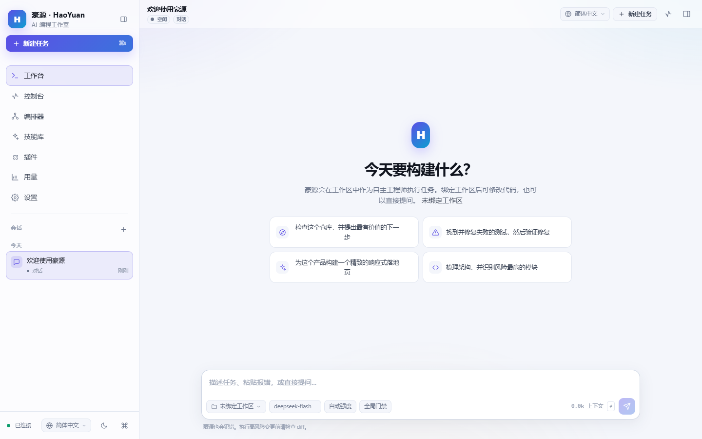
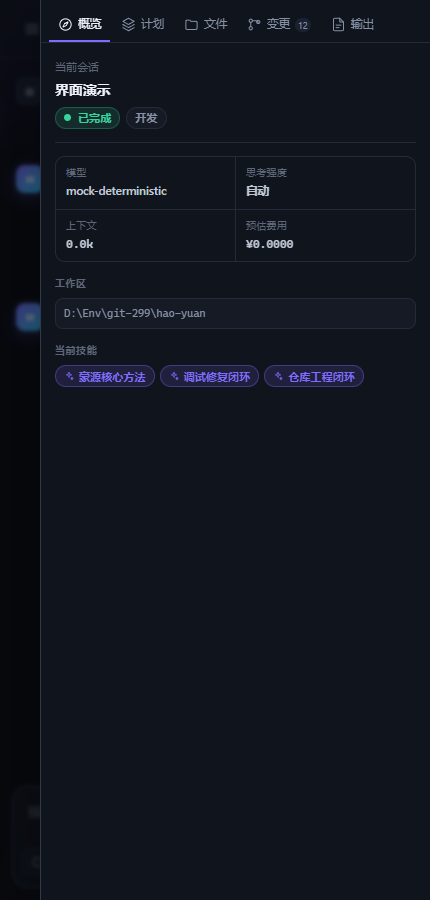

# HaoYuan · 豪源

[简体中文](../../README.md) · [繁體中文](README.zh-TW.md) · [English](README.en.md) · [日本語](README.ja.md) · [Deutsch](README.de.md) · [한국어](README.ko.md)  
[Français](README.fr.md) · **Español** · [Português (Brasil)](README.pt-BR.md) · [Italiano](README.it.md) · [Polski](README.pl.md) · [Todos los idiomas](README.md)

> Un estudio personal de AI donde diriges a múltiples empleados de AI para que trabajen de forma asíncrona y en paralelo.  
> Un núcleo, un conjunto de plugins instalables y un bucle cerrado verificable para tareas de horizonte largo.

HaoYuan está reescrito sobre **agent-harness** como su base de referencia para el backend. Conserva y refuerza la experiencia en codificación de un asistente de AI mientras reorganiza sesiones, herramientas, agentes, enrutamiento, habilidades, supervisión y orquestación en torno a una arquitectura de plugins. El frontend se reescribe por completo, con el objetivo de elevar la "colaboración con AI" de una ventana de chat a un banco de trabajo que puedes dirigir, observar y en el que puedes intervenir.


---

## 1. Características principales

### 1.1 Un bucle de codificación realmente usable

| Capacidad | Implementación |
|---|---|
| Conocimiento del repositorio | `project_scan`, `repo_map`, índice de símbolos, `search_symbol` |
| Lectura precisa | `read_file`, `read_range`, focalización por número de línea |
| Ediciones mínimas | `apply_patch` (diff unificado / SEARCH-REPLACE), `edit_file`, `multi_edit` |
| Operaciones de archivos | `write_file`, `glob`, `grep`, `list_dir`, `delete_path`, `move_path` |
| Verificación de comandos | `run_shell` (UTF-8, tiempos de espera, resúmenes de errores estructurados), `git` como envoltorio |
| Barrera de verificación | Las pruebas/lint/build son obligatorias tras los cambios en el código, lo que evita "editar sin verificar" |
| Bucle de prueba y corrección | Análisis estructurado de fallos de pytest → localización de la línea → corrección mínima → escalado por huella de fallo |
| Subagentes | `task` explora en un contexto aislado y devuelve solo conclusiones, evitando la contaminación del contexto principal |
| Gobernanza del contexto | Envejecimiento de resultados de herramientas, resúmenes estructurados, compresión dentro del turno, recorte por presupuesto máximo |
| Precarga de contexto | Clasificación `repo_map` según los requisitos más un `context_pack` de fuentes relevantes para tareas complejas (hasta ~30KB), lo que reduce las lecturas completas repetidas |
| Tareas de horizonte largo | Presupuestos de pasos, continuación automática, puntos de control, registro idempotente de efectos secundarios (las escrituras no se reaplican) |
| Humano en el bucle | Las escrituras/comandos de alto riesgo muestran una vista previa del diff y se ejecutan solo tras la aprobación |

Clasificación por capas de la intención de la sesión: los saludos, la conversación informal y las preguntas y respuestas generales se responden directamente sin escanear el espacio de trabajo, activar herramientas ni escribir; solo las tareas explícitas, como codificar, cambiar archivos y ejecutar comandos, entran en el bucle de codificación.

### 1.2 Paralelismo asíncrono de múltiples sesiones

- Una sesión = un `asyncio.Task` en segundo plano; cambiar de ventana, cerrar pestañas o desconectarse no detiene la tarea.
- Compuerta de concurrencia global + cola FIFO; cuando se espera aprobación humana, la ranura de concurrencia se cede automáticamente.
- Máquina de estados de sesión: `idle → queued → running ⇄ waiting_input → done / error`.
- Barra de pestañas de sesión en la parte superior del banco de trabajo: crear o abrir una sesión añade automáticamente una pestaña; haz clic para cambiar de pestaña horizontalmente; `×` solo cierra la vista sin eliminar la sesión, y las pestañas persisten tras recargar; haz clic derecho en una pestaña para cerrar la conversación actual / las de la izquierda / las de la derecha / todas.
- A partir del primer mensaje de una sesión nueva, el modelo asigna un título corto en el idioma actual de la interfaz; si una sesión antigua aún tiene el título predeterminado, se muestra automáticamente un resumen basado en el primer mensaje.
- Cada sesión tiene su propia URL `/#/s/<session-id>`, que se puede copiar, recargar, compartir o cambiar directamente a ella desde la barra de direcciones.
- Tras recargar la página, los mensajes, eventos, planes, aprobaciones y artefactos se restauran desde SQLite.
- El canal principal de eventos en tiempo real usa SSE (reconexión, reanudación basada en cursor, streaming incluso sin WebSocket); el endpoint de WebSocket se mantiene por compatibilidad; REST admite la repetición de eventos.

### 1.3 Supervisor de IA y orquestación multiagente

- **Supervisor**: comprobaciones de estado entre sesiones, alertas de tareas bloqueadas, interrupción automática, conversaciones de consola y acciones de programación.
- **Orquestador**: objetivo → DAG de tareas → un git worktree independiente por empleado → ejecución en paralelo → fusión y aceptación.
- Las sesiones de los empleados comparten archivos de contrato y una pizarra compartida; un fallo no bloquea otras tareas de la misma capa.

### 1.4 Biblioteca de habilidades

- Markdown + front-matter que declara `name / title / description / kinds / triggers`.
- Se asocian automáticamente según el tipo de tarea y las palabras clave; el ranking BM25 entra en juego cuando hay muchas habilidades.
- Incluidas de serie: metodología central, ciclo de ingeniería de repositorios, ciclo de depuración, entrega web y redacción de propuestas.
- Las habilidades se pueden crear, editar y eliminar en la interfaz; los cambios surten efecto al guardar.

### 1.5 Documentos de plan

- `make_plan`: genera una propuesta/plan HTML independiente con KPIs, secciones, tablas, riesgos e hitos.
- Los artefactos se registran en `api/data/artifacts/` y se pueden previsualizar/descargar directamente desde el lado derecho del banco de trabajo.

### 1.6 Arquitectura de plugins

HaoYuan no es "un único monolito gigante"; es:

```
Kernel (sessions / events / tool registry / policy / model gateway / approvals)
        │
        ├── coding       coding agent + engineering tools + skills
        ├── plans        planning tools + Planner agent
        ├── supervisor   health checks + console routes
        ├── orchestrator task DAG + worktree + merge
        └── embodied     embodied agent harness (disabled by default, install to enable)
```

Los plugins pueden aportar: herramientas, agentes, rutas HTTP, directorios de habilidades, suscripciones a eventos, hooks de ciclo de vida y metadatos de navegación/comandos del frontend. Que un solo plugin falle al cargar no derribará el kernel.


### 1.7 Once idiomas, tema claro predeterminado y una barra lateral plegable

- Tema **claro (blanco)** predeterminado; cambia al oscuro desde la página de configuración o desde la parte inferior de la barra lateral.
- **Chino simplificado** predeterminado; cambia entre **简体中文 / 繁體中文 / English / 日本語 / Deutsch / 한국어 / Français / Español / Português (Brasil) / Italiano / Polski**.
- Los puntos de acceso de idioma están en tres lugares destacados: la barra superior del área de trabajo, la parte inferior de la barra lateral (disponible en todas las páginas) y Configuración → Apariencia.
- La elección se conserva en `localStorage` y se mantiene tras actualizar y reiniciar; también se actualizan `document.lang` y el título de la página.
- La barra lateral puede contraerse a una franja de iconos de 76px; tras contraerla, queda un botón explícito «Expandir barra lateral» en la parte superior, se oculta la lista de sesiones y todo se restaura al expandirla.
- El panel de información de la derecha está contraído de forma predeterminada para dejar más espacio a la conversación; haz clic en el botón de la esquina superior derecha para abrirlo, y la elección se conserva.
- Los títulos/descripciones de habilidades integradas, los títulos/descripciones de complementos y los textos de la interfaz para estados, botones, consejos, aprobaciones, planes, uso y orquestación están totalmente cubiertos en los once idiomas.

---

## 2. Inicio rápido

### Estadísticas de uso anónimas (aviso de transparencia)

HaoYuan incluye un latido de uso **totalmente anónimo** para contar dispositivos en línea y la distribución de versiones:

- **Datos notificados**: un `install_id` aleatorio (UUID) generado localmente, la versión del cliente y el tipo de OS (p. ej., `Windows 11`). No contiene nombres de usuario, correos electrónicos, contenidos de archivos, rutas del espacio de trabajo, contenido de conversaciones ni ningún otro dato personal.
- **Frecuencia**: una vez al iniciar y cada 5 minutos mientras se ejecuta (una única solicitud POST ligera).
- **Totalmente opcional**: establece la variable de entorno `HAOYUAN_TELEMETRY=0` antes del inicio para desactivarlo de forma permanente; todas las funciones siguen sin verse afectadas.
- **Protección de la privacidad**: el servidor solo registra un hash unidireccional de la IP, nunca la IP en texto plano; los datos se conservan durante 90 días.
- **Aviso completo**: consulta el endpoint de privacidad del centro de complementos `GET {plugin-center-url}/api/plugin-center/privacy`, o el código fuente `api/core/telemetry.py` (~100 líneas, auditable).

### Requisitos

- Python 3.10+
- Node.js 18+
- Windows / Linux / macOS

### npm install (recomendado)

```bash
# Prerequisite: Node.js 18+ and Python 3.10+
npm install -g haoyuan

# Faster mirrors in mainland China:
npm install -g haoyuan --registry=https://registry.npmmirror.com

# Terminal chat (creates the venv and installs dependencies on first run)
haoyuan

# Start the service and open the web UI automatically
haoyuan web
```

| Comando | Propósito |
|---|---|
| `haoyuan` | Chat en la terminal (salida en streaming, llamadas a herramientas, solicitudes de aprobación) |
| `haoyuan --model x/y` | Iniciar chat con un modelo específico (p. ej., `--model deepseek/deepseek-flash`) |
| `haoyuan web` | Iniciar el servicio y abrir la interfaz web automáticamente |
| `haoyuan web --no-open` | Iniciar el servicio sin abrir un navegador |
| `haoyuan --version` / `-V` | Mostrar la versión |
| `haoyuan config` | Archivo de configuración global (claves de modelos, etc.); usa `--open` para editarlo directamente |
| `haoyuan login` / `haoyuan logout` | Iniciar sesión cuando la protección de la cuenta está habilitada / borrar el token local |
| `haoyuan setup` | Instalar solo las dependencias |
| `haoyuan help` | Mostrar ayuda |

Comandos en la terminal: `/models` para ver/seleccionar un modelo (elige por número, o `/model x/y` para seleccionar directamente), `/new` para crear una sesión, `/web` para abrir la sesión actual en un navegador, `/cancel` para cancelar la tarea actual, `/exit` para salir (Ctrl+C también funciona).

La interfaz web usa `http://127.0.0.1:8030` de forma predeterminada e incrementa el puerto automáticamente cuando está en uso. Sin una clave de modelo, el modelo integrado `mock` sigue ejecutando sesiones, llamadas a herramientas, aprobaciones y el frontend de extremo a extremo.

### Inicio con un clic en Windows

```bat
start.bat
```

El script realiza automáticamente lo siguiente: detiene el proceso anterior en el puerto 8030 → crea `api/env1` → instala las dependencias de Python → (solo cuando falta `web/dist`) instala las dependencias del frontend y compila → inicia la API y abre la página del producto. El paquete npm ya incluye un frontend precompilado, por lo que los entornos de intranet/sin conexión pueden iniciarse directamente una vez instaladas las dependencias. Si un `npm install` anterior dejó un `web/node_modules` incompleto debido a una interrupción de red, el script lo detecta y lo reinstala automáticamente; no es necesario eliminarlo manualmente.

**Alternativa automática de puertos**: el backend usa `8030` de forma predeterminada y el servidor de desarrollo del frontend, `8130`; si un puerto está en uso, lo incrementa automáticamente (8031, 8032, …) hasta que el enlace se establezca correctamente. Los puertos reales se escriben en `api/data/runtime.json`, y el script de inicio los lee para abrir la dirección correcta. También puedes establecer los puertos base explícitamente con `HAOYUAN_PORT` / `HAOYUAN_WEB_PORT` (frontend) y `HAOYUAN_API_PORT` (destino del proxy del frontend).

Detener:

```bat
stop.bat
```

### Consola de escritorio (desktop.exe)

Haz doble clic en `desktop.exe` en la raíz del repositorio para abrir la consola gráfica (~20 KB; solo depende de .NET Framework 4.x incluido con Windows):

- **Iniciar todo / detener todo**: gestiona el backend y el servidor de desarrollo del frontend con un solo clic; la página del producto se abre automáticamente después del inicio
- **Iniciar / detener backend** (8030 de forma predeterminada) y **iniciar / detener frontend** (8130 de forma predeterminada)
- **Configuración de puertos**: edita directamente los puertos del backend y del frontend; haz clic en "Aplicar puertos y reiniciar" para guardar la configuración y reiniciar ambos servicios; si un puerto está ocupado, el servicio igualmente lo incrementa automáticamente
- **Abrir página del producto**: abre el puerto real del backend a partir de `api/data/runtime.json`; recurre al puerto del frontend cuando solo se está ejecutando el frontend
- **Compilar frontend**, **abrir carpeta del proyecto**, estado del servicio actualizado cada segundo y registros de ejecución en tiempo real

Cerrar la ventana de la consola no detiene los servicios. Para detenerlos, haz clic en "Detener todo" o en los botones de detención correspondientes. El código fuente se encuentra en `desktop/`; ejecuta `desktop\build.bat` para recompilar después de los cambios.

### Linux / macOS

```bash
bash start.sh
bash stop.sh
```

Para entornos de intranet o con espejos personalizados, especifica explícitamente las fuentes de descarga (si se omiten, se usan las fuentes ya configuradas en `~/.npmrc` y `pip.conf`):

```bash
export HAOYUAN_NPM_REGISTRY=http://your-intranet/npm/
export HAOYUAN_PIP_INDEX_URL=http://your-intranet/pypi/simple
bash start.sh
```

Equivalente en Windows:

```bat
set HAOYUAN_NPM_REGISTRY=http://your-intranet/npm/
set HAOYUAN_PIP_INDEX_URL=http://your-intranet/pypi/simple
start.bat
```

Cuando las dependencias del frontend o de Python están incompletas (por ejemplo, una instalación anterior se interrumpió por `ECONNRESET`), `start.sh` / `start.bat` / `haoyuan setup` detectan y limpian automáticamente `web/node_modules`, reinstalan, instalan los paquetes del backend que falten y recurren al `web/dist` existente si la compilación falla.

`web/package-lock.json` ya no codifica de forma fija un espejo externo; `replace-registry-host=always` en `web/.npmrc` garantiza que las instalaciones siempre usen el registro de la configuración actual de npm, de modo que el archivo de bloqueo no pueda desviar las instalaciones hacia un espejo externo inaccesible.

### Inicio manual

```bash
# Backend
cd api
python -m venv env1
env1\Scripts\activate           # Linux: source env1/bin/activate
pip install -r requirements.txt
python main.py                  # http://127.0.0.1:8030, increments automatically if in use

# Frontend dev mode (hot reload, optional)
cd web
npm install
npm run dev                     # http://localhost:8130, increments automatically if in use; /api and /ws proxy to the backend's actual port
```

En producción, el backend sirve `web/dist` directamente, por lo que solo necesitas visitar el puerto real del backend. Los puertos se pueden sobrescribir con variables de entorno: `HAOYUAN_PORT` (backend, predeterminado 8030), `HAOYUAN_WEB_PORT` (frontend, predeterminado 8130) y `HAOYUAN_API_PORT` (destino del proxy del frontend, predeterminado desde `api/data/runtime.json`).

### Configurar modelos

**Archivo de configuración global (recomendado)** — una ruta fija por usuario no afectada por la reinstalación o actualización:

```bash
haoyuan config          # creates the file on first run and prints its path
haoyuan config --open   # open it directly in your editor
```

Ruta: `~/.config/haoyuan/config.json` (en Windows: `C:\Users\<you>\.config\haoyuan\config.json`; se puede sobrescribir con la variable de entorno `HAOYUAN_CONFIG`):

El archivo se crea automáticamente en el primer inicio (o mediante el postinstall de npm), y su directorio se crea si no existe.

```json
{
  "PROVIDER": "",
  "MODEL": "",
  "DEEPSEEK_API_KEY": "",
  "DEEPSEEK_BASE_URL": "https://api.deepseek.com",
  "DEEPSEEK_MODEL": "deepseek-flash",
  "ZHIPU_API_KEY": "",
  "ZHIPU_BASE_URL": "https://open.bigmodel.cn/api/coding/paas/v4",
  "ZHIPU_MODEL": "glm-5.3-flash",
  "MIMO_API_KEY": "",
  "MIMO_BASE_URL": "https://token-plan-cn.xiaomimimo.com/v1",
  "MIMO_MODEL": "mimo-v2.6-flash",
  "providers": {}
}
```

- Para los proveedores integrados, puedes añadir `DEEPSEEK_MODELS` / `ZHIPU_MODELS` / `MIMO_MODELS` (separados por comas) para personalizar por completo la lista de modelos; `*_THINKING_MODELS`, `*_MAX_OUTPUT` y `*_SUPPORTS_THINKING` son opcionales.
- Cualquier proveedor compatible con OpenAI se puede añadir al objeto `providers`, no solo los tres integrados:

```json
{
  "providers": {
    "my-intranet": {
      "base_url": "http://llm.intranet/v1",
      "api_key": "sk-...",
      "models": ["qwen-max", "qwen-plus"],
      "default_model": "qwen-max",
      "supports_thinking": false,
      "max_output_tokens": 8192
    }
  }
}
```

- `PROVIDER` / `MODEL` pueden fijar el modelo predeterminado (p. ej., `"MODEL": "deepseek-v4-pro"` o `"MODEL": "my-intranet/qwen-max"`; déjalo vacío para seleccionarlo automáticamente según las claves configuradas).
- **Sincronización bidireccional entre la página de configuración web y el archivo de configuración**: añadir o editar proveedores, modelos y el modelo predeterminado en «Configuración → Configuración de modelos» se escribe inmediatamente de vuelta en el archivo; si editas el archivo directamente y lo guardas, el servicio lo recarga en la siguiente solicitud (no es necesario reiniciar).
- «Actualizar todos los modelos» lee el endpoint `/models` de cada proveedor con su URL base y clave, filtrando automáticamente los modelos que no son de chat; si algunos proveedores fallan, se muestran los proveedores exactos y los motivos, mientras que los proveedores exitosos se siguen guardando.

**Configuración dentro del paquete (opcional)**:

```bash
copy api\configs\secrets_example.py api\configs\secrets_local.py
```

Edita `api/configs/secrets_local.py` con los mismos campos (como constantes de Python). Esto está pensado para despliegues desde el código fuente; en una instalación global de npm, el archivo reside dentro del directorio del paquete y se elimina al actualizar, así que es preferible usar la configuración global.

**Variables de entorno** (máxima prioridad):

```powershell
$env:DEEPSEEK_API_KEY="sk-..."
```

Prioridad: variables de entorno > archivo de configuración global > `secrets_local.py`. Después de editar el archivo de configuración global, no es necesario reiniciar (el servicio se recarga en caliente); el campo `key_source` de la comprobación de estado `GET /api/health` muestra de dónde provino la clave.

**Cuando no hay ninguna clave configurada, se usa automáticamente el modelo local `mock`**, poniendo a prueba las sesiones, las llamadas a herramientas, las aprobaciones, los eventos y el frontend de extremo a extremo.

---

## 3. Interfaz

| Área de trabajo (claro, predeterminado) | Área de trabajo (inglés) |
|---|---|
|  |  |

| Área de trabajo (chino tradicional) | Área de trabajo (oscuro) |
|---|---|
|  |  |

| Consola del supervisor | Biblioteca de habilidades |
|---|---|
|  |  |

| Acceso a configuración e idioma | Botón de expandir después de contraer la barra lateral |
|---|---|
|  |  |

Panel de información del lado derecho en móvil:  


Interacciones clave:

- Pestañas de sesión superiores: haz clic para cambiar de conversación; `×` cierra una pestaña (los datos de la sesión no se ven afectados); haz clic derecho para cerrar la conversación actual / las de la izquierda / las de la derecha / todas
- Las tareas nuevas ya no ofrecen preguntas predefinidas; simplemente describe la tarea en el cuadro de entrada y el título de la sesión se genera automáticamente a partir de un resumen
- Enrutamiento en la barra de direcciones: `/#/s/<session-id>` se asigna a una sesión específica y se puede copiar, recargar o abrir en una ventana nueva
- `Ctrl / Cmd + K`: paleta de comandos (navegación, sesiones, acciones)
- `Ctrl / Cmd + N`: nueva tarea
- `Ctrl / Cmd + B`: contraer / expandir la barra lateral
- `Enter`: enviar; `Shift + Enter`: nueva línea (`Ctrl / Cmd + Enter` también envía)
- Tarjeta de aprobación: `A` aprueba, `R` rechaza
- Cambio de idioma: esquina superior derecha del área de trabajo, parte inferior de la barra lateral en cualquier página y Configuración → Apariencia
- Escribe mientras una sesión está en ejecución: la entrada se fusiona con la ejecución actual como una "instrucción adicional" sin interrumpir la tarea
- El panel derecho está contraído de forma predeterminada; haz clic en el botón de la esquina superior derecha para abrir Resumen / Plan / Archivos / Cambios / Artefactos, y arrastra para redimensionarlo
- Los archivos y las diferencias utilizan una superposición de vista previa grande para evitar leer código en una columna estrecha

---

## 4. Arquitectura

```text
hao-yuan/
├── api/
│   ├── main.py                    FastAPI entry (extension routes + plugin routes + static frontend)
│   ├── configs/                   Configuration, model registry, secrets
│   ├── core/
│   │   ├── contracts.py           Tool / Agent / Policy / ToolContext
│   │   ├── storage.py             SQLite (WAL) storage layer
│   │   ├── events.py              Event bus (broadcast + batched persistence + replay)
│   │   ├── gateway.py             Model gateway (streaming + degradation + fallback)
│   │   ├── context.py             Context compression / aging / hard budget
│   │   ├── runtime.py             Agent main loop
│   │   ├── session_manager.py     Concurrency gate / queue / approvals / resume
│   │   ├── policy.py              Permission gate
│   │   ├── tools.py               Tool registry and execution
│   │   ├── agents.py              Agent registry
│   │   └── plugin.py              Plugin discovery / dependencies / lifecycle
│   ├── harness/                   Sandbox / skills / symbol index / fix loop / supervision / orchestration / embodied
│   ├── tools/                     builtin / dev / plan
│   ├── adapters/providers/        deepseek / mimo / mock
│   ├── plugins/                   coding / plans / supervisor / orchestrator / embodied
│   ├── extensions/                System / sessions / skills / settings / files / usage / plugins / approvals / real-time events (SSE / WebSocket)
│   ├── skills/                    Core skills
│   ├── tests/                     90 backend tests
│   └── data/                      Runtime data (gitignored)
├── web/                           Vue 3 + Vite
├── docs/screenshots/              UI screenshots
├── start.bat / stop.bat
├── start.sh / stop.sh
├── dev.bat
├── desktop.exe                    Graphical desktop console (start/stop services / open the web UI)
└── desktop/                       desktop.exe source and build scripts
```

### Datos y límites

- Base de datos: `api/data/haoyuan.db` (WAL)
- Artefactos: `api/data/artifacts/<session_id>/`
- Puertos en tiempo de ejecución: `api/data/runtime.json` (el backend escribe `api_port`, el frontend escribe `web_port` y la consola de escritorio escribe `api_port_config` / `web_port_config`)
- Todas las herramientas de archivos están restringidas por la lista de permitidos del espacio de trabajo de la sesión y rechazan `../` y los intentos de escape mediante rutas absolutas.
- Las herramientas de alto riesgo (escritura de archivos, parche, eliminación, movimiento, shell, git, movimiento del robot) requieren aprobación.
- `run_shell` bloquea de forma estricta los comandos catastróficos (como `rm -rf /`, formateo de disco y apagado).
- La vista previa del HTML de artefactos se realiza mediante un endpoint con una CSP de sandbox, lo que impide que las páginas generadas por el modelo lean credenciales locales.
- Los secretos se leen solo desde variables de entorno o desde `secrets_local.py`; nunca se almacenan en la base de datos ni se devuelven en texto plano.
- Las claves reales se encuentran en `api/configs/secrets_local.py`, que `.gitignore` ignora; `git add --dry-run` verifica que nunca entren en el repositorio.

---

## 5. Desarrollo de plugins

Crea un directorio dentro de `api/plugins/`:

```
api/plugins/my-plugin/
├── plugin.json
├── plugin.py
├── routes.py        # optional
└── skills/          # optional
    └── my-skill.md
```

`plugin.json`:

```json
{
  "name": "my-plugin",
  "title": "My Plugin",
  "version": "1.0.0",
  "description": "What this plugin adds",
  "author": "you",
  "requires": ["coding"],
  "default_enabled": true,
  "backend": "plugin.py",
  "routes": "routes.py",
  "contributes": {
    "tools": ["my_tool"],
    "agents": ["my_agent"],
    "skills": true
  },
  "frontend": {
    "nav": [{ "label": "My Plugin", "path": "/my-plugin", "icon": "puzzle" }],
    "commands": [{ "id": "my-plugin.run", "title": "Run my plugin" }]
  }
}
```

`plugin.py`:

```python
from core.contracts import AgentSpec, ToolSpec


async def my_tool(ctx, args):
    return {"echo": args.get("text", "")}


def register(ctx):
    ctx.register_tool(
        ToolSpec(
            name="my_tool",
            description="Echo text",
            input_schema={
                "type": "object",
                "properties": {"text": {"type": "string"}},
                "required": ["text"],
            },
        ),
        my_tool,
    )
    ctx.register_agent(
        AgentSpec(
            name="my_agent",
            title="My Agent",
            instructions="You are ...",
            tools=["my_tool"],
            kind="dev",
        )
    )
    ctx.add_skill_dir("skills")


async def startup(ctx):
    ...


async def shutdown(ctx):
    ...
```

Capacidades de los plugins:

- `requires` controla el orden de las dependencias; las dependencias faltantes se aíslan y el error se registra.
- `startup / shutdown`: hooks del ciclo de vida.
- `ctx.events.subscribe(sink)` se suscribe a eventos globales (así es como el orquestador recibe los eventos de finalización de los empleados).
- El estado habilitado/deshabilitado se persiste en SQLite; después de alternarlo, reinicia la API para cargar/descargar las rutas.
- El frontend obtiene los metadatos de `contributes` y `frontend` mediante `/api/plugins`.

### Por qué este diseño

Toma de WordPress la idea de «kernel pequeño + plugins instalables»: el kernel solo se encarga de las sesiones, los eventos, las políticas, los modelos y el protocolo de herramientas; todas las capacidades de negocio residen en los plugins.  
También adopta la idea de DeepSeek Harness de que «el propio harness es conectable»: un agente encarnado no es más que un plugin de harness independiente, por lo que puedes seguir añadiendo harnesses para rovers, brazos robóticos, robots humanoides y mucho más sin tocar el kernel.

---

## 6. Resultados de la autocomprobación

Lo siguiente se ejecutó en el entorno de entrega:

```bash
cd api
python -m pytest -q
# 90 passed, 2 skipped, 2 warnings

cd ../web
npm run build
# ✓ built, 97 modules transformed
```

Cobertura de las pruebas:

- Comprobación de estado, modelos, habilidades, plugins y listado de aprobaciones
- Una sesión completa con modelo simulado (mensaje → evento → done)
- Sesión de programación: escribir archivo → evento de herramienta → artefacto → lectura del árbol del espacio de trabajo
- Flujo de aprobación humana: pendiente → aprobar → ejecución de la herramienta → archivo escrito en disco
- Renombrar / ocultar / restaurar / limpiar / eliminar permanentemente sesiones
- Ajustes de la puerta global y del espacio de trabajo predeterminado, uso y exportación a CSV
- Persistencia del estado habilitado de los plugins
- Git worktree del orquestador de principio a fin (crear → despachar → completar → fusionar)
- Nivel de herramienta: escape del sandbox, read/write/edit/patch/multi_edit, glob/grep/symbols, shell, delete/move
- Bloqueo estricto de comandos shell peligrosos
- Índice de símbolos, mapa del repositorio, análisis de pytest y guía de corrección
- Generación del artefacto HTML del plan
- Enrutamiento de intenciones: los saludos, la conversación informal y las preguntas y respuestas generales (como «¿cómo estás?», «hoy hace buen tiempo», «¿qué es la inyección de dependencias?») se responden directamente sin escanear el espacio de trabajo, activar herramientas ni escribir (incluida la verificación real con deepseek-flash)
- Título de sesión automático a partir del primer mensaje (sigue el idioma de la interfaz; el mock cubre el mecanismo de reserva y la verificación con modelo real)
- Enrutamiento de sesiones independientes: enlaces directos `/#/s/<session-id>`, cambio de pestañas, edición de la barra de direcciones, restauración al actualizar y reserva al cerrar
- Clic derecho en la pestaña de sesión: cerrar la actual / las de la izquierda / las de la derecha / todas, con cambio automático a la pestaña más cercana tras el cierre masivo
- Actualización de modelos del proveedor: detalles de los fallos y filtrado de modelos que no son de chat

Además, se realizó una inspección en un navegador real de la compilación de producción con Playwright + Chrome local:

- Las páginas de banco de trabajo / consola / habilidades / plugins / configuración / uso / orquestación cargan todas
- Pestañas de sesión superiores y enrutamiento independiente: abrir, cambiar, cerrar, cierre masivo con clic derecho, enlaces profundos desde la barra de direcciones y restauración al actualizar
- Resumen de título predeterminado, menú de idioma en la esquina superior derecha (cambio entre once idiomas) y un estado vacío sin preguntas predefinidas
- El cambio entre chino simplificado, chino tradicional, inglés, japonés, alemán, coreano, francés, español, portugués de Brasil, italiano y polaco funciona, y el idioma persiste tras actualizar
- Los puntos de entrada de idioma abarcan la barra superior del banco de trabajo, la parte inferior de la barra lateral y la página de configuración
- La contracción/expansión de la barra lateral entre 286px y 76px funciona; tras contraerla, la lista de sesiones se oculta y el botón de expansión está visible
- El panel de información derecho está contraído de forma predeterminada y su estado expandido/contraído persiste
- `Enter` envía y `Shift + Enter` inserta un salto de línea; la composición del IME no envía por accidente
- Los temas oscuro y claro funcionan
- El diseño móvil de 430px, el cajón de la barra lateral y el cajón de información derecho funcionan
- Flujo en tiempo real SSE: los deltas reales de razonamiento y contenido de DeepSeek son visibles antes de `done`
- Sin errores de JS, sin recursos 404 y sin WebSocket 404 en la consola (el canal principal en tiempo real ahora es SSE)

> La verificación real en línea se completó con la clave de DeepSeek a la que hace referencia el asistente de IA: `deepseek-flash` devolvió `OK`, y el proveedor/modelo de uso = `deepseek/deepseek-flash`. La clave se almacena solo en `api/configs/secrets_local.py`, que es ignorado por `.gitignore`; el repositorio solo versiona la plantilla `secrets_example.py`. Las pruebas de regresión con mock se mantienen, por lo que el sistema se degrada automáticamente cuando está sin conexión o sin clave.

---

## 7. Resultados del benchmark justo de Harness

> Último informe: `test/testing/index-2026-10-27.html` (2026-10-27, mimo-v2.6-flash)  
> Informe histórico: `test/testing/index-2026-10-25.html` (2026-10-25, deepseek-flash)

### 7.1 Benchmark justo de MiMo (más reciente)

**Método**: 5 tareas calificables automáticamente (1 adaptativa básica + 4 que cubren localización / rendimiento / horizonte largo / concurrencia) × 3 herramientas; `mimo-v2.6-flash`, prompts, repositorio semilla y presupuesto unificados. Las pruebas ocultas se inyectan después de la ejecución, y `tests/` y `pyproject.toml` se verifican con SHA-256 — la manipulación puntúa 0. t1/d1/d3 usan el lote intercalado oficial-r1; d4/d6 usan un lote de reejecución independiente después de congelar el código.

| Rango | Herramienta | General (ponderado por producto) | Corrección | Velocidad | Coste | Disciplina de ingeniería | Equiponderado |
|---|---|---|---|---|---|---|---|
| 1 | **HaoYuan** | **98.8** | 100.0 | 94.4 | 96.9 | 100.0 | **98.3 (1.º)** |
| 2 | OpenCode | 90.5 | 100.0 | 67.8 | 53.5 | 100.0 | 84.3 (2.º) |
| 3 | Claude Code | 88.9 | 100.0 | 65.1 | 40.9 | 100.0 | 81.2 (3.º) |

General = 0.65 × corrección + 0.15 × velocidad + 0.10 × coste + 0.10 × disciplina de ingeniería; la fórmula de equiponderación usa 0.40 / 0.20 / 0.20 / 0.20.

- Los tres obtuvieron 100% de corrección; HaoYuan obtuvo **98.8** con ponderación por producto y **98.3** con ponderación equitativa, y quedó primero con ambas fórmulas.
- Por tarea: HaoYuan fue el más rápido en t1 (63.8s), d3 (220.6s) y d4 (469.6s); OpenCode ganó d1 (111.3s) y Claude Code ganó d6 (254.5s).
- Costo: el costo total de las 5 tareas fue de **$3.33** para HaoYuan, $6.56 para OpenCode y $9.04 para Claude Code; los costos por tarea fueron $0.666 / $1.313 / $1.809.
- Intensidad adaptativa: t1, una tarea fácil, tomó 63.8s y 11 llamadas sin iniciar un plan ni un subagente; la tarea d4 de horizonte largo utilizó código fuente relevante precargado para reducir la exploración repetida (de un tiempo de espera de 1200s a 469.6s).
- Correcciones clave: se completó el proveedor MiMo (anteriormente `resolve("mimo", ...)` recurría silenciosamente a deepseek), mapa del repositorio consciente de los requisitos, un paquete de contexto de 30KB para tareas complejas, liberación del árbol de procesos, proveedor estricto + límites por llamada + reintentos con el mismo modelo, y enrutamiento lite para tareas fáciles.
- Limitaciones: la comparación formal utilizó 1 ronda por tarea; d4/d6 fueron lotes independientes de reejecución; la varianza de latencia del modelo es grande (Claude d3 fue de 623s antes y 884s esta vez); d5 carecía de capacidad de discriminación y no se clasificó; las tareas son de creación propia y no pueden sustituir a benchmarks públicos como SWE-bench.

```bash
cd test/bench
python harness_bench.py run --batch official-r1 --tools haoyuan,claude,opencode --tasks t1_multisite_bugfix,d1_needle_regress,d3_perf_cliff --resume
python harness_bench.py run --batch official-r1 --tools haoyuan,claude,opencode --tasks d4_multilayer_feature,d6_concurrency_fix --resume
python make_report_mimo_final.py
```

### 7.2 Benchmark profundo de deepseek-flash (histórico)

**Método**: 8 tareas de programación calificables automáticamente (5 básicas + 3 difíciles) × 3 rondas por tarea × 3 herramientas; deepseek-flash, prompts, repositorio semilla y presupuesto unificados; las pruebas ocultas se inyectan después de la ejecución, y `tests/` y `pyproject.toml` se verifican mediante SHA-256 — la manipulación puntúa 0.

| Puesto | Herramienta | Puntuación global (ponderada por producto) | Corrección | Velocidad típica | Latencia de cola | Costo | Puntuación con ponderación equitativa |
|---|---|---|---|---|---|---|---|
| 1 | **HaoYuan** | **96.6** | 100.0 | 100.0 (mediana 30.3s) | 67.6 (P90 159.4s) | 82.2 ($0.364) | 95.0 (2.º) |
| 2 | OpenCode | 95.1 | 100.0 | 67.6 (mediana 44.8s) | 100.0 (P90 107.7s) | 100.0 ($0.299) | 96.8 (1.º) |
| 3 | Claude Code | 90.7 | 100.0 | 70.6 (mediana 42.9s) | 90.7 (P90 118.7s) | 55.4 ($0.540) | 91.7 (3.º) |

Global = 0.70 × corrección + 0.15 × velocidad típica + 0.05 × latencia de cola + 0.10 × costo; la fórmula con ponderación equitativa cambia los dos últimos pesos a 0.10 / 0.10.

- Los tres obtuvieron un 100 % de corrección; las diferencias se concentraron en la velocidad, la latencia de cola y el costo de tokens; HaoYuan quedó primero en la ponderación por producto, mientras que OpenCode lo superó con igual ponderación.
- HaoYuan tuvo el menor tiempo mediano por tarea, con 30,3 s, y fue el más rápido en la mediana de cuatro tareas (T1/T2/T3/H1); las 24 ejecuciones se completaron al 100 %. OpenCode tuvo la mejor latencia de cola y el mejor costo por tarea; Claude Code tuvo el mayor costo de tokens.
- Debilidades: la migración de versión H2 tuvo una mediana de 159,4 s (OpenCode: 101,1 s), y H3 tuvo una cola larga de 260 s; el trabajo futuro comprimirá aún más las auditorías de migración y las rondas de autoprueba.
- Limitaciones: cubre solo deepseek-flash y 3 rondas por tarea; las tareas son de construcción propia y no pueden reemplazar benchmarks públicos como SWE-bench.
- Autoiteración: durante la evaluación se corrigieron la adaptación de tuberías de Windows, la protección contra respuestas vacías y ausencia de escritura, las auditorías de aceptación de migración, las auditorías ligeras de git diff y el orden de finalización; se revirtió una optimización negativa de «exceso de pruebas».

Reproducir:

```bash
cd test/bench
python harness_bench.py run --batch final-r1 --tools haoyuan,claude,opencode --tasks all
python aggregate.py
python make_report.py
```

---

## 8. Paridad de funcionalidades con el asistente de IA

| Capacidad | HaoYuan | Notas |
|---|---|---|
| Cadena de herramientas de codificación | ✅ | Localización, parches mínimos, verificación, bucle de corrección, subagentes |
| Compresión de contexto / horizonte largo | ✅ | Compresión dentro del turno, envejecimiento, presupuesto estricto, checkpoints, reanudación idempotente |
| Paralelismo multisolución | ✅ | Puerta de concurrencia, FIFO, tareas en segundo plano desacopladas del frontend |
| Puerta de permisos / aprobación de diff | ✅ | Tarjetas de aprobación, vista previa, tiempo de espera, cesión de slots de concurrencia |
| Biblioteca de Skills | ✅ | front-matter + reglas/BM25 + edición en la UI |
| Documentos de plan | ✅ | Artefactos HTML independientes |
| Supervisor de IA | ✅ | Snapshots, alertas, conversaciones de consola, acciones de programación |
| Orquestación multiagente | ✅ | DAG de tareas + git worktree + métricas de fusión |
| Estadísticas de tokens / costos | ✅ | Agregación diaria, por modelo, exportación CSV |
| Mecanismo de plugins | ✅ Mejorado | Manifiesto, dependencias, ciclo de vida, metadatos de tools/agents/routes/skills/frontend |
| Comando remoto de Feishu | ⏳ No en esta versión | La capa de interfaz está desacoplada y se puede añadir como plugin |
| ASR / TTS / renderizado de video | ⏳ No en esta versión | El enfoque actual es el bucle central de codificación con IA |
| Benchmarks autoritativos | ⏳ Benchmarks públicos no ejecutados | Los benchmarks de construcción propia están completos: un benchmark justo de MiMo con 5 tareas y un benchmark profundo de deepseek con 8 tareas (véase la sección 7); los benchmarks públicos como SWE-bench no se han vuelto a ejecutar |

---

## 9. Hoja de ruta (arquitectura ya reservada)

### 9.1 Biblioteca de Skills para entrenamiento local en 16 GB de VRAM

Elementos integrados previstos:

- Construcción de datos SFT y scripts de entrenamiento para Qwen3.5-0.8B
- Scripts de entrenamiento de RL (optimización de preferencias / recompensas verificables)
- Configuraciones amigables con la memoria: LoRA / QLoRA, acumulación de gradientes, lotes pequeños, control de longitud de secuencia
- Organizado por «skill»: plantillas de datos, configuraciones de entrenamiento, casos de evaluación y notas de despliegue

El mecanismo actual de Skills de HaoYuan ya está basado en archivos y es versionable, por lo que los documentos de metodología de entrenamiento se podrán inyectar más adelante en los agentes como Skills.

### 9.2 Arnés encarnado basado en plugins

`plugins/embodied` ya demuestra:

- Herramientas de estado del robot / sensores / movimiento / dirección / parada de emergencia
- Aprobación de acciones de alto riesgo
- Un puente de demostración HTTP

Sin cambiar el kernel, más adelante puedes añadir:

- `embodied-ros2` (temas / servicios de ROS2)
- `embodied-serial` (Arduino / ESP32)
- `embodied-smolvla` (modelo de visión-lenguaje-acción)
- Plugins de Harness para rovers, brazos robóticos y robots humanoides

---

## 10. Descripción general de la API

Prefijo unificado `/api`, formato de respuesta `{ code, data, message }`.

| Grupo | Endpoints principales |
|---|---|
| Sistema | `GET /health`, `GET /info`, `GET /models`, `GET /agents`, `GET /tools` |
| Sesiones | `POST /sessions`, `GET /sessions`, `GET /sessions/{id}`, `PATCH /sessions/{id}` |
| Mensajes | `POST /sessions/{id}/messages`, `GET /sessions/{id}/messages` |
| Eventos | `GET /sessions/{id}/events?after_id=`, `GET /sessions/{id}/stream`, `WS /ws` |
| Aprobaciones | `GET /approvals`, `POST /approvals/{id}/resolve`, `POST /sessions/{id}/confirm` |
| Habilidades | `GET/POST /skills`, `GET/PUT/DELETE /skills/{name}` |
| Archivos | `GET /workspace/tree`, `GET /workspace/file`, `GET /workspace/changes`, `GET /workspace/diff` |
| Configuración | `GET/PUT /settings`, `PUT /settings/gate`, `PUT /settings/workspace` |
| Uso | `GET /usage/today`, `GET /usage/daily`, `GET /usage/by-model`, `GET /usage/export.csv` |
| Plugins | `GET /plugins`, `POST /plugins/{name}/toggle` |
| Supervisor | `GET /supervisor/overview`, `GET /supervisor/console`, `POST /supervisor/act`, `POST /supervisor/chat` |
| Orquestación | `POST /orchestrations`, `GET /orchestrations`, `GET /orchestrations/{id}` |

Documentación interactiva: <http://127.0.0.1:8030/docs> (tras incrementar el puerto, usa el log del backend o `api/data/runtime.json`).

---

## 11. Desarrollo y pruebas

```bash
cd api
python -m pytest -q

cd ../web
npm run build
npm run dev        # dev mode; /api and /ws proxy to the backend's actual port automatically
```

Recomendamos registrar los comandos de lint / test / build de tu equipo en `AGENTS.md`; HaoYuan inyecta automáticamente la memoria del proyecto en el contexto.

---

## Licencia

Este proyecto se publica bajo la Licencia MIT y es libre de usar, modificar y distribuir.
