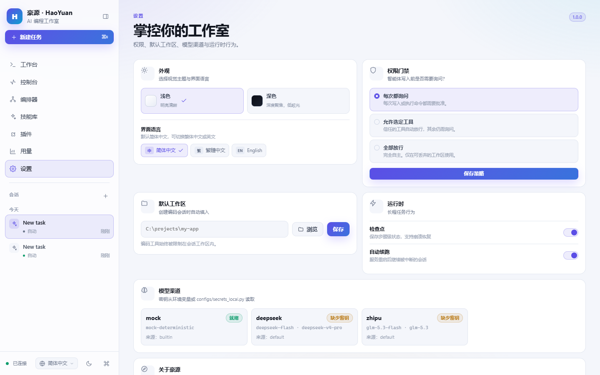

# HaoYuan · 豪源

[简体中文](../../README.md) · [繁體中文](README.zh-TW.md) · [English](README.en.md) · [日本語](README.ja.md) · [Deutsch](README.de.md) · [한국어](README.ko.md)  
[Français](README.fr.md) · [Español](README.es.md) · [Português (Brasil)](README.pt-BR.md) · **Italiano** · [Polski](README.pl.md) · [Tutte le lingue](README.md)

> Uno studio AI personale in cui dirigi più dipendenti AI affinché lavorino in modo asincrono e in parallelo.  
> Un kernel, un insieme di plugin installabili e un ciclo chiuso verificabile per attività di lungo periodo.

HaoYuan è riscritto sopra **agent-harness** come fondamento di riferimento per il backend. Preserva e rafforza le competenze di programmazione di un assistente AI, riorganizzando sessioni, strumenti, agenti, routing, competenze, supervisione e orchestrazione attorno a un'architettura a plugin. Il frontend è completamente riscritto, con l'obiettivo di trasformare la "collaborazione AI" da una finestra di chat in un banco di lavoro che puoi dirigere, osservare e in cui puoi intervenire.


---

## 1. Funzionalità principali

### 1.1 Un ciclo di programmazione realmente utilizzabile

| Capacità | Implementazione |
|---|---|
| Consapevolezza del repository | `project_scan`, `repo_map`, indice dei simboli, `search_symbol` |
| Lettura precisa | `read_file`, `read_range`, targeting per numero di riga |
| Modifiche minime | `apply_patch` (diff unificato / SEARCH-REPLACE), `edit_file`, `multi_edit` |
| Operazioni sui file | `write_file`, `glob`, `grep`, `list_dir`, `delete_path`, `move_path` |
| Verifica dei comandi | `run_shell` (UTF-8, timeout, riepiloghi strutturati degli errori), `git` wrapper |
| Gate di verifica | Test/lint/build sono obbligatori dopo modifiche al codice, impedendo di "modificare senza verificare" |
| Ciclo test-correzione | Parsing strutturato dei fallimenti pytest → localizzazione della riga → correzione minima → escalation basata sul fingerprint del fallimento |
| Sub-agenti | `task` esplora in un contesto isolato e restituisce solo conclusioni, evitando l'inquinamento del contesto principale |
| Gestione del contesto | Invecchiamento dei risultati degli strumenti, riepiloghi strutturati, compressione all'interno del turno, riduzione forzata al budget |
| Precaricamento del contesto | Ranking `repo_map` sensibile ai requisiti più un `context_pack` delle fonti rilevanti per attività complesse (fino a ~30KB), riducendo le letture complete ripetute |
| Attività di lungo periodo | Budget per i passi, continuazione automatica, checkpoint, registro idempotente degli effetti collaterali (le scritture non vengono riapplicate) |
| Intervento umano nel ciclo | Scritture/comandi ad alto rischio mostrano un'anteprima diff e vengono eseguiti solo dopo approvazione |

Suddivisione per intento della sessione: saluti, conversazione informale e domande e risposte generali ricevono risposta diretta senza scansionare il workspace, attivare strumenti o scrivere; solo attività esplicite come programmazione, modifiche ai file ed esecuzione di comandi entrano nel ciclo di programmazione.

### 1.2 Parallelismo asincrono multi-sessione

- Una sessione = un `asyncio.Task` in background; cambiare finestra, chiudere schede o disconnettersi non interrompe l'attività.
- Gate di concorrenza globale + coda FIFO; durante l'attesa dell'approvazione umana, lo slot di concorrenza viene ceduto automaticamente.
- Macchina a stati della sessione: `idle → queued → running ⇄ waiting_input → done / error`.
- Barra delle schede delle sessioni nella parte superiore del workbench: creare o aprire una sessione aggiunge automaticamente una scheda; fare clic per passare orizzontalmente; `×` chiude solo la vista senza eliminare la sessione, e le schede persistono dopo l'aggiornamento; fare clic con il pulsante destro su una scheda per chiudere la conversazione corrente / quelle a sinistra / a destra / tutte.
- Al primo messaggio di una nuova sessione viene assegnato un titolo breve dal modello nella lingua corrente dell'interfaccia; se una vecchia sessione ha ancora il titolo predefinito, viene mostrato automaticamente un riepilogo basato sul primo messaggio.
- Ogni sessione ha il proprio URL `/#/s/<session-id>`, che può essere copiato, aggiornato, condiviso o aperto direttamente dalla barra degli indirizzi.
- Dopo l'aggiornamento della pagina, messaggi, eventi, piani, approvazioni e artefatti vengono ripristinati da SQLite.
- Il canale principale degli eventi in tempo reale utilizza SSE (riconnessione, ripresa basata su cursore, streaming anche senza WebSocket); l'endpoint WebSocket rimane per compatibilità; REST supporta la riproduzione degli eventi.

### 1.3 Supervisore AI e orchestrazione multi-agente

- **Supervisor**: controlli di integrità tra sessioni, avvisi per attività bloccate, interruzione automatica, conversazioni in console e azioni di pianificazione.
- **Orchestratore**: obiettivo → DAG delle attività → un worktree git indipendente per dipendente → esecuzione parallela → merge e accettazione.
- Le sessioni dei dipendenti condividono file di contratto e una blackboard condivisa; un errore non blocca le altre attività allo stesso livello.

### 1.4 Libreria delle skill

- Markdown + front-matter che dichiarano `name / title / description / kinds / triggers`.
- Corrispondenza automatica per tipo di attività e parole chiave; il ranking BM25 entra in gioco quando le skill sono numerose.
- Integrate: metodologia core, ciclo di ingegneria del repository, ciclo di debug, delivery web e stesura di proposte.
- Le skill possono essere create, modificate ed eliminate nell'interfaccia; le modifiche hanno effetto al salvataggio.

### 1.5 Documenti di piano

- `make_plan`: genera una proposta/piano HTML autonomo con KPI, sezioni, tabelle, rischi e milestone.
- Gli artefatti sono registrati in `api/data/artifacts/` e possono essere visualizzati in anteprima/scaricati direttamente dal lato destro del workbench.

### 1.6 Architettura dei plugin

HaoYuan non è "un unico grande monolite"; è:

```
Kernel (sessions / events / tool registry / policy / model gateway / approvals)
        │
        ├── coding       coding agent + engineering tools + skills
        ├── plans        planning tools + Planner agent
        ├── supervisor   health checks + console routes
        ├── orchestrator task DAG + worktree + merge
        └── embodied     embodied agent harness (disabled by default, install to enable)
```

I plugin possono contribuire con: strumenti, agenti, route HTTP, directory di skill, iscrizioni agli eventi, hook del ciclo di vita e metadati di navigazione/comandi del frontend. Il fallimento del caricamento di un singolo plugin non abbatte il kernel.


### 1.7 Undici lingue, tema chiaro predefinito e barra laterale comprimibile

- **Tema chiaro (bianco)** predefinito; passa a quello scuro dalla pagina delle impostazioni o dalla parte inferiore della barra laterale.
- **Cinese semplificato** predefinito; passa tra **简体中文 / 繁體中文 / English / 日本語 / Deutsch / 한국어 / Français / Español / Português (Brasil) / Italiano / Polski**.
- I punti di accesso alla lingua sono in tre posizioni ben visibili: la barra superiore della workbench, la parte inferiore della barra laterale (disponibile in tutte le pagine) e Impostazioni → Aspetto.
- La scelta viene salvata in `localStorage` e persiste dopo il refresh e il riavvio; vengono aggiornati anche `document.lang` e il titolo della pagina.
- La barra laterale può ridursi a una barra di icone da 76px; dopo la riduzione, nella parte superiore rimane un pulsante esplicito "Espandi barra laterale", l'elenco delle sessioni viene nascosto e tutto viene ripristinato quando la si espande.
- Il pannello approfondimenti a destra è chiuso per impostazione predefinita per lasciare più spazio alla conversazione; fai clic sul pulsante in alto a destra per aprirlo e la scelta viene mantenuta.
- Titoli/descrizioni delle skill integrate, titoli/descrizioni dei plugin e testi dell'interfaccia per stato, pulsanti, suggerimenti, approvazioni, piani, utilizzo e orchestrazione sono completamente coperti in tutte e undici le lingue.

---

## 2. Avvio rapido

### Statistiche di utilizzo anonime (informativa sulla trasparenza)

HaoYuan include un heartbeat di utilizzo **completamente anonimo** per conteggiare i dispositivi online e la distribuzione delle versioni:

- **Dati segnalati**: un `install_id` casuale generato localmente (UUID), la versione del client e il tipo di sistema operativo (ad es. `Windows 11`). Non contiene nomi utente, indirizzi email, contenuti dei file, percorsi del workspace, contenuto delle conversazioni né altri dati personali.
- **Frequenza**: una volta all'avvio e ogni 5 minuti durante l'esecuzione (una singola richiesta POST leggera).
- **Completamente facoltativo**: imposta la variabile d'ambiente `HAOYUAN_TELEMETRY=0` prima dell'avvio per disattivarlo in modo permanente; tutte le funzionalità restano inalterate.
- **Protezione della privacy**: il server registra solo un hash unidirezionale dell'IP, mai l'IP in chiaro; i dati vengono conservati per 90 giorni.
- **Informativa completa**: vedi l'endpoint per la privacy del centro plugin `GET {plugin-center-url}/api/plugin-center/privacy` oppure il codice sorgente `api/core/telemetry.py` (circa 100 righe, verificabili).

### Requisiti

- Python 3.10+
- Node.js 18+
- Windows / Linux / macOS

### npm install (consigliato)

```bash
# Prerequisite: Node.js 18+ and Python 3.10+
npm install -g haoyuan

# Faster mirrors in mainland China:
npm install -g haoyuan --registry=https://registry.npmmirror.com

# Terminal chat (creates the venv and installs dependencies on first run)
haoyuan

# Start the service and open the web UI automatically
haoyuan web
```

| Comando | Scopo |
|---|---|
| `haoyuan` | Chat nel terminale (output in streaming, chiamate agli strumenti, richieste di approvazione) |
| `haoyuan --model x/y` | Avvia la chat con un modello specifico (ad es. `--model deepseek/deepseek-flash`) |
| `haoyuan web` | Avvia il servizio e apre automaticamente l'interfaccia web |
| `haoyuan web --no-open` | Avvia il servizio senza aprire un browser |
| `haoyuan --version` / `-V` | Mostra la versione |
| `haoyuan config` | File di configurazione globale (chiavi dei modelli, ecc.); usa `--open` per modificarlo direttamente |
| `haoyuan login` / `haoyuan logout` | Accedi quando la protezione dell'account è abilitata / cancella il token locale |
| `haoyuan setup` | Installa solo le dipendenze |
| `haoyuan help` | Mostra la guida |

Comandi nel terminale: `/models` per visualizzare/selezionare un modello (scegli per numero oppure `/model x/y` per selezionarlo direttamente), `/new` per creare una sessione, `/web` per aprire la sessione corrente in un browser, `/cancel` per annullare l'attività corrente, `/exit` per uscire (funziona anche Ctrl+C).

L'interfaccia web usa per impostazione predefinita `http://127.0.0.1:8030` e incrementa automaticamente la porta quando questa è in uso. Senza una chiave del modello, il modello integrato `mock` esegue comunque sessioni, chiamate agli strumenti, approvazioni e il frontend end-to-end.

### Avvio con un clic su Windows

```bat
start.bat
```

Lo script automaticamente: arresta il vecchio processo sulla porta 8030 → crea `api/env1` → installa le dipendenze Python → (solo quando `web/dist` è assente) installa le dipendenze del frontend ed esegue la build → avvia l'API e apre la pagina del prodotto. Il pacchetto npm include già un frontend precompilato, quindi gli ambienti intranet/offline possono avviarsi direttamente una volta installate le dipendenze. Se un precedente `npm install` ha lasciato un `web/node_modules` incompleto a causa di un'interruzione di rete, lo script lo rileva e lo reinstalla automaticamente — non è necessaria alcuna eliminazione manuale.

**Fallback automatico delle porte**: il backend usa per impostazione predefinita `8030` e il server di sviluppo del frontend `8130`; se una porta è in uso, viene incrementata automaticamente (8031, 8032, …) finché il binding non va a buon fine. Le porte effettive vengono scritte in `api/data/runtime.json` e lo script di avvio le legge per aprire l'indirizzo corretto. È inoltre possibile impostare esplicitamente le porte di base con `HAOYUAN_PORT` / `HAOYUAN_WEB_PORT` (frontend) e `HAOYUAN_API_PORT` (destinazione del proxy del frontend).

Arresto:

```bat
stop.bat
```

### Console desktop (desktop.exe)

Fai doppio clic su `desktop.exe` nella radice del repository per aprire la console grafica (~20 KB, dipende solo da .NET Framework 4.x incluso in Windows):

- **Avvia tutto / arresta tutto**: gestisci il backend e il server di sviluppo del frontend con un clic; la pagina del prodotto si apre automaticamente dopo l'avvio
- **Avvia / arresta backend** (predefinito 8030) e **avvia / arresta frontend** (predefinito 8130)
- **Impostazioni delle porte**: modifica direttamente le porte del backend/del frontend; fai clic su "Applica porte e riavvia" per salvare la configurazione e riavviare entrambi i servizi; se una porta è occupata, il servizio incrementa comunque automaticamente la porta
- **Apri pagina del prodotto**: apre la porta effettiva del backend da `api/data/runtime.json`; ricorre alla porta del frontend quando è in esecuzione solo il frontend
- **Compila frontend**, **apri cartella del progetto**, stato del servizio aggiornato ogni secondo e log di runtime in tempo reale

La chiusura della finestra della console non arresta i servizi. Per arrestarli, fai clic su "Arresta tutto" o sui pulsanti di arresto corrispondenti. Il codice sorgente si trova in `desktop/`; esegui `desktop\build.bat` per ricompilare dopo le modifiche.

### Linux / macOS

```bash
bash start.sh
bash stop.sh
```

Per ambienti intranet o con mirror personalizzati, specifica esplicitamente le origini di download (se omesse, vengono utilizzate le origini già configurate in `~/.npmrc` e `pip.conf`):

```bash
export HAOYUAN_NPM_REGISTRY=http://your-intranet/npm/
export HAOYUAN_PIP_INDEX_URL=http://your-intranet/pypi/simple
bash start.sh
```

Equivalente per Windows:

```bat
set HAOYUAN_NPM_REGISTRY=http://your-intranet/npm/
set HAOYUAN_PIP_INDEX_URL=http://your-intranet/pypi/simple
start.bat
```

Quando le dipendenze del frontend o di Python sono incomplete (ad esempio, un'installazione precedente è stata interrotta da `ECONNRESET`), `start.sh` / `start.bat` / `haoyuan setup` rilevano e rimuovono automaticamente `web/node_modules`, reinstallano, installano i pacchetti backend mancanti e usano `web/dist` esistente come fallback se la build fallisce.

`web/package-lock.json` non codifica più in modo fisso un mirror esterno; `replace-registry-host=always` in `web/.npmrc` garantisce che le installazioni usino sempre il registry della configurazione npm corrente, così il lockfile non può dirottare le installazioni verso un mirror esterno irraggiungibile.

### Avvio manuale

```bash
# Backend
cd api
python -m venv env1
env1\Scripts\activate           # Linux: source env1/bin/activate
pip install -r requirements.txt
python main.py                  # http://127.0.0.1:8030, increments automatically if in use

# Frontend dev mode (hot reload, optional)
cd web
npm install
npm run dev                     # http://localhost:8130, increments automatically if in use; /api and /ws proxy to the backend's actual port
```

In produzione, il backend serve direttamente `web/dist`, quindi è sufficiente visitare la porta effettiva del backend. Le porte possono essere sovrascritte con variabili d'ambiente: `HAOYUAN_PORT` (backend, predefinita 8030), `HAOYUAN_WEB_PORT` (frontend, predefinita 8130) e `HAOYUAN_API_PORT` (target del proxy frontend, predefinito da `api/data/runtime.json`).

### Configurare i modelli

**File di configurazione globale (consigliato)** — un percorso fisso per utente non influenzato da reinstallazione o aggiornamento:

```bash
haoyuan config          # creates the file on first run and prints its path
haoyuan config --open   # open it directly in your editor
```

Percorso: `~/.config/haoyuan/config.json` (su Windows: `C:\Users\<you>\.config\haoyuan\config.json`; sovrascrivibile con la variabile d'ambiente `HAOYUAN_CONFIG`):

Il file viene creato automaticamente al primo avvio (o dal postinstall di npm) e la sua directory viene creata se mancante.

```json
{
  "PROVIDER": "",
  "MODEL": "",
  "DEEPSEEK_API_KEY": "",
  "DEEPSEEK_BASE_URL": "https://api.deepseek.com",
  "DEEPSEEK_MODEL": "deepseek-flash",
  "ZHIPU_API_KEY": "",
  "ZHIPU_BASE_URL": "https://open.bigmodel.cn/api/coding/paas/v4",
  "ZHIPU_MODEL": "glm-5.3-flash",
  "MIMO_API_KEY": "",
  "MIMO_BASE_URL": "https://token-plan-cn.xiaomimimo.com/v1",
  "MIMO_MODEL": "mimo-v2.6-flash",
  "providers": {}
}
```

- Per i provider integrati puoi aggiungere `DEEPSEEK_MODELS` / `ZHIPU_MODELS` / `MIMO_MODELS` (separati da virgola) per personalizzare completamente l'elenco dei modelli; `*_THINKING_MODELS`, `*_MAX_OUTPUT` e `*_SUPPORTS_THINKING` sono opzionali.
- Qualsiasi provider compatibile con OpenAI può essere aggiunto all'oggetto `providers`, non solo ai tre integrati:

```json
{
  "providers": {
    "my-intranet": {
      "base_url": "http://llm.intranet/v1",
      "api_key": "sk-...",
      "models": ["qwen-max", "qwen-plus"],
      "default_model": "qwen-max",
      "supports_thinking": false,
      "max_output_tokens": 8192
    }
  }
}
```

- `PROVIDER` / `MODEL` possono fissare il modello predefinito (ad es. `"MODEL": "deepseek-v4-pro"` o `"MODEL": "my-intranet/qwen-max"`; lascia vuoto per selezionare automaticamente in base alle chiavi configurate).
- **Sincronizzazione bidirezionale tra la pagina delle impostazioni web e il file di configurazione**: l'aggiunta/modifica di provider, modelli e modello predefinito in "Impostazioni → Configurazione modelli" viene scritta immediatamente nel file; se modifichi direttamente il file e salvi, il servizio lo ricarica alla richiesta successiva (nessun riavvio necessario).
- "Aggiorna tutti i modelli" legge l'endpoint `/models` di ciascun provider con il relativo URL di base e la chiave, filtrando automaticamente i modelli non chat; se alcuni provider falliscono, vengono mostrati i provider esatti e i motivi, mentre i provider riusciti vengono comunque salvati.

**Configurazione nel pacchetto (opzionale)**:

```bash
copy api\configs\secrets_example.py api\configs\secrets_local.py
```

Modifica `api/configs/secrets_local.py` con gli stessi campi (come costanti Python). Questo è pensato per distribuzioni da sorgente; per un'installazione globale npm il file risiede nella directory del pacchetto e viene rimosso durante l'aggiornamento, quindi preferisci la configurazione globale.

**Variabili d'ambiente** (priorità massima):

```powershell
$env:DEEPSEEK_API_KEY="sk-..."
```

Priorità: variabili d'ambiente > file di configurazione globale > `secrets_local.py`. Dopo aver modificato il file di configurazione globale, non è necessario riavviare (il servizio esegue l'hot-reload); il campo `key_source` del controllo di integrità `GET /api/health` mostra da dove proviene la chiave.

**Quando non è configurata alcuna chiave, viene utilizzato automaticamente il modello locale `mock`**, esercitando sessioni, chiamate agli strumenti, approvazioni, eventi e il frontend end-to-end.

---

## 3. Interfaccia

| Workbench (tema chiaro, predefinito) | Workbench (inglese) |
|---|---|
|  |  |

| Workbench (cinese tradizionale) | Workbench (tema scuro) |
|---|---|
|  |  |

| Console del supervisore | Libreria delle competenze |
|---|---|
|  |  |

| Accesso a impostazioni e lingua | Pulsante di espansione dopo aver compresso la barra laterale |
|---|---|
|  |  |

Pannello approfondimenti a destra su mobile:  


Interazioni principali:

- Schede delle sessioni in alto: fai clic per passare da una conversazione all'altra; `×` chiude una scheda (i dati della sessione non vengono modificati); fai clic con il tasto destro per chiudere la conversazione corrente / quelle a sinistra / a destra / tutte
- Le nuove attività non propongono più domande preimpostate; basta descrivere l'attività nella casella di input e il titolo della sessione viene riepilogato automaticamente
- Routing della barra degli indirizzi: `/#/s/<session-id>` rimanda a una sessione specifica e può essere copiato, aggiornato o aperto in una nuova finestra
- `Ctrl / Cmd + K`: tavolozza dei comandi (navigazione, sessioni, azioni)
- `Ctrl / Cmd + N`: nuova attività
- `Ctrl / Cmd + B`: comprimi / espandi la barra laterale
- `Enter`: invia; `Shift + Enter`: nuova riga (anche `Ctrl / Cmd + Enter` invia)
- Scheda di approvazione: `A` approva, `R` rifiuta
- Cambio lingua: in alto a destra del workbench, in fondo alla barra laterale su qualsiasi pagina e in Impostazioni → Aspetto
- Digita mentre una sessione è in esecuzione: l'input viene incorporato nell'esecuzione corrente come "istruzione aggiuntiva" senza interrompere l'attività
- Il pannello destro è compresso per impostazione predefinita; fai clic sul pulsante in alto a destra per aprire Panoramica / Piano / File / Modifiche / Artefatti, e trascina per ridimensionare
- File e diff utilizzano un overlay di anteprima di grandi dimensioni per evitare di leggere il codice in una colonna stretta

---

## 4. Architettura

```text
hao-yuan/
├── api/
│   ├── main.py                    FastAPI entry (extension routes + plugin routes + static frontend)
│   ├── configs/                   Configuration, model registry, secrets
│   ├── core/
│   │   ├── contracts.py           Tool / Agent / Policy / ToolContext
│   │   ├── storage.py             SQLite (WAL) storage layer
│   │   ├── events.py              Event bus (broadcast + batched persistence + replay)
│   │   ├── gateway.py             Model gateway (streaming + degradation + fallback)
│   │   ├── context.py             Context compression / aging / hard budget
│   │   ├── runtime.py             Agent main loop
│   │   ├── session_manager.py     Concurrency gate / queue / approvals / resume
│   │   ├── policy.py              Permission gate
│   │   ├── tools.py               Tool registry and execution
│   │   ├── agents.py              Agent registry
│   │   └── plugin.py              Plugin discovery / dependencies / lifecycle
│   ├── harness/                   Sandbox / skills / symbol index / fix loop / supervision / orchestration / embodied
│   ├── tools/                     builtin / dev / plan
│   ├── adapters/providers/        deepseek / mimo / mock
│   ├── plugins/                   coding / plans / supervisor / orchestrator / embodied
│   ├── extensions/                System / sessions / skills / settings / files / usage / plugins / approvals / real-time events (SSE / WebSocket)
│   ├── skills/                    Core skills
│   ├── tests/                     90 backend tests
│   └── data/                      Runtime data (gitignored)
├── web/                           Vue 3 + Vite
├── docs/screenshots/              UI screenshots
├── start.bat / stop.bat
├── start.sh / stop.sh
├── dev.bat
├── desktop.exe                    Graphical desktop console (start/stop services / open the web UI)
└── desktop/                       desktop.exe source and build scripts
```

### Dati e confini

- Database: `api/data/haoyuan.db` (WAL)
- Artefatti: `api/data/artifacts/<session_id>/`
- Porte di runtime: `api/data/runtime.json` (il backend scrive `api_port`, il frontend scrive `web_port`, e la console desktop scrive `api_port_config` / `web_port_config`)
- Tutti gli strumenti file sono vincolati all'allowlist dello spazio di lavoro della sessione e rifiutano `../` e le evasioni tramite percorsi assoluti.
- Gli strumenti ad alto rischio (scrittura di file, patch, eliminazione, spostamento, shell, git, movimento del robot) richiedono approvazione.
- `run_shell` blocca in modo rigido i comandi catastrofici (come `rm -rf /`, la formattazione del disco e lo spegnimento).
- L'HTML degli artefatti viene visualizzato in anteprima tramite un endpoint con CSP sandbox, impedendo alle pagine generate dal modello di leggere credenziali locali.
- I segreti vengono letti solo da variabili d'ambiente o da `secrets_local.py`; non vengono mai memorizzati nel database né restituiti in chiaro.
- Le chiavi reali risiedono in `api/configs/secrets_local.py`, che è ignorato da `.gitignore`; `git add --dry-run` verifica che non entrino mai nel repository.

---

## 5. Sviluppo di plugin

Crea una directory sotto `api/plugins/`:

```
api/plugins/my-plugin/
├── plugin.json
├── plugin.py
├── routes.py        # optional
└── skills/          # optional
    └── my-skill.md
```

`plugin.json`:

```json
{
  "name": "my-plugin",
  "title": "My Plugin",
  "version": "1.0.0",
  "description": "What this plugin adds",
  "author": "you",
  "requires": ["coding"],
  "default_enabled": true,
  "backend": "plugin.py",
  "routes": "routes.py",
  "contributes": {
    "tools": ["my_tool"],
    "agents": ["my_agent"],
    "skills": true
  },
  "frontend": {
    "nav": [{ "label": "My Plugin", "path": "/my-plugin", "icon": "puzzle" }],
    "commands": [{ "id": "my-plugin.run", "title": "Run my plugin" }]
  }
}
```

`plugin.py`:

```python
from core.contracts import AgentSpec, ToolSpec


async def my_tool(ctx, args):
    return {"echo": args.get("text", "")}


def register(ctx):
    ctx.register_tool(
        ToolSpec(
            name="my_tool",
            description="Echo text",
            input_schema={
                "type": "object",
                "properties": {"text": {"type": "string"}},
                "required": ["text"],
            },
        ),
        my_tool,
    )
    ctx.register_agent(
        AgentSpec(
            name="my_agent",
            title="My Agent",
            instructions="You are ...",
            tools=["my_tool"],
            kind="dev",
        )
    )
    ctx.add_skill_dir("skills")


async def startup(ctx):
    ...


async def shutdown(ctx):
    ...
```

Capacità dei plugin:

- `requires` controlla l'ordinamento delle dipendenze; le dipendenze mancanti vengono isolate e l'errore viene registrato.
- Hook del ciclo di vita `startup / shutdown`.
- `ctx.events.subscribe(sink)` si iscrive agli eventi globali (è così che l'orchestratore riceve gli eventi di completamento dei dipendenti).
- Lo stato abilitato/disabilitato viene salvato in modo persistente in SQLite; dopo la commutazione, riavvia l'API per caricare/scaricare le route.
- Il frontend ottiene i metadati `contributes` e `frontend` tramite `/api/plugins`.

### Perché questo design

Riprende il modello di WordPress "kernel piccolo + plugin installabili": il kernel gestisce solo sessioni, eventi, policy, modelli e il protocollo dei tool; tutte le capacità di business risiedono nei plugin.  
Adotta inoltre l'idea di DeepSeek Harness secondo cui "l'harness stesso è pluggable": un agente incarnato è semplicemente un plugin harness indipendente, così è possibile continuare ad aggiungere harness per rover, bracci robotici, robot umanoidi e altro ancora senza toccare il kernel.

---

## 6. Risultati dell'autotest

Quanto segue è stato eseguito nell'ambiente di consegna:

```bash
cd api
python -m pytest -q
# 90 passed, 2 skipped, 2 warnings

cd ../web
npm run build
# ✓ built, 97 modules transformed
```

Copertura dei test:

- Health check, modelli, skill, plugin ed elenco delle approvazioni
- Una sessione completa con modello mock (messaggio → evento → done)
- Sessione di coding: scrittura file → evento tool → artefatto → lettura dell'albero del workspace
- Flusso di approvazione umana: pending → approvazione → esecuzione del tool → file scritto su disco
- Rinomina / nascondi / ripristina / svuota / eliminazione definitiva della sessione
- Impostazioni del gate globale e del workspace predefinito, utilizzo ed esportazione CSV
- Persistenza dello stato di abilitazione dei plugin
- Worktree git dell'orchestratore end to end (creazione → dispatch → completamento → merge)
- Livello tool: sandbox escape, read/write/edit/patch/multi_edit, glob/grep/symbols, shell, delete/move
- Blocco rigido dei comandi shell pericolosi
- Indice dei simboli, repo map, parsing di pytest e guida alla correzione
- Generazione dell'artefatto HTML del piano
- Intent routing: saluti, small talk e domande generiche (come "how are you", "nice weather today", "what is dependency injection") ricevono risposta diretta senza scansionare il workspace, attivare tool o scrivere (inclusa la verifica reale con deepseek-flash)
- Titolo automatico della sessione dal primo messaggio (segue la lingua dell'interfaccia; il mock copre il fallback e la verifica con modello reale)
- Routing indipendente delle sessioni: deep link `/#/s/<session-id>`, cambio scheda, modifica della barra degli indirizzi, ripristino al refresh e fallback alla chiusura
- Menu contestuale sulle schede di sessione: chiudi corrente / a sinistra / a destra / tutte, con passaggio automatico alla scheda più vicina dopo la chiusura multipla
- Aggiornamento dei modelli del provider: dettagli degli errori e filtraggio dei modelli non chat

Inoltre, è stata eseguita un'ispezione con browser reale della build di produzione usando Playwright + Chrome locale:

- Tutte le pagine Workbench / console / competenze / plugin / impostazioni / utilizzo / orchestrazione si caricano
- Schede delle sessioni in alto e routing indipendente: apertura, cambio, chiusura, chiusura multipla con clic destro, link profondi dalla barra degli indirizzi e ripristino dopo l'aggiornamento
- Sintesi del titolo predefinito, menu della lingua in alto a destra (commutazione tra undici lingue) e stato vuoto senza domande preimpostate
- Il cambio tra cinese semplificato, cinese tradizionale, inglese, giapponese, tedesco, coreano, francese, spagnolo, portoghese brasiliano, italiano e polacco funziona e la lingua rimane impostata dopo l'aggiornamento
- I punti di accesso alla lingua coprono la barra superiore del workbench, la parte inferiore della barra laterale e la pagina delle impostazioni
- La compressione/espansione della barra laterale tra 286px e 76px funziona; dopo la compressione, l'elenco delle sessioni è nascosto e il pulsante di espansione è visibile
- Il pannello degli approfondimenti a destra è compresso per impostazione predefinita e il suo stato espanso/compresso persiste
- `Enter` invia e `Shift + Enter` inserisce una nuova riga; la composizione IME non invia accidentalmente
- I temi scuro / chiaro funzionano
- Il layout mobile da 430px, il drawer della barra laterale e il drawer degli approfondimenti a destra funzionano
- Stream SSE in tempo reale: i delta reali di ragionamento e contenuto di DeepSeek sono visibili prima di `done`
- Nessun errore JS, nessuna risorsa 404 e nessun 404 WebSocket nella console (il canale real-time principale ora è SSE)

> La verifica online reale è stata completata con la chiave DeepSeek indicata dall'assistente AI: `deepseek-flash` ha restituito `OK`, e provider/modello di utilizzo = `deepseek/deepseek-flash`. La chiave è memorizzata solo in `api/configs/secrets_local.py`, che è ignorato da `.gitignore`; il repository esegue il commit solo del template `secrets_example.py`. I test di regressione mock restano, quindi il sistema degrada automaticamente quando è offline o senza chiave.

---

## 7. Risultati del benchmark equo Harness

> Report più recente: `test/testing/index-2026-10-27.html` (2026-10-27, mimo-v2.6-flash)  
> Report storico: `test/testing/index-2026-10-25.html` (2026-10-25, deepseek-flash)

### 7.1 Benchmark equo MiMo (più recente)

**Metodo**: 5 attività valutabili automaticamente (1 adattiva di base + 4 che coprono localizzazione / prestazioni / orizzonte lungo / concorrenza) × 3 strumenti; `mimo-v2.6-flash`, prompt, repository seed e budget unificati. I test nascosti vengono iniettati dopo l'esecuzione e `tests/` e `pyproject.toml` sono verificati con SHA-256 — la manomissione assegna 0. t1/d1/d3 usano il batch interleaved official-r1; d4/d6 usano un batch di riesecuzione indipendente dopo il congelamento del codice.

| Posizione | Strumento | Complessivo (ponderato per prodotto) | Correttezza | Velocità | Costo | Disciplina ingegneristica | Ponderazione uguale |
|---|---|---|---|---|---|---|---|
| 1 | **HaoYuan** | **98.8** | 100.0 | 94.4 | 96.9 | 100.0 | **98.3 (1º)** |
| 2 | OpenCode | 90.5 | 100.0 | 67.8 | 53.5 | 100.0 | 84.3 (2º) |
| 3 | Claude Code | 88.9 | 100.0 | 65.1 | 40.9 | 100.0 | 81.2 (3º) |

Complessivo = 0.65 × correttezza + 0.15 × velocità + 0.10 × costo + 0.10 × disciplina ingegneristica; la formula a pesi uguali usa 0.40 / 0.20 / 0.20 / 0.20.

- Tutti e tre hanno ottenuto il 100% di correttezza; HaoYuan ha ottenuto **98.8** con ponderazione per prodotto e **98.3** con ponderazione a pesi uguali, primo in entrambe le formule.
- Per attività: HaoYuan è stato il più veloce su t1 (63.8s), d3 (220.6s) e d4 (469.6s); OpenCode ha vinto su d1 (111.3s) e Claude Code su d6 (254.5s).
- Costo: il costo totale per le 5 attività è stato **$3.33** per HaoYuan, $6.56 per OpenCode e $9.04 per Claude Code; i costi per attività sono stati $0.666 / $1.313 / $1.809.
- Intensità adattiva: t1, un'attività semplice, ha impiegato 63.8s e 11 chiamate senza avviare un piano o un sub-agent; l'attività d4 a lungo orizzonte ha utilizzato codice sorgente rilevante precaricato per ridurre l'esplorazione ripetuta (da un timeout di 1200s a 469.6s).
- Correzioni principali: completato il provider MiMo (in precedenza `resolve("mimo", ...)` ricadeva silenziosamente su deepseek), mappa del repository consapevole dei requisiti, un pacchetto di contesto da 30KB per attività complesse, recupero dell'albero dei processi, limiti rigorosi per provider + per chiamata + retry sullo stesso modello e routing lite per attività semplici.
- Limitazioni: il confronto formale ha utilizzato 1 round per attività; d4/d6 erano lotti di riesecuzione indipendenti; la varianza della latenza del modello è elevata (Claude d3 era 623s in precedenza e 884s questa volta); d5 mancava di potere discriminatorio e non è stato classificato; le attività sono autocostruite e non possono sostituire benchmark pubblici come SWE-bench.

Riproduci:

```bash
cd test/bench
python harness_bench.py run --batch official-r1 --tools haoyuan,claude,opencode --tasks t1_multisite_bugfix,d1_needle_regress,d3_perf_cliff --resume
python harness_bench.py run --batch official-r1 --tools haoyuan,claude,opencode --tasks d4_multilayer_feature,d6_concurrency_fix --resume
python make_report_mimo_final.py
```

### 7.2 Benchmark approfondito di deepseek-flash (storico)

**Metodo**: 8 attività di programmazione valutabili automaticamente (5 di base + 3 difficili) × 3 round per attività × 3 strumenti; deepseek-flash, prompt, repository seed e budget unificati; i test nascosti vengono iniettati dopo l'esecuzione, e `tests/` e `pyproject.toml` sono verificati tramite SHA-256 — la manomissione assegna 0.

| Posizione | Strumento | Punteggio complessivo (ponderato per prodotto) | Correttezza | Velocità tipica | Latenza di coda | Costo | Punteggio a pesi uguali |
|---|---|---|---|---|---|---|---|
| 1 | **HaoYuan** | **96.6** | 100.0 | 100.0 (mediana 30.3s) | 67.6 (P90 159.4s) | 82.2 ($0.364) | 95.0 (2°) |
| 2 | OpenCode | 95.1 | 100.0 | 67.6 (mediana 44.8s) | 100.0 (P90 107.7s) | 100.0 ($0.299) | 96.8 (1°) |
| 3 | Claude Code | 90.7 | 100.0 | 70.6 (mediana 42.9s) | 90.7 (P90 118.7s) | 55.4 ($0.540) | 91.7 (3°) |

Complessivo = 0.70 × correttezza + 0.15 × velocità tipica + 0.05 × latenza di coda + 0.10 × costo; la formula a pesi uguali modifica gli ultimi due pesi in 0.10 / 0.10.

- Tutti e tre hanno ottenuto il 100% di correttezza; le differenze si sono concentrate su velocità, latenza di coda e costo dei token; HaoYuan è risultato primo nella ponderazione per prodotto, mentre OpenCode lo ha superato a parità di peso.
- HaoYuan ha avuto il tempo mediano più breve per attività, pari a 30,3s, ed è stato il più veloce sulla mediana di quattro attività (T1/T2/T3/H1); tutte le 24 esecuzioni sono state complete al 100%. OpenCode ha avuto la migliore latenza di coda e il miglior costo per attività; Claude Code ha avuto il costo dei token più alto.
- Punti deboli: la migrazione di versione H2 ha avuto una mediana di 159,4s (OpenCode: 101,1s), e H3 ha avuto una coda lunga di 260s; il lavoro futuro comprimerà ulteriormente gli audit di migrazione e i cicli di autotest.
- Limitazioni: copre solo deepseek-flash e 3 round per attività; le attività sono autocostruite e non possono sostituire benchmark pubblici come SWE-bench.
- Autoiterazione: durante la valutazione sono stati corretti l'adattamento delle pipe di Windows, la protezione da risposte vuote/nessuna scrittura, gli audit di accettazione della migrazione, gli audit leggeri di git diff e l'ordinamento di completamento; un'ottimizzazione negativa di "over-testing" è stata annullata.

Riproduzione:

```bash
cd test/bench
python harness_bench.py run --batch final-r1 --tools haoyuan,claude,opencode --tasks all
python aggregate.py
python make_report.py
```

---

## 8. Parità di funzionalità con l'AI Assistant

| Capacità | HaoYuan | Note |
|---|---|---|
| Toolchain di coding | ✅ | Localizzazione, patch minime, verifica, ciclo di correzione, sotto-agenti |
| Compressione del contesto / lungo orizzonte | ✅ | Compressione nel turno, invecchiamento, budget rigido, checkpoint, ripresa idempotente |
| Parallelismo multi-sessione | ✅ | Gate di concorrenza, FIFO, attività in background disaccoppiate dal frontend |
| Gate dei permessi / approvazione diff | ✅ | Schede di approvazione, anteprima, timeout, cessione dello slot di concorrenza |
| Libreria di Skill | ✅ | front-matter + regole/BM25 + editing UI |
| Documenti di piano | ✅ | Artefatti HTML standalone |
| Supervisore AI | ✅ | Snapshot, avvisi, conversazioni in console, azioni di pianificazione |
| Orchestrazione multi-agente | ✅ | DAG delle attività + git worktree + metriche di merge |
| Statistiche token / costi | ✅ | Aggregazione giornaliera, per modello, esportazione CSV |
| Meccanismo di plugin | ✅ Migliorato | Manifest, dipendenze, ciclo di vita, metadati tools/agents/routes/skills/frontend |
| Comando remoto Feishu | ⏳ Non in questa release | Il livello di interfaccia è disaccoppiato e può essere aggiunto come plugin |
| ASR / TTS / rendering video | ⏳ Non in questa release | L'attuale focus è il ciclo core di coding AI |
| Benchmark autorevoli | ⏳ Benchmark pubblici non eseguiti | I benchmark autocostruiti sono completi: un benchmark equo MiMo a 5 attività e un benchmark approfondito deepseek a 8 attività (vedere Sezione 7); i benchmark pubblici come SWE-bench non sono stati rieseguiti |

---

## 9. Roadmap (architettura già riservata)

### 9.1 Libreria di Skill per il training locale su 16GB di VRAM

Componenti integrati pianificati:

- Script di costruzione dati SFT e di training per Qwen3.5-0.8B
- Script di training RL (ottimizzazione delle preferenze / ricompense verificabili)
- Configurazioni attente alla memoria: LoRA / QLoRA, accumulo del gradiente, batch piccoli, controllo della lunghezza delle sequenze
- Organizzati per "skill": template di dati, configurazioni di training, casi di valutazione e note di deployment

L'attuale meccanismo Skill di HaoYuan è già basato su file e versionabile, quindi i documenti di metodologia di training possono essere successivamente iniettati negli agenti come Skill.

### 9.2 Harness incarnato basato su plugin

`plugins/embodied` dimostra già:

- Strumenti per stato del robot / sensori / movimento / sterzata / arresto di emergenza
- Approvazione delle azioni ad alto rischio
- Un bridge demo HTTP

Senza modificare il kernel, in seguito è possibile aggiungere:

- `embodied-ros2` (ROS2 topics / services)
- `embodied-serial` (Arduino / ESP32)
- `embodied-smolvla` (modello visione-linguaggio-azione)
- Plugin harness per rover, bracci robotici e robot umanoidi

---

## 10. Panoramica dell'API

Prefisso unificato `/api`, formato di risposta `{ code, data, message }`.

| Gruppo | Endpoint principali |
|---|---|
| Sistema | `GET /health`, `GET /info`, `GET /models`, `GET /agents`, `GET /tools` |
| Sessioni | `POST /sessions`, `GET /sessions`, `GET /sessions/{id}`, `PATCH /sessions/{id}` |
| Messaggi | `POST /sessions/{id}/messages`, `GET /sessions/{id}/messages` |
| Eventi | `GET /sessions/{id}/events?after_id=`, `GET /sessions/{id}/stream`, `WS /ws` |
| Approvazioni | `GET /approvals`, `POST /approvals/{id}/resolve`, `POST /sessions/{id}/confirm` |
| Skill | `GET/POST /skills`, `GET/PUT/DELETE /skills/{name}` |
| File | `GET /workspace/tree`, `GET /workspace/file`, `GET /workspace/changes`, `GET /workspace/diff` |
| Impostazioni | `GET/PUT /settings`, `PUT /settings/gate`, `PUT /settings/workspace` |
| Utilizzo | `GET /usage/today`, `GET /usage/daily`, `GET /usage/by-model`, `GET /usage/export.csv` |
| Plugin | `GET /plugins`, `POST /plugins/{name}/toggle` |
| Supervisore | `GET /supervisor/overview`, `GET /supervisor/console`, `POST /supervisor/act`, `POST /supervisor/chat` |
| Orchestrazione | `POST /orchestrations`, `GET /orchestrations`, `GET /orchestrations/{id}` |

Documentazione interattiva: <http://127.0.0.1:8030/docs> (in caso di incremento della porta, usare il log del backend o `api/data/runtime.json`).

---

## 11. Sviluppo e test

```bash
cd api
python -m pytest -q

cd ../web
npm run build
npm run dev        # dev mode; /api and /ws proxy to the backend's actual port automatically
```

Consigliamo di registrare i comandi lint / test / build del proprio team in `AGENTS.md`; HaoYuan inietta automaticamente la memoria di progetto nel contesto.

---

## Licenza

Questo progetto è rilasciato con MIT License ed è libero da usare, modificare e distribuire.
