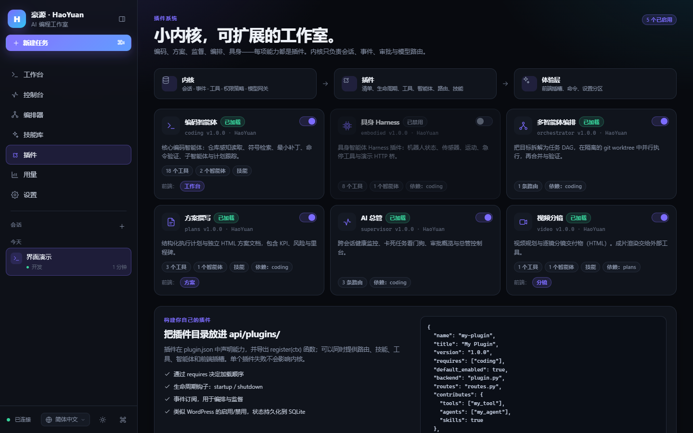
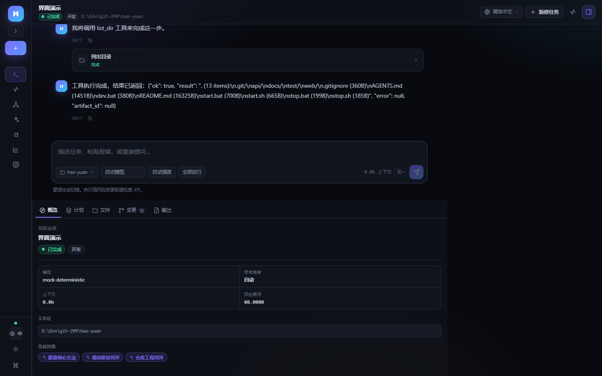

# HaoYuan · 豪源

[简体中文](../../README.md) · [繁體中文](README.zh-TW.md) · [English](README.en.md) · **日本語** · [Deutsch](README.de.md) · [한국어](README.ko.md)  
[Français](README.fr.md) · [Español](README.es.md) · [Português (Brasil)](README.pt-BR.md) · [Italiano](README.it.md) · [Polski](README.pl.md) · [すべての言語](README.md)

> 複数の AI 社員に非同期かつ並列で働くよう指示できる、パーソナル AI スタジオ。  
> 1 つのカーネル、インストール可能なプラグイン群、そして長期的タスクのための検証可能な閉ループ。

HaoYuan は、**agent-harness** をバックエンドの参照基盤として、その上に書き直されています。AI アシスタントのコーディング専門性を維持・強化しつつ、セッション、ツール、エージェント、ルーティング、スキル、監視、オーケストレーションをプラグインアーキテクチャを中心に再編成しています。フロントエンドは全面的に書き直され、「AI コラボレーション」をチャットウィンドウから、指示・観察・介入が可能なワークベンチへとアップグレードすることを目指しています。


---

## 1. コア機能

### 1.1 実用的に使えるコーディングループ

| 機能 | 実装 |
|---|---|
| リポジトリ認識 | `project_scan`, `repo_map`, シンボルインデックス, `search_symbol` |
| 正確な読み取り | `read_file`, `read_range`, 行番号指定 |
| 最小限の編集 | `apply_patch`（unified diff / SEARCH-REPLACE）、`edit_file`, `multi_edit` |
| ファイル操作 | `write_file`, `glob`, `grep`, `list_dir`, `delete_path`, `move_path` |
| コマンド検証 | `run_shell`（UTF-8、タイムアウト、構造化エラー要約）、`git` ラッパー |
| 検証ゲート | コード変更後はテスト／lint／build が必須で、「検証せずに編集する」ことを防ぎます |
| テスト修正ループ | 構造化された pytest 失敗解析 → 行の特定 → 最小限の修正 → 失敗フィンガープリントによるエスカレーション |
| サブエージェント | `task` は分離されたコンテキストで偵察し、結論のみを返すことで、メインコンテキストの汚染を回避します |
| コンテキストガバナンス | ツール結果のエージング、構造化要約、ターン内圧縮、ハードバジェットによるトリミング |
| コンテキストの事前読み込み | 要件を考慮した `repo_map` ランキングと、複雑なタスク向けの関連ソース `context_pack`（最大約30KB）により、繰り返しの全体読み取りを削減します |
| 長期的タスク | ステップバジェット、自動継続、チェックポイント、冪等な副作用レジストリ（書き込みは再適用されません） |
| 人間参加型 | 高リスクの書き込み／コマンドは diff プレビューを表示し、承認後にのみ実行します |

セッション意図の階層化：挨拶、雑談、一般的な Q&A は、ワークスペースのスキャン、ツールの起動、書き込みを行わずに直接回答されます。コーディング、ファイル変更、コマンド実行などの明示的なタスクのみがコーディングループに入ります。

### 1.2 マルチセッションの非同期並列性

- 1 セッション = バックグラウンド `asyncio.Task` 1 つ。ウィンドウの切り替え、タブの閉鎖、切断によってタスクが停止することはありません。
- グローバル同時実行ゲート + FIFO キュー。人による承認を待機している間、同時実行スロットは自動的に解放されます。
- セッションステートマシン: `idle → queued → running ⇄ waiting_input → done / error`。
- ワークベンチ上部のセッションタブバー: セッションを作成または開くと自動的にタブが追加され、クリックすると横方向に切り替わります。`×` はビューのみを閉じ、セッションは削除しません。タブは更新後も保持されます。タブを右クリックすると、現在/左/右/すべての会話を閉じられます。
- 新しいセッションの最初のメッセージには、現在の UI 言語でモデルによって短いタイトルが付けられます。古いセッションがまだデフォルトのタイトルである場合は、最初のメッセージに基づく概要が自動的に表示されます。
- 各セッションには独自の URL `/#/s/<session-id>` があり、コピー、更新、共有、またはアドレスバーからの直接切り替えが可能です。
- ページを更新すると、メッセージ、イベント、プラン、承認、アーティファクトが SQLite から復元されます。
- メインのリアルタイムイベントチャネルは SSE を使用します（再接続、カーソルベースの再開、WebSocket なしでもストリーミング）。WebSocket エンドポイントは互換性のために残されています。REST はイベントのリプレイをサポートします。

### 1.3 AI スーパーバイザーとマルチエージェントオーケストレーション

- **スーパーバイザー**: セッション横断のヘルスチェック、スタックしたタスクのアラート、自動中断、コンソールでの会話、スケジューリングアクション。
- **オーケストレーター**: 目標 → タスク DAG → 従業員ごとの独立した git worktree → 並列実行 → マージと受け入れ。
- 従業員セッションは契約ファイルと共有ブラックボードを共有します。障害が発生しても、同じレイヤーの他のタスクはブロックされません。

### 1.4 スキルライブラリ

- Markdown + front-matter で `name / title / description / kinds / triggers` を宣言します。
- タスクタイプとキーワードによって自動的にマッチングされます。スキルが多い場合は BM25 ランキングが適用されます。
- 組み込み: コア方法論、リポジトリエンジニアリングループ、デバッグループ、Web デリバリー、提案書作成。
- スキルは UI で作成、編集、削除できます。変更は保存時に反映されます。

### 1.5 プランドキュメント

- `make_plan`: KPI、セクション、表、リスク、マイルストーンを含むスタンドアロンの HTML 提案書/計画書を生成します。
- アーティファクトは `api/data/artifacts/` に登録され、ワークベンチの右側から直接プレビュー/ダウンロードできます。

### 1.6 プラグインアーキテクチャ

HaoYuan は「1 つの巨大なモノリス」ではなく、次のような構成です:

```
Kernel (sessions / events / tool registry / policy / model gateway / approvals)
        │
        ├── coding       coding agent + engineering tools + skills
        ├── plans        planning tools + Planner agent
        ├── supervisor   health checks + console routes
        ├── orchestrator task DAG + worktree + merge
        └── embodied     embodied agent harness (disabled by default, install to enable)
```

プラグインは、ツール、エージェント、HTTP ルート、スキルディレクトリ、イベント購読、ライフサイクルフック、フロントエンドのナビゲーション/コマンドメタデータを提供できます。1 つのプラグインの読み込みに失敗してもカーネルが停止することはありません。



### 1.7 11 言語、デフォルトのライトテーマ、折りたたみ可能なサイドバー

- デフォルトは**ライト（ホワイト）テーマ**です。設定ページまたはサイドバー下部からダークテーマに切り替えられます。
- デフォルトは**簡体字中国語**です。**简体中文 / 繁體中文 / English / 日本語 / Deutsch / 한국어 / Français / Español / Português (Brasil) / Italiano / Polski** の間で切り替えられます。
- 言語の切り替え入口は次の3か所に目立つ形で用意されています：ワークベンチ上部バー、サイドバー下部（全ページで利用可能）、設定 → 外観。
- 選択内容は `localStorage` に永続化され、再読み込みや再起動後も保持されます。`document.lang` とページタイトルも更新されます。
- サイドバーは76pxのアイコンレールまで折りたためます。折りたたみ後も上部に明示的な「サイドバーを展開」ボタンが残り、セッション一覧は非表示になり、展開するとすべて復元されます。
- 右側のインサイトパネルは、会話用のスペースを広く確保するためデフォルトで折りたたまれています。右上のボタンをクリックすると開き、開閉状態は保持されます。
- 組み込みスキルのタイトル/説明、プラグインのタイトル/説明、およびステータス、ボタン、ヒント、承認、プラン、使用状況、オーケストレーションに関するUIコピーは、11言語すべてで完全にカバーされています。

---

## 2. クイックスタート

### 匿名利用統計（透明性に関する通知）

HaoYuan には、オンラインデバイス数とバージョン分布を集計するための**完全に匿名**の利用ハートビートが含まれています。

- **報告されるデータ**：ローカルで生成されるランダムな `install_id`（UUID）、クライアントバージョン、OS種別（例：`Windows 11`）。ユーザー名、メールアドレス、ファイル内容、ワークスペースパス、会話内容、その他の個人データは含まれません。
- **頻度**：起動時に1回、実行中は5分ごと（軽量なPOSTリクエスト1件）。
- **完全に任意**：起動前に環境変数 `HAOYUAN_TELEMETRY=0` を設定すると完全に無効化できます。すべての機能は引き続き利用できます。
- **プライバシー保護**：サーバーはIPの一方向ハッシュのみを記録し、平文のIPは決して記録しません。データは90日間保持されます。
- **詳細な通知**：プラグインセンターのプライバシーエンドポイント `GET {plugin-center-url}/api/plugin-center/privacy`、またはソース `api/core/telemetry.py`（約100行、監査可能）を参照してください。

### 動作要件

- Python 3.10+
- Node.js 18+
- Windows / Linux / macOS

### npm インストール（推奨）

```bash
# Prerequisite: Node.js 18+ and Python 3.10+
npm install -g haoyuan

# Faster mirrors in mainland China:
npm install -g haoyuan --registry=https://registry.npmmirror.com

# Terminal chat (creates the venv and installs dependencies on first run)
haoyuan

# Start the service and open the web UI automatically
haoyuan web
```

| コマンド | 用途 |
|---|---|
| `haoyuan` | ターミナルチャット（ストリーミング出力、ツール呼び出し、承認プロンプト） |
| `haoyuan --model x/y` | 特定のモデルでチャットを開始（例：`--model deepseek/deepseek-flash`） |
| `haoyuan web` | サービスを起動し、Web UIを自動で開く |
| `haoyuan web --no-open` | ブラウザを開かずにサービスを起動 |
| `haoyuan --version` / `-V` | バージョンを表示 |
| `haoyuan config` | グローバル設定ファイル（モデルキーなど）。`--open` で直接編集できます |
| `haoyuan login` / `haoyuan logout` | アカウント保護が有効な場合にログイン / ローカルトークンをクリア |
| `haoyuan setup` | 依存関係のみをインストール |
| `haoyuan help` | ヘルプを表示 |

ターミナル内コマンド：`/models` でモデルを表示/選択（番号で選択、または `/model x/y` で直接選択）、`/new` でセッションを作成、`/web` で現在のセッションをブラウザで開く、`/cancel` で現在のタスクをキャンセル、`/exit` で終了（Ctrl+C も使用可能）。

Web UIはデフォルトで`http://127.0.0.1:8030`を使用し、ポートが使用中の場合は自動的にインクリメントします。モデルキーがなくても、組み込みの`mock`モデルはセッション、ツール呼び出し、承認、フロントエンドをエンドツーエンドで実行できます。

### Windowsワンクリック起動

```bat
start.bat
```

スクリプトは自動的に以下を実行します: ポート8030の古いプロセスを停止 → `api/env1`を作成 → Python依存関係をインストール → (`web/dist`が存在しない場合のみ) フロントエンドの依存関係をインストールしてビルド → APIを起動し、プロダクトページを開きます。npmパッケージにはビルド済みのフロントエンドが同梱されているため、イントラネット/オフライン環境でも依存関係をインストールすればすぐに起動できます。以前の`npm install`がネットワーク中断により不完全な`web/node_modules`を残した場合、スクリプトが自動的に検出して再インストールします — 手動での削除は不要です。

**ポートの自動フォールバック**: バックエンドはデフォルトで`8030`、フロントエンド開発サーバーは`8130`を使用します。ポートが使用中の場合は、バインドが成功するまで自動的にインクリメントされます (8031、8032、…)。実際のポートは`api/data/runtime.json`に書き込まれ、起動スクリプトがそれを読み取って正しいアドレスを開きます。`HAOYUAN_PORT` / `HAOYUAN_WEB_PORT` (フロントエンド) および`HAOYUAN_API_PORT` (フロントエンドプロキシターゲット) でベースポートを明示的に設定することもできます。

停止:

```bat
stop.bat
```

### デスクトップコンソール (desktop.exe)

リポジトリルートの`desktop.exe`をダブルクリックすると、グラフィカルコンソールが開きます (~20 KB、Windowsに同梱されている.NET Framework 4.xのみに依存):

- **すべて起動 / すべて停止**: バックエンドとフロントエンド開発サーバーをワンクリックで管理。起動後はプロダクトページが自動的に開きます
- **バックエンドの起動 / 停止** (デフォルト8030) および**フロントエンドの起動 / 停止** (デフォルト8130)
- **ポート設定**: バックエンド/フロントエンドのポートを直接編集。「ポートを適用して再起動」をクリックすると設定が保存され、両方のサービスが再起動します。ポートが使用中の場合でも、サービスは自動的にインクリメントされます
- **プロダクトページを開く**: `api/data/runtime.json`からバックエンドの実際のポートを開きます。フロントエンドのみが実行中の場合はフロントエンドのポートにフォールバックします
- **フロントエンドのビルド**、**プロジェクトフォルダを開く**、秒単位のサービスステータス、およびリアルタイムのランタイムログ

コンソールウィンドウを閉じてもサービスは停止しません。停止するには「すべて停止」または該当する停止ボタンをクリックしてください。ソースは`desktop/`にあり、変更後は`desktop\build.bat`を実行して再ビルドします。

### Linux / macOS

```bash
bash start.sh
bash stop.sh
```

イントラネットまたはカスタムミラー環境では、ダウンロードソースを明示的に指定してください (省略した場合は、`~/.npmrc`および`pip.conf`で既に設定されているソースが使用されます):

```bash
export HAOYUAN_NPM_REGISTRY=http://your-intranet/npm/
export HAOYUAN_PIP_INDEX_URL=http://your-intranet/pypi/simple
bash start.sh
```

Windowsの場合:

```bat
set HAOYUAN_NPM_REGISTRY=http://your-intranet/npm/
set HAOYUAN_PIP_INDEX_URL=http://your-intranet/pypi/simple
start.bat
```

フロントエンドまたはPythonの依存関係が不完全な場合 (例えば、以前のインストールが`ECONNRESET`によって中断された場合)、`start.sh` / `start.bat` / `haoyuan setup`が`web/node_modules`を自動的に検出してクリーンアップし、再インストールし、不足しているバックエンドパッケージをインストールし、ビルドが失敗した場合は既存の`web/dist`にフォールバックします。

`web/package-lock.json`は外部ミラーをハードコードしなくなりました。`web/.npmrc`内の`replace-registry-host=always`により、インストールは常に現在のnpm設定のレジストリを使用するため、ロックファイルによって到達不能な外部ミラーにインストールがハイジャックされることはありません。

### 手動起動

```bash
# Backend
cd api
python -m venv env1
env1\Scripts\activate           # Linux: source env1/bin/activate
pip install -r requirements.txt
python main.py                  # http://127.0.0.1:8030, increments automatically if in use

# Frontend dev mode (hot reload, optional)
cd web
npm install
npm run dev                     # http://localhost:8130, increments automatically if in use; /api and /ws proxy to the backend's actual port
```

本番環境では、バックエンドが `web/dist` を直接提供するため、バックエンドの実際のポートにアクセスするだけで済みます。ポートは環境変数で上書きできます: `HAOYUAN_PORT`（バックエンド、デフォルト 8030）、`HAOYUAN_WEB_PORT`（フロントエンド、デフォルト 8130）、および `HAOYUAN_API_PORT`（フロントエンドプロキシターゲット、デフォルトは `api/data/runtime.json` から）。

### モデルを設定

**グローバル設定ファイル（推奨）** — 再インストールやアップグレードの影響を受けない、ユーザーごとの固定パス:

```bash
haoyuan config          # creates the file on first run and prints its path
haoyuan config --open   # open it directly in your editor
```

パス: `~/.config/haoyuan/config.json`（Windows の場合: `C:\Users\<you>\.config\haoyuan\config.json`。`HAOYUAN_CONFIG` 環境変数で上書き可能）:

このファイルは初回起動時（または npm postinstall）に自動的に作成され、ディレクトリが存在しない場合はそのディレクトリも作成されます。

```json
{
  "PROVIDER": "",
  "MODEL": "",
  "DEEPSEEK_API_KEY": "",
  "DEEPSEEK_BASE_URL": "https://api.deepseek.com",
  "DEEPSEEK_MODEL": "deepseek-flash",
  "ZHIPU_API_KEY": "",
  "ZHIPU_BASE_URL": "https://open.bigmodel.cn/api/coding/paas/v4",
  "ZHIPU_MODEL": "glm-5.3-flash",
  "MIMO_API_KEY": "",
  "MIMO_BASE_URL": "https://token-plan-cn.xiaomimimo.com/v1",
  "MIMO_MODEL": "mimo-v2.6-flash",
  "providers": {}
}
```

- 組み込みプロバイダーの場合、`DEEPSEEK_MODELS` / `ZHIPU_MODELS` / `MIMO_MODELS`（カンマ区切り）を追加してモデル一覧を完全にカスタマイズできます。`*_THINKING_MODELS`、`*_MAX_OUTPUT`、`*_SUPPORTS_THINKING` は任意です。
- OpenAI 互換のプロバイダーは、組み込みの 3 つに限らず、`providers` オブジェクトに追加できます:

```json
{
  "providers": {
    "my-intranet": {
      "base_url": "http://llm.intranet/v1",
      "api_key": "sk-...",
      "models": ["qwen-max", "qwen-plus"],
      "default_model": "qwen-max",
      "supports_thinking": false,
      "max_output_tokens": 8192
    }
  }
}
```

- `PROVIDER` / `MODEL` はデフォルトモデルを固定できます（例: `"MODEL": "deepseek-v4-pro"` または `"MODEL": "my-intranet/qwen-max"`。空欄にすると、設定済みのキーに基づいて自動選択されます）。
- **Web 設定ページと設定ファイルの双方向同期**: 「設定 → モデル設定」でプロバイダー、モデル、デフォルトモデルを追加/編集すると、直ちにファイルへ書き戻されます。ファイルを直接編集して保存した場合、サービスは次回リクエスト時に再読み込みします（再起動は不要です）。
- 「すべてのモデルを更新」は、各プロバイダーの `/models` エンドポイントをベース URL とキーで読み取り、非チャットモデルを自動的に除外します。一部のプロバイダーが失敗した場合は、該当プロバイダーと理由が表示され、成功したプロバイダーは引き続き保存されます。

**パッケージ内設定（任意）**:

```bash
copy api\configs\secrets_example.py api\configs\secrets_local.py
```

`api/configs/secrets_local.py` を同じフィールド（Python 定数）で編集します。これはソースデプロイ向けです。グローバル npm インストールではファイルがパッケージディレクトリ内にあり、アップグレード時に削除されるため、グローバル設定を推奨します。

**環境変数**（最優先）:

```powershell
$env:DEEPSEEK_API_KEY="sk-..."
```

優先順位: 環境変数 > グローバル設定ファイル > `secrets_local.py`。グローバル設定ファイルを編集した後、再起動は不要です（サービスがホットリロードします）。ヘルスチェック `GET /api/health` の `key_source` フィールドには、キーの取得元が表示されます。

**キーが設定されていない場合、ローカルの `mock` モデルが自動的に使用され**、セッション、ツール呼び出し、承認、イベント、フロントエンドをエンドツーエンドで検証できます。

---

## 3. インターフェース

| ワークベンチ（ライト、デフォルト） | ワークベンチ（英語） |
|---|---|
|  |  |

| ワークベンチ（繁体字中国語） | ワークベンチ（ダーク） |
|---|---|
|  |  |

| スーパーバイザーコンソール | スキルライブラリ |
|---|---|
|  |  |

| 設定と言語の入口 | サイドバー折りたたみ後の展開ボタン |
|---|---|
|  |  |

モバイルの右側インサイトパネル:  


主なインタラクション:

- 画面上部のセッションタブ：クリックで会話を切り替え、`×` でタブを閉じます（セッションデータには影響しません）。右クリックで現在／左／右／すべての会話を閉じます
- 新規タスクではプリセットの質問を提示しなくなりました。入力ボックスにタスクを記述するだけで、セッションタイトルは自動的に要約されます
- アドレスバールーティング：`/#/s/<session-id>` は特定のセッションにマッピングされ、コピー、更新、新しいウィンドウでのオープンが可能です
- `Ctrl / Cmd + K`：コマンドパレット（ナビゲーション、セッション、アクション）
- `Ctrl / Cmd + N`：新しいタスク
- `Ctrl / Cmd + B`：サイドバーの折りたたみ／展開
- `Enter`：送信、`Shift + Enter`：改行（`Ctrl / Cmd + Enter` でも送信されます）
- 承認カード：`A` で承認、`R` で拒否
- 言語切り替え：ワークベンチの右上、任意のページのサイドバー下部、および設定 → 外観
- セッションの実行中に入力した内容は、タスクを中断することなく「追加指示」として現在の実行にマージされます
- 右パネルはデフォルトで折りたたまれています。右上のボタンをクリックすると、概要／計画／ファイル／変更／アーティファクトが開き、ドラッグでサイズを変更できます
- ファイルと差分は大きなプレビューオーバーレイを使用するため、狭いカラムでコードを読む必要はありません

---

## 4. アーキテクチャ

```text
hao-yuan/
├── api/
│   ├── main.py                    FastAPI entry (extension routes + plugin routes + static frontend)
│   ├── configs/                   Configuration, model registry, secrets
│   ├── core/
│   │   ├── contracts.py           Tool / Agent / Policy / ToolContext
│   │   ├── storage.py             SQLite (WAL) storage layer
│   │   ├── events.py              Event bus (broadcast + batched persistence + replay)
│   │   ├── gateway.py             Model gateway (streaming + degradation + fallback)
│   │   ├── context.py             Context compression / aging / hard budget
│   │   ├── runtime.py             Agent main loop
│   │   ├── session_manager.py     Concurrency gate / queue / approvals / resume
│   │   ├── policy.py              Permission gate
│   │   ├── tools.py               Tool registry and execution
│   │   ├── agents.py              Agent registry
│   │   └── plugin.py              Plugin discovery / dependencies / lifecycle
│   ├── harness/                   Sandbox / skills / symbol index / fix loop / supervision / orchestration / embodied
│   ├── tools/                     builtin / dev / plan
│   ├── adapters/providers/        deepseek / mimo / mock
│   ├── plugins/                   coding / plans / supervisor / orchestrator / embodied
│   ├── extensions/                System / sessions / skills / settings / files / usage / plugins / approvals / real-time events (SSE / WebSocket)
│   ├── skills/                    Core skills
│   ├── tests/                     90 backend tests
│   └── data/                      Runtime data (gitignored)
├── web/                           Vue 3 + Vite
├── docs/screenshots/              UI screenshots
├── start.bat / stop.bat
├── start.sh / stop.sh
├── dev.bat
├── desktop.exe                    Graphical desktop console (start/stop services / open the web UI)
└── desktop/                       desktop.exe source and build scripts
```

### データと境界

- データベース：`api/data/haoyuan.db`（WAL）
- アーティファクト：`api/data/artifacts/<session_id>/`
- ランタイムポート：`api/data/runtime.json`（バックエンドは `api_port`、フロントエンドは `web_port`、デスクトップコンソールは `api_port_config` / `web_port_config` を書き込みます）
- すべてのファイルツールはセッションワークスペースの許可リストによって制約され、`../` と絶対パスによるエスケープを拒否します。
- 高リスクツール（ファイル書き込み、パッチ、削除、移動、シェル、git、ロボット動作）には承認が必要です。
- `run_shell` は壊滅的なコマンド（`rm -rf /`、ディスクフォーマット、シャットダウンなど）を強制的にブロックします。
- アーティファクト HTML はサンドボックス CSP 付きのエンドポイントを通じてプレビューされ、モデル生成ページがローカルの認証情報を読み取ることを防ぎます。
- シークレットは環境変数または `secrets_local.py` からのみ読み取られ、データベースに保存されたり、平文で返されたりすることはありません。
- 実際のキーは `api/configs/secrets_local.py` にあり、これは `.gitignore` によって無視されます。`git add --dry-run` は、それらがリポジトリに混入しないことを検証します。

---

## 5. プラグイン開発

`api/plugins/` の下にディレクトリを作成します：

```
api/plugins/my-plugin/
├── plugin.json
├── plugin.py
├── routes.py        # optional
└── skills/          # optional
    └── my-skill.md
```

`plugin.json`：

```json
{
  "name": "my-plugin",
  "title": "My Plugin",
  "version": "1.0.0",
  "description": "What this plugin adds",
  "author": "you",
  "requires": ["coding"],
  "default_enabled": true,
  "backend": "plugin.py",
  "routes": "routes.py",
  "contributes": {
    "tools": ["my_tool"],
    "agents": ["my_agent"],
    "skills": true
  },
  "frontend": {
    "nav": [{ "label": "My Plugin", "path": "/my-plugin", "icon": "puzzle" }],
    "commands": [{ "id": "my-plugin.run", "title": "Run my plugin" }]
  }
}
```

`plugin.py`：

```python
from core.contracts import AgentSpec, ToolSpec


async def my_tool(ctx, args):
    return {"echo": args.get("text", "")}


def register(ctx):
    ctx.register_tool(
        ToolSpec(
            name="my_tool",
            description="Echo text",
            input_schema={
                "type": "object",
                "properties": {"text": {"type": "string"}},
                "required": ["text"],
            },
        ),
        my_tool,
    )
    ctx.register_agent(
        AgentSpec(
            name="my_agent",
            title="My Agent",
            instructions="You are ...",
            tools=["my_tool"],
            kind="dev",
        )
    )
    ctx.add_skill_dir("skills")


async def startup(ctx):
    ...


async def shutdown(ctx):
    ...
```

プラグインの機能：

- `requires` は依存関係の順序を制御します。不足している依存関係は分離され、エラーが記録されます。
- `startup / shutdown` のライフサイクルフック。
- `ctx.events.subscribe(sink)` はグローバルイベントを購読します（オーケストレーターが従業員の完了イベントを受信するのはこの仕組みです）。
- 有効／無効の状態は SQLite に永続化されます。切り替え後、ルートをロード／アンロードするには API を再起動してください。
- フロントエンドは `/api/plugins` を介して `contributes` および `frontend` のメタデータを取得します。

### この設計の理由

WordPressの「小さなカーネル + インストール可能なプラグイン」を借用している。カーネルはセッション、イベント、ポリシー、モデル、ツールプロトコルのみを処理し、すべてのビジネス機能はプラグインに存在する。  
また、「ハーネス自体がプラグイン可能」という DeepSeek Harness の考え方も採用している。身体化エージェントは独立したハーネスプラグインにすぎないため、ローバー、ロボットアーム、ヒューマノイドロボットなどのハーネスをカーネルに触れることなく追加し続けることができる。

---

## 6. セルフテスト結果

以下は納品環境で実行された：

```bash
cd api
python -m pytest -q
# 90 passed, 2 skipped, 2 warnings

cd ../web
npm run build
# ✓ built, 97 modules transformed
```

テストカバレッジ：

- ヘルスチェック、モデル、スキル、プラグイン、承認一覧
- モックモデルによる完全なセッション（メッセージ → イベント → 完了）
- コーディングセッション：ファイル書き込み → ツールイベント → アーティファクト → ワークスペースツリー読み取り
- 人間による承認フロー：保留 → 承認 → ツール実行 → ファイルのディスク書き込み
- セッションの名前変更 / 非表示 / 復元 / クリア / 完全削除
- グローバルゲートとデフォルトワークスペース設定、使用状況、CSVエクスポート
- プラグインの有効状態の永続化
- オーケストレータのgit worktreeのエンドツーエンド（作成 → ディスパッチ → 完了 → マージ）
- ツールレベル：サンドボックスエスケープ、read/write/edit/patch/multi_edit、glob/grep/symbols、shell、delete/move
- 危険なシェルコマンドのハードブロック
- シンボルインデックス、リポマップ、pytest解析、修正ガイダンス
- プランHTMLアーティファクトの生成
- 意図ルーティング：挨拶、雑談、一般的なQ&A（「元気ですか」「今日はいい天気ですね」「依存性注入とは何か」など）は、ワークスペースのスキャン、ツールの起動、書き込みを行わずに直接回答される（実際のdeepseek-flashによる検証を含む）
- 最初のメッセージからのセッションタイトル自動生成（UI言語に従う。モックはフォールバックと実モデル検証をカバー）
- 独立セッションルーティング：`/#/s/<session-id>` ディープリンク、タブ切り替え、アドレスバー編集、リフレッシュ復元、クローズ時のフォールバック
- セッションタブの右クリック：現在 / 左 / 右 / すべてを閉じる。一括クローズ後は最も近いタブに自動切り替え
- プロバイダーモデルのリフレッシュ：失敗詳細と非チャットモデルのフィルタリング

さらに、Playwright + ローカルChromeを使用して本番ビルドの実ブラウザ検査が行われた：

- ワークベンチ / コンソール / スキル / プラグイン / 設定 / 使用状況 / オーケストレーションの各ページがすべて読み込まれる
- 上部のセッションタブと独立ルーティング: 開く、切り替え、閉じる、右クリックによる一括閉じ、アドレスバーのディープリンク、更新後の復元
- デフォルトタイトルの要約、右上の言語メニュー（11言語切り替え）、プリセット質問のない空状態
- 簡体字中国語、繁体字中国語、英語、日本語、ドイツ語、韓国語、フランス語、スペイン語、ブラジルポルトガル語、イタリア語、ポーランド語の切り替えが機能し、更新後も言語が保持される
- 言語のエントリーポイントは、ワークベンチ上部バー、サイドバー下部、設定ページをカバーする
- サイドバーの 286px と 76px の間の折りたたみ/展開が機能し、折りたたみ後はセッションリストが非表示になり、展開ボタンが表示される
- 右側のインサイトパネルはデフォルトで折りたたまれ、その展開/折りたたみ状態が保持される
- `Enter` で送信され、`Shift + Enter` で改行が挿入される。IME 変換中に誤って送信されることはない
- ダーク / ライトテーマが機能する
- 430px のモバイルレイアウト、サイドバードロワー、右インサイトドロワーが機能する
- SSE リアルタイムストリーム: `done` より前に、実際の DeepSeek の推論とコンテンツデルタが表示される
- コンソールに JS エラー、404 リソース、WebSocket 404 がない（メインのリアルタイムチャネルは現在 SSE）

> AI アシスタントが参照する DeepSeek キーを使用して、実際のオンライン検証が完了した: `deepseek-flash` は `OK` を返し、使用量の provider/model = `deepseek/deepseek-flash`。キーは `api/configs/secrets_local.py` にのみ保存され、`.gitignore` によって無視される。リポジトリには `secrets_example.py` テンプレートのみがコミットされる。モック回帰テストは残っているため、オフライン時またはキーがない場合はシステムが自動的に縮退する。

---

## 7. Harness 公平ベンチマーク結果

> 最新レポート: `test/testing/index-2026-10-27.html` (2026-10-27, mimo-v2.6-flash)  
> 過去レポート: `test/testing/index-2026-10-25.html` (2026-10-25, deepseek-flash)

### 7.1 MiMo 公平ベンチマーク（最新）

**方法**: 5 つの自動採点可能なタスク（1 つの基本適応 + ローカライゼーション / パフォーマンス / ロングホライズン / 並行性をカバーする 4 つ）× 3 ツール。統一された `mimo-v2.6-flash`、プロンプト、シードリポジトリ、予算。隠しテストは実行後に注入され、`tests/` と `pyproject.toml` は SHA-256 で検証される — 改ざんは 0 点。t1/d1/d3 は official-r1 のインターリーブバッチを使用し、d4/d6 はコード凍結後の独立再実行バッチを使用する。

| 順位 | ツール | 総合（製品重み付け） | 正確性 | 速度 | コスト | エンジニアリング規律 | 均等重み |
|---|---|---|---|---|---|---|---|
| 1 | **HaoYuan** | **98.8** | 100.0 | 94.4 | 96.9 | 100.0 | **98.3（1位）** |
| 2 | OpenCode | 90.5 | 100.0 | 67.8 | 53.5 | 100.0 | 84.3（2位） |
| 3 | Claude Code | 88.9 | 100.0 | 65.1 | 40.9 | 100.0 | 81.2（3位） |

総合 = 0.65 × 正確性 + 0.15 × 速度 + 0.10 × コスト + 0.10 × エンジニアリング規律。均等重みの式では 0.40 / 0.20 / 0.20 / 0.20 を使用する。

- 3つとも正解率100%。HaoYuanは**98.8**の製品重み付けスコアと**98.3**の等重みスコアを記録し、両方の計算式で1位。
- タスク別: HaoYuanはt1（63.8秒）、d3（220.6秒）、d4（469.6秒）で最速。OpenCodeはd1（111.3秒）で勝利し、Claude Codeはd6（254.5秒）で勝利。
- コスト: 5タスクの総コストはHaoYuanが**$3.33**、OpenCodeが$6.56、Claude Codeが$9.04。タスクあたりのコストは$0.666 / $1.313 / $1.809。
- 適応的強度: 簡単なタスクであるt1は、プランやサブエージェントを起動せずに63.8秒・11回の呼び出しで完了。長期的なd4タスクでは、事前に読み込んだ関連ソースを使用して繰り返しの探索を削減（1200秒のタイムアウトから469.6秒に短縮）。
- 主な修正: MiMoプロバイダーの完成（以前は`resolve("mimo", ...)`が暗黙的にdeepseekにフォールバックしていた）、要件認識リポジトリマップ、複雑なタスク向け30KBコンテキストパック、プロセスツリーの回収、厳格なプロバイダー + 呼び出しごとの制限 + 同一モデルでのリトライ、簡単なタスク向けの軽量ルーティング。
- 制限事項: 正式な比較はタスクごとに1ラウンド。d4/d6は独立した再実行バッチ。モデルのレイテンシ分散は大きい（Claudeのd3は以前623秒、今回は884秒）。d5は識別力に欠けるためランキング対象外。タスクは自作であり、SWE-benchなどの公開ベンチマークの代替にはならない。

再現:

```bash
cd test/bench
python harness_bench.py run --batch official-r1 --tools haoyuan,claude,opencode --tasks t1_multisite_bugfix,d1_needle_regress,d3_perf_cliff --resume
python harness_bench.py run --batch official-r1 --tools haoyuan,claude,opencode --tasks d4_multilayer_feature,d6_concurrency_fix --resume
python make_report_mimo_final.py
```

### 7.2 deepseek-flash 詳細ベンチマーク（履歴）

**方法**: 8つの自動採点可能なコーディングタスク（基本5 + 難関3）× タスクごとに3ラウンド × 3ツール。統一されたdeepseek-flash、プロンプト、シードリポジトリ、予算。隠しテストは実行後に注入され、`tests/`と`pyproject.toml`はSHA-256で検証される — 改ざんは0点。

| 順位 | ツール | 総合スコア（製品重み付け） | 正解率 | 典型速度 | テールレイテンシ | コスト | 等重みスコア |
|---|---|---|---|---|---|---|---|
| 1 | **HaoYuan** | **96.6** | 100.0 | 100.0（中央値30.3秒） | 67.6（P90 159.4秒） | 82.2（$0.364） | 95.0（2位） |
| 2 | OpenCode | 95.1 | 100.0 | 67.6（中央値44.8秒） | 100.0（P90 107.7秒） | 100.0（$0.299） | 96.8（1位） |
| 3 | Claude Code | 90.7 | 100.0 | 70.6（中央値42.9秒） | 90.7（P90 118.7秒） | 55.4（$0.540） | 91.7（3位） |

総合 = 0.70 × 正解率 + 0.15 × 典型速度 + 0.05 × テールレイテンシ + 0.10 × コスト。等重みの計算式では、最後の2つの重みが0.10 / 0.10に変更される。

- 3つすべてが正解率100%を記録し、差異は速度、テールレイテンシ、トークンコストに集中した。HaoYuanは製品加重で1位、OpenCodeは等加重でそれを上回った。
- HaoYuanは中央値タスク時間が最短の30.3秒で、4タスク（T1/T2/T3/H1）の中央値でも最速だった。全24回の実行は100%完了した。OpenCodeはテールレイテンシとタスクあたりコストが最良で、Claude Codeはトークンコストが最高だった。
- 弱点：H2バージョン移行は中央値159.4秒（OpenCode：101.1秒）、H3は260秒のロングテールだった。今後の作業で移行監査と自己テストのラウンドをさらに圧縮する。
- 制限：deepseek-flashのみ、タスクあたり3ラウンドのみを対象とする。タスクは自作であり、SWE-benchなどの公開ベンチマークの代替にはならない。
- 自己反復：評価中にWindowsパイプ適応、空返信/無書き込み保護、移行受け入れ監査、軽量git diff監査、完了順序を修正した。「過剰テスト」の負の最適化1件はロールバックした。

再現：

```bash
cd test/bench
python harness_bench.py run --batch final-r1 --tools haoyuan,claude,opencode --tasks all
python aggregate.py
python make_report.py
```

---

## 8. AIアシスタントとの機能パリティ

| 機能 | HaoYuan | 備考 |
|---|---|---|
| コーディングツールチェーン | ✅ | ローカライズ、最小パッチ、検証、修正ループ、サブエージェント |
| コンテキスト圧縮 / ロングホライズン | ✅ | ターン内圧縮、エイジング、ハードバジェット、チェックポイント、冪等リジューム |
| マルチセッション並列性 | ✅ | 並行ゲート、FIFO、フロントエンドから切り離されたバックグラウンドタスク |
| 権限ゲート / diff承認 | ✅ | 承認カード、プレビュー、タイムアウト、並行スロットの譲渡 |
| スキルライブラリ | ✅ | front-matter + ルール/BM25 + UI編集 |
| プランドキュメント | ✅ | スタンドアロンHTML成果物 |
| AIスーパーバイザー | ✅ | スナップショット、アラート、コンソール会話、スケジューリングアクション |
| マルチエージェントオーケストレーション | ✅ | タスクDAG + git worktree + マージメトリクス |
| トークン / コスト統計 | ✅ | 日次集計、モデル別、CSVエクスポート |
| プラグイン機構 | ✅ 強化 | マニフェスト、依存関係、ライフサイクル、tools/agents/routes/skills/frontendメタデータ |
| Feishuリモートコマンド | ⏳ 今回のリリースには含まれない | インターフェース層は分離されており、プラグインとして追加可能 |
| ASR / TTS / 動画レンダリング | ⏳ 今回のリリースには含まれない | 現在の焦点はコアAIコーディングループ |
| 権威あるベンチマーク | ⏳ 公開ベンチマークは未実行 | 自作ベンチマークは完了：5タスクのMiMo公平ベンチマークと8タスクのdeepseek詳細ベンチマーク（セクション7参照）。SWE-benchなどの公開ベンチマークは再実行していない |

---

## 9. ロードマップ（アーキテクチャはすでに予約済み）

### 9.1 16GB VRAMでのローカルトレーニング用スキルライブラリ

組み込み予定：

- Qwen3.5-0.8B向けのSFTデータ構築とトレーニングスクリプト
- RL（選好最適化 / 検証可能な報酬）トレーニングスクリプト
- メモリフレンドリーな構成：LoRA / QLoRA、勾配蓄積、小バッチ、シーケンス長制御
- 「スキル」ごとに整理：データテンプレート、トレーニング設定、評価ケース、デプロイメントノート

HaoYuanの現在のSkill機構はすでにファイルベースでバージョン管理可能なため、トレーニング方法論のドキュメントは後でSkillとしてエージェントに注入できる。

### 9.2 プラグインベースの具現化ハーネス

`plugins/embodied` はすでに示している：

- ロボットの状態 / センサー / 移動 / ステアリング / 緊急停止ツール
- 高リスクアクションの承認
- HTTP デモブリッジ

カーネルを変更せずに、後から以下を追加できます:

- `embodied-ros2` (ROS2 トピック / サービス)
- `embodied-serial` (Arduino / ESP32)
- `embodied-smolvla` (視覚言語アクションモデル)
- ローバー、ロボットアーム、ヒューマノイドロボット向けのハーネスプラグイン

---

## 10. API 概要

統一プレフィックス `/api`、レスポンス形式 `{ code, data, message }`。

| グループ | 主要エンドポイント |
|---|---|
| システム | `GET /health`、`GET /info`、`GET /models`、`GET /agents`、`GET /tools` |
| セッション | `POST /sessions`、`GET /sessions`、`GET /sessions/{id}`、`PATCH /sessions/{id}` |
| メッセージ | `POST /sessions/{id}/messages`、`GET /sessions/{id}/messages` |
| イベント | `GET /sessions/{id}/events?after_id=`、`GET /sessions/{id}/stream`、`WS /ws` |
| 承認 | `GET /approvals`、`POST /approvals/{id}/resolve`、`POST /sessions/{id}/confirm` |
| スキル | `GET/POST /skills`、`GET/PUT/DELETE /skills/{name}` |
| ファイル | `GET /workspace/tree`、`GET /workspace/file`、`GET /workspace/changes`、`GET /workspace/diff` |
| 設定 | `GET/PUT /settings`、`PUT /settings/gate`、`PUT /settings/workspace` |
| 使用状況 | `GET /usage/today`、`GET /usage/daily`、`GET /usage/by-model`、`GET /usage/export.csv` |
| プラグイン | `GET /plugins`、`POST /plugins/{name}/toggle` |
| スーパーバイザー | `GET /supervisor/overview`、`GET /supervisor/console`、`POST /supervisor/act`、`POST /supervisor/chat` |
| オーケストレーション | `POST /orchestrations`、`GET /orchestrations`、`GET /orchestrations/{id}` |

インタラクティブドキュメント: <http://127.0.0.1:8030/docs> (ポートをインクリメントした後は、バックエンドログまたは `api/data/runtime.json` を使用してください)。

---

## 11. 開発とテスト

```bash
cd api
python -m pytest -q

cd ../web
npm run build
npm run dev        # dev mode; /api and /ws proxy to the backend's actual port automatically
```

チームの lint / test / build コマンドを `AGENTS.md` に記録することを推奨します。HaoYuan はプロジェクトメモリを自動的にコンテキストへ注入します。

---

## ライセンス

このプロジェクトは MIT License の下で公開されており、自由に使用、変更、配布できます。
