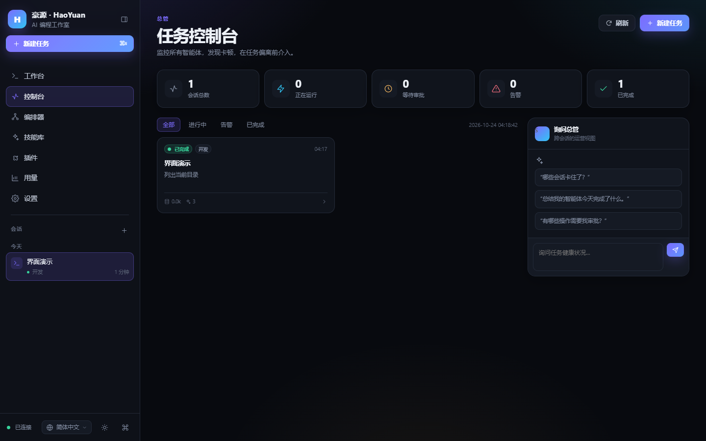

# HaoYuan · 豪源

[简体中文](../../README.md) · [繁體中文](README.zh-TW.md) · [English](README.en.md) · [日本語](README.ja.md) · [Deutsch](README.de.md) · **한국어**  
[Français](README.fr.md) · [Español](README.es.md) · [Português (Brasil)](README.pt-BR.md) · [Italiano](README.it.md) · [Polski](README.pl.md) · [모든 언어](README.md)

> 여러 AI 직원을 비동기적으로 병렬 작업하도록 지시하는 개인 AI 스튜디오입니다.  
> 하나의 커널, 설치 가능한 플러그인 세트, 그리고 장기 작업을 위한 검증 가능한 폐쇄 루프.

HaoYuan은 **agent-harness**를 백엔드 참조 기반으로 하여 그 위에 재작성되었습니다. AI 어시스턴트의 코딩 전문성을 보존하고 강화하는 동시에 세션, 도구, 에이전트, 라우팅, 스킬, 감독, 오케스트레이션을 플러그인 아키텍처 중심으로 재구성합니다. 프런트엔드는 완전히 재작성되었으며, "AI 협업"을 채팅 창에서 지시하고 관찰하며 개입할 수 있는 워크벤치로 업그레이드하는 것을 목표로 합니다.


---

## 1. 핵심 기능

### 1.1 실제로 사용 가능한 코딩 루프

| 기능 | 구현 |
|---|---|
| 저장소 인식 | `project_scan`, `repo_map`, 심볼 인덱스, `search_symbol` |
| 정밀 읽기 | `read_file`, `read_range`, 줄 번호 지정 |
| 최소 편집 | `apply_patch` (unified diff / SEARCH-REPLACE), `edit_file`, `multi_edit` |
| 파일 작업 | `write_file`, `glob`, `grep`, `list_dir`, `delete_path`, `move_path` |
| 명령 검증 | `run_shell` (UTF-8, 타임아웃, 구조화된 오류 요약), `git` 래퍼 |
| 검증 게이트 | 코드 변경 후 테스트/lint/build는 필수이며, "검증 없는 편집"을 방지합니다 |
| 테스트-수정 루프 | 구조화된 pytest 실패 파싱 → 줄 위치 특정 → 최소 수정 → 실패 지문(fingerprint) 에스컬레이션 |
| 서브 에이전트 | `task`는 격리된 컨텍스트에서 탐색하고 결론만 반환하여 메인 컨텍스트 오염을 방지합니다 |
| 컨텍스트 거버넌스 | 도구 결과 에이징, 구조화된 요약, 턴 내 압축, 하드 예산 트리밍 |
| 컨텍스트 사전 로딩 | 요구사항 인식 `repo_map` 랭킹과 복잡한 작업을 위한 관련 소스 `context_pack`(최대 ~30KB)를 더해 반복적인 전체 읽기를 줄입니다 |
| 장기 작업 | 단계 예산, 자동 계속, 체크포인트, 멱등 부수 효과 레지스트리(쓰기 재적용 없음) |

### 1.2 여러 세션 비동기 병렬 실행

- 세션 하나 = 백그라운드 `asyncio.Task` 하나; 창 전환, 탭 닫기, 연결 해제는 작업을 중단하지 않습니다.
- 전역 동시성 게이트 + FIFO 큐; 사람의 승인을 기다리는 동안 동시성 슬롯은 자동으로 양보됩니다.
- 세션 상태 머신: `idle → queued → running ⇄ waiting_input → done / error`.
- 워크벤치 상단의 세션 탭 바: 세션을 만들거나 열면 탭이 자동으로 추가됩니다; 클릭하여 가로로 전환합니다; `×`는 세션을 삭제하지 않고 보기만 닫으며, 새로 고침 후에도 탭이 유지됩니다; 탭을 마우스 오른쪽 버튼으로 클릭하면 현재 / 왼쪽 / 오른쪽 / 모든 대화를 닫습니다.
- 모델은 새 세션의 첫 메시지에 현재 UI 언어로 짧은 제목을 부여합니다; 기존 세션에 여전히 기본 제목이 있으면 첫 메시지를 기반으로 한 요약이 자동으로 표시됩니다.
- 각 세션에는 고유한 URL `/#/s/<session-id>`가 있으며, 주소 표시줄에서 직접 복사, 새로 고침, 공유하거나 전환할 수 있습니다.
- 페이지를 새로 고친 후 메시지, 이벤트, 계획, 승인, 아티팩트는 SQLite에서 복원됩니다.
- 기본 실시간 이벤트 채널은 SSE를 사용합니다(재연결, 커서 기반 재개, WebSocket 없이도 스트리밍); WebSocket 엔드포인트는 호환성을 위해 유지됩니다; REST는 이벤트 재생을 지원합니다.

### 1.3 AI 슈퍼바이저 및 멀티 에이전트 오케스트레이션

- **슈퍼바이저**: 세션 간 상태 점검, 정체된 작업 알림, 자동 중단, 콘솔 대화, 스케줄링 작업.
- **오케스트레이터**: 목표 → 작업 DAG → 직원별 독립 git worktree → 병렬 실행 → 병합 및 인수.
- 직원 세션은 계약 파일과 공유 블랙보드를 공유합니다; 하나의 실패가 동일 계층의 다른 작업을 차단하지 않습니다.

### 1.4 스킬 라이브러리

- Markdown + `name / title / description / kinds / triggers`를 선언하는 front-matter.
- 작업 유형과 키워드로 자동 매칭됩니다; 스킬이 많으면 BM25 랭킹이 적용됩니다.
- 내장: 핵심 방법론, 저장소 엔지니어링 루프, 디버그 루프, 웹 전달, 제안서 작성.
- UI에서 스킬을 생성, 편집, 삭제할 수 있습니다; 변경 사항은 저장 시 적용됩니다.

### 1.5 계획 문서

- `make_plan`: KPI, 섹션, 표, 위험, 마일스톤을 포함한 독립형 HTML 제안서/계획서를 생성합니다.
- 아티팩트는 `api/data/artifacts/` 아래에 등록되며 워크벤치 오른쪽에서 바로 미리 보기/다운로드할 수 있습니다.

### 1.6 플러그인 아키텍처

HaoYuan은 '하나의 거대한 모놀리스'가 아니라 다음과 같습니다:

```
Kernel (sessions / events / tool registry / policy / model gateway / approvals)
        │
        ├── coding       coding agent + engineering tools + skills
        ├── plans        planning tools + Planner agent
        ├── supervisor   health checks + console routes
        ├── orchestrator task DAG + worktree + merge
        └── embodied     embodied agent harness (disabled by default, install to enable)
```

플러그인은 다음을 제공할 수 있습니다: 도구, 에이전트, HTTP 라우트, 스킬 디렉터리, 이벤트 구독, 라이프사이클 훅, 프런트엔드 탐색/명령 메타데이터. 단일 플러그인의 로드 실패가 커널을 중단시키지는 않습니다.


### 1.7 11개 언어, 기본 라이트 모드, 접을 수 있는 사이드바

- 기본값은 **라이트(흰색) 테마**입니다. 설정 페이지 또는 사이드바 하단에서 다크 테마로 전환할 수 있습니다.
- 기본 언어는 **중국어 간체**이며, **简体中文 / 繁體中文 / English / 日本語 / Deutsch / 한국어 / Français / Español / Português (Brasil) / Italiano / Polski** 중에서 전환할 수 있습니다.
- 언어 전환 진입점은 눈에 잘 띄는 세 곳에 있습니다: 워크벤치 상단 바, 사이드바 하단(모든 페이지에서 사용 가능), 설정 → 모양.
- 선택한 설정은 `localStorage`에 저장되어 새로고침과 재시작 후에도 유지되며, `document.lang`와 페이지 제목도 함께 업데이트됩니다.
- 사이드바는 76px 아이콘 레일로 접을 수 있습니다. 접은 후에도 상단에는 "사이드바 확장" 버튼이 그대로 남아 있고, 세션 목록은 숨겨지며, 다시 확장하면 모든 것이 복원됩니다.
- 오른쪽 인사이트 패널은 대화를 위한 공간을 더 확보하기 위해 기본적으로 접혀 있습니다. 오른쪽 상단 버튼을 클릭하면 열리며, 이 선택은 유지됩니다.
- 내장 스킬의 제목/설명, 플러그인의 제목/설명, 그리고 상태, 버튼, 팁, 승인, 계획, 사용량 및 오케스트레이션에 대한 UI 문구는 11개 언어 모두에서 완전히 지원됩니다.

---

## 2. 빠른 시작

### 익명 사용 통계(투명성 고지)

HaoYuan에는 온라인 기기 수와 버전 분포를 집계하기 위한 **완전히 익명**의 사용 하트비트가 포함되어 있습니다:

- **보고되는 데이터**: 로컬에서 생성된 무작위 `install_id` (UUID), 클라이언트 버전, OS 유형(예: `Windows 11`). 여기에는 사용자 이름, 이메일, 파일 내용, 워크스페이스 경로, 대화 내용 또는 기타 개인 데이터가 포함되지 않습니다.
- **빈도**: 시작 시 1회, 실행 중에는 5분마다(가벼운 POST 요청 1회).
- **완전 선택 사항**: 시작 전에 환경 변수 `HAOYUAN_TELEMETRY=0`를 설정하면 영구적으로 비활성화할 수 있으며, 모든 기능은 그대로 유지됩니다.
- **개인정보 보호**: 서버는 IP의 단방향 해시만 기록하며 평문 IP는 절대 기록하지 않습니다. 데이터는 90일 동안 보관됩니다.
- **전체 고지**: 플러그인 센터 개인정보 엔드포인트 `GET {plugin-center-url}/api/plugin-center/privacy` 또는 소스 `api/core/telemetry.py`(약 100줄, 감사 가능)를 참조하세요.

### 요구 사항

- Python 3.10+
- Node.js 18+
- Windows / Linux / macOS

### npm install (권장)

```bash
# Prerequisite: Node.js 18+ and Python 3.10+
npm install -g haoyuan

# Faster mirrors in mainland China:
npm install -g haoyuan --registry=https://registry.npmmirror.com

# Terminal chat (creates the venv and installs dependencies on first run)
haoyuan

# Start the service and open the web UI automatically
haoyuan web
```

| 명령 | 용도 |
|---|---|
| `haoyuan` | 터미널 채팅(스트리밍 출력, 도구 호출, 승인 프롬프트) |
| `haoyuan --model x/y` | 특정 모델로 채팅 시작(예: `--model deepseek/deepseek-flash`) |
| `haoyuan web` | 서비스를 시작하고 웹 UI를 자동으로 엽니다 |
| `haoyuan web --no-open` | 브라우저를 열지 않고 서비스를 시작합니다 |
| `haoyuan --version` / `-V` | 버전 표시 |
| `haoyuan config` | 전역 구성 파일(모델 키 등). `--open`를 사용하여 직접 편집합니다 |
| `haoyuan login` / `haoyuan logout` | 계정 보호가 활성화된 경우 로그인 / 로컬 토큰 지우기 |
| `haoyuan setup` | 의존성만 설치 |
| `haoyuan help` | 도움말 표시 |

터미널 내 명령: `/models`로 모델을 보거나 선택하고(번호로 선택하거나 `/model x/y`로 직접 선택), `/new`로 세션을 생성하고, `/web`로 현재 세션을 브라우저에서 열고, `/cancel`로 현재 작업을 취소하고, `/exit`로 종료합니다(Ctrl+C도 작동합니다).

웹 UI는 기본적으로 `http://127.0.0.1:8030`를 사용하며, 해당 포트가 사용 중이면 자동으로 포트를 증가시킵니다. 모델 키가 없어도 내장된 `mock` 모델로 세션, 도구 호출, 승인, 프런트엔드까지 엔드 투 엔드로 실행됩니다.

### Windows 원클릭 시작

```bat
start.bat
```

스크립트는 자동으로 다음을 수행합니다: 8030 포트의 이전 프로세스 중지 → `api/env1` 생성 → Python 의존성 설치 → (`web/dist`가 없을 때만) 프런트엔드 의존성 설치 및 빌드 → API 시작 및 제품 페이지 열기. npm 패키지에는 이미 빌드된 프런트엔드가 포함되어 있으므로, 인트라넷/오프라인 환경에서도 의존성만 설치되면 바로 시작할 수 있습니다. 이전 `npm install`가 네트워크 중단으로 인해 불완전한 `web/node_modules`를 남긴 경우, 스크립트가 이를 감지해 자동으로 재설치하므로 수동으로 삭제할 필요가 없습니다.

**자동 포트 폴백**: 백엔드는 기본적으로 `8030`를, 프런트엔드 개발 서버는 `8130`를 사용하며, 포트가 사용 중이면 바인딩에 성공할 때까지 자동으로 증가합니다(8031, 8032, …). 실제 포트는 `api/data/runtime.json`에 기록되며, 시작 스크립트가 이를 읽어 올바른 주소를 엽니다. `HAOYUAN_PORT` / `HAOYUAN_WEB_PORT`(프런트엔드)와 `HAOYUAN_API_PORT`(프런트엔드 프록시 대상)로 기준 포트를 명시적으로 설정할 수도 있습니다.

중지:

```bat
stop.bat
```

### 데스크톱 콘솔(desktop.exe)

저장소 루트의 `desktop.exe`를 더블 클릭하면 그래픽 콘솔이 열립니다(약 20KB, Windows에 기본 포함된 .NET Framework 4.x에만 의존):

- **모두 시작 / 모두 중지**: 백엔드와 프런트엔드 개발 서버를 한 번의 클릭으로 관리하며, 시작 후 제품 페이지가 자동으로 열립니다
- **백엔드 시작 / 중지**(기본 8030) 및 **프런트엔드 시작 / 중지**(기본 8130)
- **포트 설정**: 백엔드/프런트엔드 포트를 직접 편집하고, "포트 적용 및 재시작"을 클릭하면 구성이 저장되고 두 서비스가 재시작됩니다. 포트가 점유되어 있으면 서비스는 여전히 자동으로 증가합니다
- **제품 페이지 열기**: `api/data/runtime.json`에서 백엔드의 실제 포트를 열며, 프런트엔드만 실행 중일 때는 프런트엔드 포트로 대체됩니다
- **프런트엔드 빌드**, **프로젝트 폴더 열기**, 초 단위 서비스 상태, 실시간 런타임 로그

콘솔 창을 닫아도 서비스는 중지되지 않습니다. 중지하려면 "모두 중지" 또는 해당 중지 버튼을 클릭하세요. 소스는 `desktop/`에 있으며, 변경 후 `desktop\build.bat`를 실행해 다시 빌드하세요.

### Linux / macOS

```bash
bash start.sh
bash stop.sh
```

인트라넷 또는 사용자 지정 미러 환경에서는 다운로드 소스를 명시적으로 지정하세요(생략 시 `~/.npmrc` 및 `pip.conf`에 이미 구성된 소스가 사용됩니다):

```bash
export HAOYUAN_NPM_REGISTRY=http://your-intranet/npm/
export HAOYUAN_PIP_INDEX_URL=http://your-intranet/pypi/simple
bash start.sh
```

Windows에 해당하는 명령:

```bat
set HAOYUAN_NPM_REGISTRY=http://your-intranet/npm/
set HAOYUAN_PIP_INDEX_URL=http://your-intranet/pypi/simple
start.bat
```

프런트엔드 또는 Python 의존성이 불완전한 경우(예: 이전 설치가 `ECONNRESET`로 중단된 경우), `start.sh` / `start.bat` / `haoyuan setup`가 `web/node_modules`를 자동으로 감지해 정리하고 재설치하며, 누락된 백엔드 패키지를 설치하고, 빌드가 실패하면 기존 `web/dist`로 대체합니다.

`web/package-lock.json`는 더 이상 외부 미러를 하드코딩하지 않으며, `web/.npmrc`의 `replace-registry-host=always`가 설치 시 항상 현재 npm 구성의 레지스트리를 사용하도록 보장하므로, lockfile이 설치를 접근 불가능한 외부 미러로 가로챌 수 없습니다.

### 수동 시작

```bash
# Backend
cd api
python -m venv env1
env1\Scripts\activate           # Linux: source env1/bin/activate
pip install -r requirements.txt
python main.py                  # http://127.0.0.1:8030, increments automatically if in use

# Frontend dev mode (hot reload, optional)
cd web
npm install
npm run dev                     # http://localhost:8130, increments automatically if in use; /api and /ws proxy to the backend's actual port
```

프로덕션에서는 백엔드가 `web/dist`를 직접 제공하므로 백엔드의 실제 포트에만 접속하면 됩니다. 포트는 환경 변수로 재정의할 수 있습니다: `HAOYUAN_PORT`(백엔드, 기본값 8030), `HAOYUAN_WEB_PORT`(프런트엔드, 기본값 8130), `HAOYUAN_API_PORT`(프런트엔드 프록시 대상, 기본값은 `api/data/runtime.json`에서 가져옴).

### 모델 구성

**전역 구성 파일(권장)** — 재설치나 업그레이드의 영향을 받지 않는 사용자별 고정 경로:

```bash
haoyuan config          # creates the file on first run and prints its path
haoyuan config --open   # open it directly in your editor
```

경로: `~/.config/haoyuan/config.json`(Windows: `C:\Users\<you>\.config\haoyuan\config.json`, `HAOYUAN_CONFIG` 환경 변수로 재정의):

이 파일은 첫 시작 시(또는 npm postinstall에 의해) 자동으로 생성되며, 해당 디렉터리가 없으면 생성됩니다.

```json
{
  "PROVIDER": "",
  "MODEL": "",
  "DEEPSEEK_API_KEY": "",
  "DEEPSEEK_BASE_URL": "https://api.deepseek.com",
  "DEEPSEEK_MODEL": "deepseek-flash",
  "ZHIPU_API_KEY": "",
  "ZHIPU_BASE_URL": "https://open.bigmodel.cn/api/coding/paas/v4",
  "ZHIPU_MODEL": "glm-5.3-flash",
  "MIMO_API_KEY": "",
  "MIMO_BASE_URL": "https://token-plan-cn.xiaomimimo.com/v1",
  "MIMO_MODEL": "mimo-v2.6-flash",
  "providers": {}
}
```

- 기본 제공 공급자의 경우 `DEEPSEEK_MODELS` / `ZHIPU_MODELS` / `MIMO_MODELS`(쉼표로 구분)를 추가하여 모델 목록을 완전히 사용자 지정할 수 있습니다. `*_THINKING_MODELS`, `*_MAX_OUTPUT`, `*_SUPPORTS_THINKING`는 선택 사항입니다.
- 세 가지 기본 제공 공급자뿐 아니라 OpenAI 호환 공급자라면 무엇이든 `providers` 객체에 추가할 수 있습니다:

```json
{
  "providers": {
    "my-intranet": {
      "base_url": "http://llm.intranet/v1",
      "api_key": "sk-...",
      "models": ["qwen-max", "qwen-plus"],
      "default_model": "qwen-max",
      "supports_thinking": false,
      "max_output_tokens": 8192
    }
  }
}
```

- `PROVIDER` / `MODEL`로 기본 모델을 고정할 수 있습니다(예: `"MODEL": "deepseek-v4-pro"` 또는 `"MODEL": "my-intranet/qwen-max"`, 구성된 키에 따라 자동 선택하려면 비워 두세요).
- **웹 설정 페이지와 구성 파일 간 양방향 동기화**: "설정 → 모델 구성"에서 공급자, 모델, 기본 모델을 추가/편집하면 즉시 파일에 다시 기록됩니다. 파일을 직접 편집하고 저장하면 서비스가 다음 요청 시 이를 다시 로드합니다(재시작 필요 없음).
- "모든 모델 새로 고침"은 각 공급자의 `/models` 엔드포인트를 해당 기본 URL과 키로 읽고, 비채팅 모델을 자동으로 필터링합니다. 일부 공급자가 실패하면 정확한 공급자와 이유가 표시되며, 성공한 공급자는 계속 저장됩니다.

**패키지 내 구성(선택 사항)**:

```bash
copy api\configs\secrets_example.py api\configs\secrets_local.py
```

`api/configs/secrets_local.py`를 동일한 필드(Python 상수)로 편집하세요. 이는 소스 배포용이며, 전역 npm 설치의 경우 파일이 패키지 디렉터리 내부에 있고 업그레이드 시 제거되므로 전역 구성을 권장합니다.

**환경 변수**(최우선순위):

```powershell
$env:DEEPSEEK_API_KEY="sk-..."
```

우선순위: 환경 변수 > 전역 구성 파일 > `secrets_local.py`. 전역 구성 파일을 편집한 뒤에는 재시작이 필요하지 않습니다(서비스가 핫 리로드됨). 헬스 체크 `GET /api/health`의 `key_source` 필드는 키가 어디에서 왔는지 보여 줍니다.

**키가 구성되지 않은 경우 로컬 `mock` 모델이 자동으로 사용되며**, 세션, 도구 호출, 승인, 이벤트, 프런트엔드를 엔드투엔드로 실행합니다.

---

## 3. 인터페이스

| 워크벤치(라이트, 기본) | 워크벤치(영어) |
|---|---|
|  |  |

| 워크벤치(번체 중국어) | 워크벤치(다크) |
|---|---|
|  |  |

| 슈퍼바이저 콘솔 | 스킬 라이브러리 |
|---|---|
|  |  |

| 설정 및 언어 항목 | 사이드바를 접은 후 펼치기 버튼 |
|---|---|
|  |  |

모바일 오른쪽 인사이트 패널:  


주요 상호작용:

- 상단 세션 탭: 클릭하여 대화를 전환합니다. `×`는 탭을 닫습니다(세션 데이터는 영향을 받지 않음). 마우스 오른쪽 버튼을 클릭해 현재 / 왼쪽 / 오른쪽 / 모든 대화를 닫습니다.
- 새 작업에서는 더 이상 사전 설정된 질문을 제공하지 않습니다. 입력 상자에 작업을 설명하기만 하면 세션 제목이 자동으로 요약됩니다.
- 주소 표시줄 라우팅: `/#/s/<session-id>`는 특정 세션에 매핑되며 복사, 새로 고침 또는 새 창에서 열기가 가능합니다.
- `Ctrl / Cmd + K`: 명령 팔레트(탐색, 세션, 작업)
- `Ctrl / Cmd + N`: 새 작업
- `Ctrl / Cmd + B`: 사이드바 접기 / 펼치기
- `Enter`: 전송; `Shift + Enter`: 줄바꿈(`Ctrl / Cmd + Enter`도 전송)
- 승인 카드: `A` 승인, `R` 거부
- 언어 전환: 워크벤치 오른쪽 상단, 모든 페이지의 사이드바 하단, 설정 → 모양
- 세션이 실행 중일 때 입력: 입력은 작업을 중단하지 않고 "추가 지시"로 현재 실행에 병합됩니다.
- 오른쪽 패널은 기본적으로 접혀 있습니다. 오른쪽 상단 버튼을 클릭해 개요 / 계획 / 파일 / 변경 사항 / 아티팩트를 열고, 드래그하여 크기를 조정하세요.
- 파일과 diff는 좁은 열에서 코드를 읽지 않도록 큰 미리보기 오버레이를 사용합니다.

---

## 4. 아키텍처

```text
hao-yuan/
├── api/
│   ├── main.py                    FastAPI entry (extension routes + plugin routes + static frontend)
│   ├── configs/                   Configuration, model registry, secrets
│   ├── core/
│   │   ├── contracts.py           Tool / Agent / Policy / ToolContext
│   │   ├── storage.py             SQLite (WAL) storage layer
│   │   ├── events.py              Event bus (broadcast + batched persistence + replay)
│   │   ├── gateway.py             Model gateway (streaming + degradation + fallback)
│   │   ├── context.py             Context compression / aging / hard budget
│   │   ├── runtime.py             Agent main loop
│   │   ├── session_manager.py     Concurrency gate / queue / approvals / resume
│   │   ├── policy.py              Permission gate
│   │   ├── tools.py               Tool registry and execution
│   │   ├── agents.py              Agent registry
│   │   └── plugin.py              Plugin discovery / dependencies / lifecycle
│   ├── harness/                   Sandbox / skills / symbol index / fix loop / supervision / orchestration / embodied
│   ├── tools/                     builtin / dev / plan
│   ├── adapters/providers/        deepseek / mimo / mock
│   ├── plugins/                   coding / plans / supervisor / orchestrator / embodied
│   ├── extensions/                System / sessions / skills / settings / files / usage / plugins / approvals / real-time events (SSE / WebSocket)
│   ├── skills/                    Core skills
│   ├── tests/                     90 backend tests
│   └── data/                      Runtime data (gitignored)
├── web/                           Vue 3 + Vite
├── docs/screenshots/              UI screenshots
├── start.bat / stop.bat
├── start.sh / stop.sh
├── dev.bat
├── desktop.exe                    Graphical desktop console (start/stop services / open the web UI)
└── desktop/                       desktop.exe source and build scripts
```

### 데이터와 경계

- 데이터베이스: `api/data/haoyuan.db` (WAL)
- 아티팩트: `api/data/artifacts/<session_id>/`
- 런타임 포트: `api/data/runtime.json` (백엔드는 `api_port`에 쓰고, 프런트엔드는 `web_port`에 쓰며, 데스크톱 콘솔은 `api_port_config` / `web_port_config`에 씁니다)
- 모든 파일 도구는 세션 워크스페이스 허용 목록의 제약을 받으며 `../` 및 절대 경로 이탈을 거부합니다.
- 고위험 도구(파일 쓰기, 패치, 삭제, 이동, 셸, git, 로봇 동작)는 승인이 필요합니다.
- `run_shell`는 치명적인 명령(예: `rm -rf /`, 디스크 포맷, 종료)을 원천적으로 차단합니다.
- 아티팩트 HTML은 샌드박스 CSP가 적용된 엔드포인트를 통해 미리 보기되므로 모델이 생성한 페이지가 로컬 자격 증명을 읽는 것을 방지합니다.
- 시크릿은 환경 변수 또는 `secrets_local.py`에서만 읽으며, 데이터베이스에 저장되거나 평문으로 반환되지 않습니다.
- 실제 키는 `api/configs/secrets_local.py`에 있으며 이는 `.gitignore`에서 무시됩니다. `git add --dry-run`는 실제 키가 저장소에 들어가지 않음을 검증합니다.

---

## 5. 플러그인 개발

`api/plugins/` 아래에 디렉터리를 생성하세요:

```
api/plugins/my-plugin/
├── plugin.json
├── plugin.py
├── routes.py        # optional
└── skills/          # optional
    └── my-skill.md
```

`plugin.json`:

```json
{
  "name": "my-plugin",
  "title": "My Plugin",
  "version": "1.0.0",
  "description": "What this plugin adds",
  "author": "you",
  "requires": ["coding"],
  "default_enabled": true,
  "backend": "plugin.py",
  "routes": "routes.py",
  "contributes": {
    "tools": ["my_tool"],
    "agents": ["my_agent"],
    "skills": true
  },
  "frontend": {
    "nav": [{ "label": "My Plugin", "path": "/my-plugin", "icon": "puzzle" }],
    "commands": [{ "id": "my-plugin.run", "title": "Run my plugin" }]
  }
}
```

`plugin.py`:

```python
from core.contracts import AgentSpec, ToolSpec


async def my_tool(ctx, args):
    return {"echo": args.get("text", "")}


def register(ctx):
    ctx.register_tool(
        ToolSpec(
            name="my_tool",
            description="Echo text",
            input_schema={
                "type": "object",
                "properties": {"text": {"type": "string"}},
                "required": ["text"],
            },
        ),
        my_tool,
    )
    ctx.register_agent(
        AgentSpec(
            name="my_agent",
            title="My Agent",
            instructions="You are ...",
            tools=["my_tool"],
            kind="dev",
        )
    )
    ctx.add_skill_dir("skills")


async def startup(ctx):
    ...


async def shutdown(ctx):
    ...
```

플러그인 기능:

- `requires`는 종속성 순서를 제어합니다. 누락된 종속성은 격리되고 오류가 기록됩니다.
- `startup / shutdown` 라이프사이클 훅.
- `ctx.events.subscribe(sink)`는 전역 이벤트를 구독합니다(오케스트레이터가 직원 완료 이벤트를 수신하는 방식입니다).
- 활성화/비활성화 상태는 SQLite에 유지됩니다. 전환한 후 라우트를 로드/언로드하려면 API를 다시 시작하세요.
- 프런트엔드는 `/api/plugins`를 통해 `contributes` 및 `frontend` 메타데이터를 가져옵니다.

### 이 설계를 선택한 이유

WordPress의 "작은 커널 + 설치 가능한 플러그인" 방식을 차용합니다. 커널은 세션, 이벤트, 정책, 모델, 도구 프로토콜만 처리하며, 모든 비즈니스 기능은 플러그인에 존재합니다.  
또한 "하네스 자체가 플러그 가능하다"는 DeepSeek Harness 아이디어를 채택합니다. 체화형 에이전트는 독립적인 하네스 플러그인일 뿐이므로, 커널을 건드리지 않고 로버, 로봇 팔, 휴머노이드 로봇 등에 대한 하네스를 계속 추가할 수 있습니다.

---

## 6. 자체 테스트 결과

다음은 전달 환경에서 실행되었습니다:

```bash
cd api
python -m pytest -q
# 90 passed, 2 skipped, 2 warnings

cd ../web
npm run build
# ✓ built, 97 modules transformed
```

테스트 범위:

- 헬스 체크, 모델, 스킬, 플러그인, 승인 목록 조회
- 완전한 mock 모델 세션 (메시지 → 이벤트 → 완료)
- 코딩 세션: 파일 쓰기 → 도구 이벤트 → 아티팩트 → 워크스페이스 트리 읽기
- 사람 승인 흐름: 대기 → 승인 → 도구 실행 → 파일 디스크 기록
- 세션 이름 변경 / 숨기기 / 복원 / 비우기 / 영구 삭제
- 전역 게이트 및 기본 워크스페이스 설정, 사용량, CSV 내보내기
- 플러그인 활성화 상태 영속성
- 오케스트레이터 git worktree 종단 간 (생성 → 디스패치 → 완료 → 병합)
- 도구 수준: 샌드박스 탈출, read/write/edit/patch/multi_edit, glob/grep/symbols, shell, delete/move
- 위험한 셸 명령의 강제 차단
- 심볼 인덱스, 저장소 맵, pytest 파싱, 수정 가이드
- 계획 HTML 아티팩트 생성
- 의도 라우팅: 인사, 잡담, 일반 Q&A("어떻게 지내세요", "오늘 날씨 좋네요", "의존성 주입이란 무엇인가요" 등)는 워크스페이스 스캔, 도구 트리거, 쓰기 없이 직접 응답 (실제 deepseek-flash 검증 포함)
- 첫 메시지에서 세션 제목 자동 생성 (UI 언어를 따름, mock은 폴백 및 실제 모델 검증 포함)
- 독립 세션 라우팅: `/#/s/<session-id>` 딥 링크, 탭 전환, 주소 표시줄 편집, 새로고침 복원, 닫기 시 폴백
- 세션 탭 우클릭: 현재 / 왼쪽 / 오른쪽 / 전체 닫기, 일괄 닫기 후 가장 가까운 탭으로 자동 전환
- 프로바이더 모델 새로고침: 실패 상세 및 비채팅 모델 필터링

또한 Playwright + 로컬 Chrome으로 프로덕션 빌드에 대한 실제 브라우저 검사를 수행했습니다:

- 워크벤치 / 콘솔 / 스킬 / 플러그인 / 설정 / 사용량 / 오케스트레이션 페이지가 모두 로드됨
- 상단 세션 탭 및 독립 라우팅: 열기, 전환, 닫기, 오른쪽 클릭 일괄 닫기, 주소 표시줄 딥 링크, 새로고침 복원
- 기본 제목 요약, 우측 상단 언어 메뉴(11개 언어 전환), 사전 설정 질문이 없는 빈 상태
- 중국어 간체, 중국어 번체, 영어, 일본어, 독일어, 한국어, 프랑스어, 스페인어, 브라질 포르투갈어, 이탈리아어, 폴란드어 전환이 작동하며, 새로고침 후에도 언어가 유지됨
- 언어 진입점은 워크벤치 상단 바, 사이드바 하단, 설정 페이지를 포함함
- 사이드바 접기/펼치기가 286px와 76px 사이에서 작동함; 접은 후 세션 목록은 숨겨지고 펼치기 버튼이 표시됨
- 오른쪽 인사이트 패널은 기본으로 접혀 있으며, 펼침/접힘 상태가 유지됨
- `Enter`는 제출하고 `Shift + Enter`는 줄바꿈을 삽입함; IME 조합 중에는 실수로 제출되지 않음
- 다크 / 라이트 테마가 작동함
- 430px 모바일 레이아웃, 사이드바 드로어, 오른쪽 인사이트 드로어가 작동함
- SSE 실시간 스트림: `done` 이전에 실제 DeepSeek 추론 및 콘텐츠 델타가 표시됨
- 콘솔에 JS 오류 없음, 404 리소스 없음, WebSocket 404 없음(주 실시간 채널은 이제 SSE임)

> AI 어시스턴트가 참조한 DeepSeek 키로 실제 온라인 검증을 완료했습니다: `deepseek-flash`가 `OK`를 반환했고, 사용량 제공자/모델 = `deepseek/deepseek-flash`입니다. 키는 `api/configs/secrets_local.py`에만 저장되며 `.gitignore`에서 무시됩니다; 저장소에는 `secrets_example.py` 템플릿만 커밋됩니다. 모의 회귀 테스트는 유지되므로 오프라인이거나 키가 없으면 시스템이 자동으로 성능이 저하됩니다.

---

## 7. Harness 공정 벤치마크 결과

> 최신 보고서: `test/testing/index-2026-10-27.html` (2026-10-27, mimo-v2.6-flash)  
> 이전 보고서: `test/testing/index-2026-10-25.html` (2026-10-25, deepseek-flash)

### 7.1 MiMo 공정 벤치마크(최신)

**방법**: 자동 채점 가능한 5개 작업(기본 적응형 1개 + 현지화 / 성능 / 장기 호라이즌 / 동시성 4개) × 3개 도구; 통합 `mimo-v2.6-flash`, 프롬프트, 시드 저장소, 예산. 숨겨진 테스트는 실행 후 주입되며, `tests/` 및 `pyproject.toml`는 SHA-256으로 검증됨 — 변조 시 점수는 0. t1/d1/d3은 official-r1 교차 배치를 사용하고, d4/d6은 코드 동결 후 독립 재실행 배치를 사용함.

| 순위 | 도구 | 종합(제품 가중) | 정확성 | 속도 | 비용 | 엔지니어링 규율 | 동등 가중 |
|---|---|---|---|---|---|---|---|
| 1 | **HaoYuan** | **98.8** | 100.0 | 94.4 | 96.9 | 100.0 | **98.3 (1위)** |
| 2 | OpenCode | 90.5 | 100.0 | 67.8 | 53.5 | 100.0 | 84.3 (2위) |
| 3 | Claude Code | 88.9 | 100.0 | 65.1 | 40.9 | 100.0 | 81.2 (3위) |

종합 = 0.65 × 정확성 + 0.15 × 속도 + 0.10 × 비용 + 0.10 × 엔지니어링 규율; 동등 가중 공식은 0.40 / 0.20 / 0.20 / 0.20을 사용함.

- 세 도구 모두 정확성 100%를 기록했으며, HaoYuan은 제품 가중 **98.8**, 동일 가중 **98.3**으로 두 산식 모두에서 1위였습니다.
- 과제별로는 HaoYuan이 t1(63.8초), d3(220.6초), d4(469.6초)에서 가장 빨랐고, OpenCode는 d1(111.3초), Claude Code는 d6(254.5초)에서 우승했습니다.
- 비용: 5개 과제의 총비용은 HaoYuan **$3.33**, OpenCode $6.56, Claude Code $9.04였으며, 과제당 비용은 $0.666 / $1.313 / $1.809였습니다.
- 적응형 강도: 쉬운 과제인 t1은 계획이나 하위 에이전트를 시작하지 않고 11회 호출, 63.8초가 걸렸습니다. 장기 과제인 d4는 관련 소스를 미리 로드해 반복 탐색을 줄였습니다(1200초 타임아웃에서 469.6초로 단축).
- 주요 수정 사항: MiMo 프로바이더 완성(이전에는 `resolve("mimo", ...)`가 조용히 deepseek로 폴백됨), 요구사항 인식 저장소 맵, 복잡한 과제용 30KB 컨텍스트 팩, 프로세스 트리 회수, 엄격한 프로바이더 + 호출별 한도 + 동일 모델 재시도, 쉬운 과제용 라이트 라우팅.
- 한계: 공식 비교는 과제당 1라운드를 사용했습니다. d4/d6은 독립 재실행 배치였습니다. 모델 지연시간 편차가 큽니다(Claude d3는 이전에 623초, 이번에는 884초). d5는 변별력이 부족해 순위에 포함하지 않았습니다. 과제는 자체 제작한 것이므로 SWE-bench와 같은 공개 벤치마크를 대체할 수 없습니다.

재현:

```bash
cd test/bench
python harness_bench.py run --batch official-r1 --tools haoyuan,claude,opencode --tasks t1_multisite_bugfix,d1_needle_regress,d3_perf_cliff --resume
python harness_bench.py run --batch official-r1 --tools haoyuan,claude,opencode --tasks d4_multilayer_feature,d6_concurrency_fix --resume
python make_report_mimo_final.py
```

### 7.2 deepseek-flash 심층 벤치마크(과거)

**방법**: 자동 채점 가능한 코딩 과제 8개(기본 5개 + 고난도 3개) × 과제당 3라운드 × 도구 3종; deepseek-flash, 프롬프트, 시드 저장소, 예산을 통일; 숨은 테스트는 실행 후 주입되며, `tests/` 및 `pyproject.toml`는 SHA-256으로 검증됩니다 — 변조 시 0점.

| 순위 | 도구 | 종합 점수(제품 가중) | 정확성 | 대표 속도 | 테일 지연시간 | 비용 | 동일 가중 점수 |
|---|---|---|---|---|---|---|---|
| 1 | **HaoYuan** | **96.6** | 100.0 | 100.0 (중앙값 30.3초) | 67.6 (P90 159.4초) | 82.2 ($0.364) | 95.0 (2위) |
| 2 | OpenCode | 95.1 | 100.0 | 67.6 (중앙값 44.8초) | 100.0 (P90 107.7초) | 100.0 ($0.299) | 96.8 (1위) |
| 3 | Claude Code | 90.7 | 100.0 | 70.6 (중앙값 42.9초) | 90.7 (P90 118.7초) | 55.4 ($0.540) | 91.7 (3위) |

종합 = 0.70 × 정확성 + 0.15 × 대표 속도 + 0.05 × 테일 지연시간 + 0.10 × 비용; 동일 가중 산식은 마지막 두 가중치를 0.10 / 0.10으로 변경합니다.

- 세 도구 모두 정확도 100%를 기록했으며, 차이는 속도, 테일 지연 시간, 토큰 비용에 집중되었다. HaoYuan은 제품 가중치 기준 1위였고, 동일 가중치에서는 OpenCode가 이를 앞질렀다.
- HaoYuan은 중앙값 작업 시간이 30.3초로 가장 짧았고, 네 개 작업(T1/T2/T3/H1)의 중앙값에서 가장 빨랐으며, 24회 실행 모두 100% 완료되었다. OpenCode는 테일 지연 시간과 작업별 비용이 가장 우수했고, Claude Code는 토큰 비용이 가장 높았다.
- 약점: H2 버전 마이그레이션은 중앙값 159.4초(OpenCode: 101.1초)였고, H3는 260초의 긴 테일을 보였다. 향후 작업에서 마이그레이션 감사와 자체 테스트 라운드를 더욱 압축할 예정이다.
- 한계: deepseek-flash만 포함하고 작업당 3라운드만 수행했다. 작업은 자체 제작되어 SWE-bench와 같은 공개 벤치마크를 대체할 수 없다.
- 자체 반복: 평가 과정에서 Windows 파이프 적응, 빈 응답/무쓰기 보호, 마이그레이션 수용 감사, 경량 git diff 감사, 완료 순서 지정이 수정되었고, 한 번의 "과잉 테스트" 부정 최적화는 롤백되었다.

재현:

```bash
cd test/bench
python harness_bench.py run --batch final-r1 --tools haoyuan,claude,opencode --tasks all
python aggregate.py
python make_report.py
```

---

## 8. AI 어시스턴트와의 기능 동등성

| 기능 | HaoYuan | 비고 |
|---|---|---|
| 코딩 도구 체인 | ✅ | 현지화, 최소 패치, 검증, 수정 루프, 서브 에이전트 |
| 컨텍스트 압축 / 장기 호라이즌 | ✅ | 턴 내 압축, 에이징, 하드 예산, 체크포인트, 멱등 재개 |
| 다중 세션 병렬 처리 | ✅ | 동시성 게이트, FIFO, 프런트엔드와 분리된 백그라운드 작업 |
| 권한 게이트 / diff 승인 | ✅ | 승인 카드, 미리보기, 타임아웃, 동시성 슬롯 양보 |
| 스킬 라이브러리 | ✅ | front-matter + rules/BM25 + UI 편집 |
| 계획 문서 | ✅ | 독립형 HTML 아티팩트 |
| AI 슈퍼바이저 | ✅ | 스냅샷, 알림, 콘솔 대화, 스케줄링 작업 |
| 다중 에이전트 오케스트레이션 | ✅ | 작업 DAG + git worktree + 병합 지표 |
| 토큰 / 비용 통계 | ✅ | 일별 집계, 모델별, CSV 내보내기 |
| 플러그인 메커니즘 | ✅ 강화됨 | Manifest, 의존성, 라이프사이클, tools/agents/routes/skills/frontend 메타데이터 |
| Feishu 원격 명령 | ⏳ 이번 릴리스에는 없음 | 인터페이스 계층이 분리되어 있어 플러그인으로 추가 가능 |
| ASR / TTS / 비디오 렌더링 | ⏳ 이번 릴리스에는 없음 | 현재는 핵심 AI 코딩 루프에 집중 |
| 권위 있는 벤치마크 | ⏳ 공개 벤치마크 미실행 | 자체 제작 벤치마크는 완료됨: 5개 작업 MiMo 공정 벤치마크 및 8개 작업 deepseek 심층 벤치마크(7절 참조), SWE-bench 등 공개 벤치마크는 아직 재실행되지 않음 |

---

## 9. 로드맵 (아키텍처는 이미 예약됨)

### 9.1 16GB VRAM에서 로컬 학습을 위한 스킬 라이브러리

계획된 내장 기능:

- Qwen3.5-0.8B용 SFT 데이터 구성 및 학습 스크립트
- RL(선호 최적화 / 검증 가능 보상) 학습 스크립트
- 메모리 친화적 구성: LoRA / QLoRA, 경사 누적, 소배치, 시퀀스 길이 제어
- "스킬" 단위로 구성: 데이터 템플릿, 학습 구성, 평가 사례, 배포 노트

HaoYuan의 현재 Skill 메커니즘은 이미 파일 기반이며 버전 관리가 가능하므로, 학습 방법론 문서를 나중에 Skills로 에이전트에 주입할 수 있다.

### 9.2 플러그인 기반 체화형 하네스

`plugins/embodied`는 이미 다음을 보여준다:

- 로봇 상태 / 센서 / 이동 / 조향 / 비상 정지 도구
- 고위험 작업 승인
- HTTP 데모 브리지

커널을 변경하지 않고 나중에 다음을 추가할 수 있습니다:

- `embodied-ros2` (ROS2 토픽 / 서비스)
- `embodied-serial` (Arduino / ESP32)
- `embodied-smolvla` (비전-언어-행동 모델)
- 로버, 로봇 팔, 휴머노이드 로봇용 하네스 플러그인

---

## 10. API 개요

통합 접두사 `/api`, 응답 형식 `{ code, data, message }`.

| 그룹 | 주요 엔드포인트 |
|---|---|
| 시스템 | `GET /health`, `GET /info`, `GET /models`, `GET /agents`, `GET /tools` |
| 세션 | `POST /sessions`, `GET /sessions`, `GET /sessions/{id}`, `PATCH /sessions/{id}` |
| 메시지 | `POST /sessions/{id}/messages`, `GET /sessions/{id}/messages` |
| 이벤트 | `GET /sessions/{id}/events?after_id=`, `GET /sessions/{id}/stream`, `WS /ws` |
| 승인 | `GET /approvals`, `POST /approvals/{id}/resolve`, `POST /sessions/{id}/confirm` |
| 스킬 | `GET/POST /skills`, `GET/PUT/DELETE /skills/{name}` |
| 파일 | `GET /workspace/tree`, `GET /workspace/file`, `GET /workspace/changes`, `GET /workspace/diff` |
| 설정 | `GET/PUT /settings`, `PUT /settings/gate`, `PUT /settings/workspace` |
| 사용량 | `GET /usage/today`, `GET /usage/daily`, `GET /usage/by-model`, `GET /usage/export.csv` |
| 플러그인 | `GET /plugins`, `POST /plugins/{name}/toggle` |
| 슈퍼바이저 | `GET /supervisor/overview`, `GET /supervisor/console`, `POST /supervisor/act`, `POST /supervisor/chat` |
| 오케스트레이션 | `POST /orchestrations`, `GET /orchestrations`, `GET /orchestrations/{id}` |

대화형 문서: <http://127.0.0.1:8030/docs> (포트 증가 후에는 백엔드 로그 또는 `api/data/runtime.json`를 사용하세요).

---

## 11. 개발 및 테스트

```bash
cd api
python -m pytest -q

cd ../web
npm run build
npm run dev        # dev mode; /api and /ws proxy to the backend's actual port automatically
```

팀의 lint / test / build 명령을 `AGENTS.md`에 기록하는 것을 권장합니다. HaoYuan은 프로젝트 메모리를 컨텍스트에 자동으로 주입합니다.

---

## 라이선스

이 프로젝트는 MIT License에 따라 배포되며, 자유롭게 사용, 수정 및 배포할 수 있습니다.
