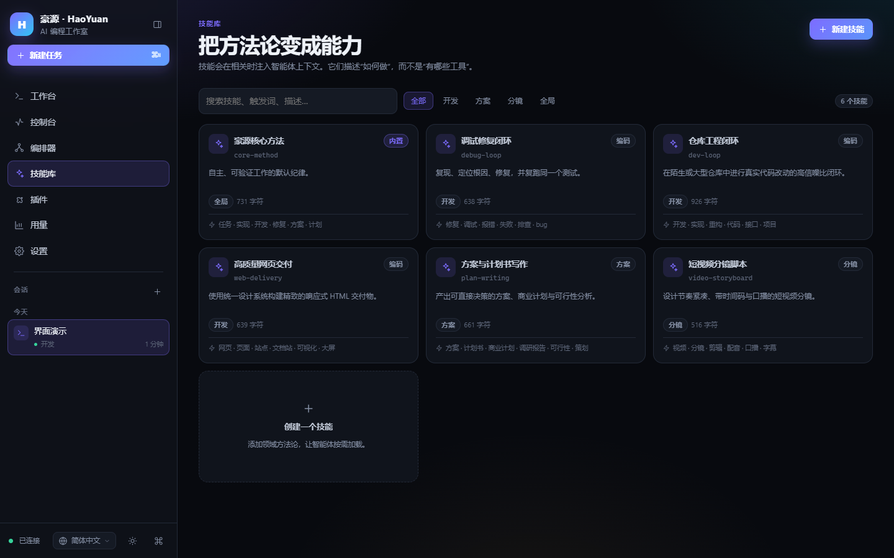

# HaoYuan · 豪源

[简体中文](../../README.md) · [繁體中文](README.zh-TW.md) · [English](README.en.md) · [日本語](README.ja.md) · [Deutsch](README.de.md) · [한국어](README.ko.md)  
[Français](README.fr.md) · [Español](README.es.md) · [Português (Brasil)](README.pt-BR.md) · [Italiano](README.it.md) · **Polski** · [Wszystkie języki](README.md)

> Osobiste studio AI, w którym kierujesz wieloma pracownikami AI pracującymi asynchronicznie i równolegle.  
> Jeden rdzeń, zestaw instalowalnych wtyczek i weryfikowalna pętla zamknięta dla zadań długoterminowych.

HaoYuan został przepisany na bazie **agent-harness** jako podstawy referencyjnej swojego backendu. Zachowuje i wzmacnia ekspertyzę kodowania asystenta AI, jednocześnie reorganizując sesje, narzędzia, agentów, routing, umiejętności, nadzór i orkiestrację wokół architektury wtyczek. Frontend został w pełni przepisany, aby wynieść „współpracę z AI” z okna czatu na stanowisko pracy, którym można kierować, które można obserwować i w które można interweniować.


---

## 1. Główne funkcje

### 1.1 Naprawdę użyteczna pętla kodowania

| Możliwość | Implementacja |
|---|---|
| Świadomość repozytorium | `project_scan`, `repo_map`, indeks symboli, `search_symbol` |
| Precyzyjne czytanie | `read_file`, `read_range`, wskazywanie według numerów wierszy |
| Minimalne edycje | `apply_patch` (unified diff / SEARCH-REPLACE), `edit_file`, `multi_edit` |
| Operacje na plikach | `write_file`, `glob`, `grep`, `list_dir`, `delete_path`, `move_path` |
| Weryfikacja poleceń | `run_shell` (UTF-8, limity czasu, ustrukturyzowane podsumowania błędów), wrapper `git` |
| Bramka weryfikacji | Testy/lint/build są obowiązkowe po zmianach w kodzie, co zapobiega „edycji bez weryfikacji” |
| Pętla test–poprawka | Ustrukturyzowane parsowanie błędów pytest → lokalizacja wiersza → minimalna poprawka → eskalacja na podstawie sygnatury błędu |
| Podagenci | `task` prowadzi zwiad w izolowanym kontekście i zwraca tylko wnioski, unikając zanieczyszczenia głównego kontekstu |
| Zarządzanie kontekstem | Starzenie wyników narzędzi, ustrukturyzowane podsumowania, kompresja w obrębie tury, przycinanie do twardego budżetu |
| Wstępne ładowanie kontekstu | Ranking `repo_map` uwzględniający wymagania oraz `context_pack` powiązanych źródeł dla złożonych zadań (do ~30 KB), co ogranicza powtarzane pełne odczyty |
| Zadania długoterminowe | Budżety kroków, automatyczna kontynuacja, punkty kontrolne, rejestr idempotentnych efektów ubocznych (zapisy nie są stosowane ponownie) |
| Człowiek w pętli | Dla zapisów/poleceń wysokiego ryzyka wyświetlany jest podgląd diffa; są one wykonywane dopiero po zatwierdzeniu |

Warstwowanie intencji sesji: powitania, rozmowy towarzyskie i ogólne pytania i odpowiedzi są obsługiwane bezpośrednio bez skanowania przestrzeni roboczej, uruchamiania narzędzi ani zapisu; tylko jawne zadania, takie jak kodowanie, zmiany w plikach i uruchamianie poleceń, wchodzą do pętli kodowania.

### 1.2 Asynchroniczna równoległość wielu sesji

- Jedna sesja = jeden `asyncio.Task` działający w tle; przełączanie okien, zamykanie kart lub rozłączanie nie zatrzymuje zadania.
- Globalna bramka współbieżności + kolejka FIFO; podczas oczekiwania na zatwierdzenie przez człowieka slot współbieżności jest automatycznie zwalniany.
- Maszyna stanów sesji: `idle → queued → running ⇄ waiting_input → done / error`.
- Pasek kart sesji u góry pulpitu roboczego: utworzenie lub otwarcie sesji automatycznie dodaje kartę; kliknij, aby przełączać się między kartami; `×` tylko zamyka widok, nie usuwając sesji, a karty pozostają po odświeżeniu; kliknij kartę prawym przyciskiem myszy, aby zamknąć bieżącą / lewą / prawą / wszystkie rozmowy.
- Pierwsza wiadomość nowej sesji otrzymuje od modelu krótki tytuł w języku bieżącego interfejsu użytkownika; jeśli stara sesja nadal ma domyślny tytuł, automatycznie wyświetlane jest podsumowanie na podstawie pierwszej wiadomości.
- Każda sesja ma własny URL `/#/s/<session-id>`, który można skopiować, odświeżyć, udostępnić lub przejść do niego bezpośrednio z paska adresu.
- Po odświeżeniu strony wiadomości, zdarzenia, plany, zatwierdzenia i artefakty są przywracane z SQLite.
- Główny kanał zdarzeń w czasie rzeczywistym wykorzystuje SSE (ponowne łączenie, wznawianie na podstawie kursora, strumieniowanie nawet bez WebSocket); punkt końcowy WebSocket pozostaje dla zgodności; REST obsługuje odtwarzanie zdarzeń.

### 1.3 Nadzorca AI i orkiestracja wieloagentowa

- **Nadzorca**: kontrole kondycji między sesjami, alerty o zablokowanych zadaniach, automatyczne przerywanie, rozmowy w konsoli i działania harmonogramowania.
- **Orkiestrator**: cel → DAG zadań → niezależny git worktree dla każdego pracownika → równoległe wykonywanie → scalanie i akceptacja.
- Sesje pracowników współdzielą pliki kontraktu i wspólną tablicę; awaria nie blokuje innych zadań na tym samym poziomie.

### 1.4 Biblioteka umiejętności

- Markdown + front-matter z deklaracją `name / title / description / kinds / triggers`.
- Automatycznie dopasowywane według typu zadania i słów kluczowych; ranking BM25 uruchamia się, gdy umiejętności jest wiele.
- Wbudowane: podstawowa metodologia, pętla inżynierii repozytorium, pętla debugowania, dostarczanie webowe i pisanie propozycji.
- Umiejętności można tworzyć, edytować i usuwać w interfejsie użytkownika; zmiany zaczynają obowiązywać po zapisaniu.

### 1.5 Dokumenty planu

- `make_plan`: generuje samodzielny plan/propozycję w formacie HTML zawierający KPI, sekcje, tabele, ryzyka i kamienie milowe.
- Artefakty są rejestrowane w `api/data/artifacts/` i można je podglądać/pobierać bezpośrednio z prawej strony pulpitu roboczego.

### 1.6 Architektura wtyczek

HaoYuan nie jest „jednym wielkim monolitem”; to:

```
Kernel (sessions / events / tool registry / policy / model gateway / approvals)
        │
        ├── coding       coding agent + engineering tools + skills
        ├── plans        planning tools + Planner agent
        ├── supervisor   health checks + console routes
        ├── orchestrator task DAG + worktree + merge
        └── embodied     embodied agent harness (disabled by default, install to enable)
```

Wtyczki mogą dostarczać: narzędzia, agentów, trasy HTTP, katalogi umiejętności, subskrypcje zdarzeń, hooki cyklu życia oraz metadane nawigacji/poleceń frontendu. Pojedyncza wtyczka, której nie uda się załadować, nie spowoduje awarii jądra.


### 1.7 Jedenaście języków, jasny motyw domyślny i zwijany pasek boczny

- Domyślny **jasny (biały) motyw**; ciemny motyw można włączyć na stronie ustawień lub u dołu paska bocznego.
- Domyślnie **uproszczony chiński**; przełączaj między **简体中文 / 繁體中文 / English / 日本語 / Deutsch / 한국어 / Français / Español / Português (Brasil) / Italiano / Polski**.
- Punkty wejścia do wyboru języka znajdują się w trzech widocznych miejscach: na górnym pasku obszaru roboczego, u dołu paska bocznego (dostępne na wszystkich stronach) oraz w Ustawienia → Wygląd.
- Wybór jest utrwalany w `localStorage` i przetrwa odświeżenie oraz ponowne uruchomienie; `document.lang` oraz tytuł strony również są aktualizowane.
- Pasek boczny można zwinąć do szyny ikon o szerokości 76px; po zwinięciu u góry pozostaje wyraźny przycisk „Rozwiń pasek boczny”, lista sesji jest ukryta, a po rozwinięciu wszystko zostaje przywrócone.
- Prawy panel analiz jest domyślnie zwinięty, aby pozostawić więcej miejsca na rozmowę; kliknij przycisk w prawym górnym rogu, aby go otworzyć, a wybór jest zapamiętywany.
- Wbudowane tytuły/opisy umiejętności, tytuły/opisy wtyczek oraz teksty interfejsu dla statusów, przycisków, wskazówek, zatwierdzeń, planów, zużycia i orkiestracji są w pełni pokryte we wszystkich jedenastu językach.

---

## 2. Szybki start

### Anonimowe statystyki użytkowania (informacja o przejrzystości)

HaoYuan zawiera **w pełni anonimowy** sygnał heartbeat użytkowania, aby zliczać urządzenia online i rozkład wersji:

- **Przekazywane dane**: lokalnie wygenerowany losowy `install_id` (UUID), wersja klienta i typ systemu operacyjnego (np. `Windows 11`). Nie zawierają nazw użytkowników, adresów e-mail, zawartości plików, ścieżek obszaru roboczego, treści rozmów ani innych danych osobowych.
- **Częstotliwość**: raz przy uruchomieniu i co 5 minut podczas działania (pojedyncze lekkie żądanie POST).
- **W pełni opcjonalny**: ustaw zmienną środowiskową `HAOYUAN_TELEMETRY=0` przed uruchomieniem, aby trwale to wyłączyć; wszystkie funkcje działają bez zmian.
- **Ochrona prywatności**: serwer zapisuje wyłącznie jednokierunkowy hash adresu IP, nigdy jawny adres IP; dane są przechowywane przez 90 dni.
- **Pełna informacja**: zobacz endpoint prywatności centrum wtyczek `GET {plugin-center-url}/api/plugin-center/privacy` lub kod źródłowy `api/core/telemetry.py` (~100 linii, możliwy do audytu).

### Wymagania

- Python 3.10+
- Node.js 18+
- Windows / Linux / macOS

### npm install (zalecane)

```bash
# Prerequisite: Node.js 18+ and Python 3.10+
npm install -g haoyuan

# Faster mirrors in mainland China:
npm install -g haoyuan --registry=https://registry.npmmirror.com

# Terminal chat (creates the venv and installs dependencies on first run)
haoyuan

# Start the service and open the web UI automatically
haoyuan web
```

| Polecenie | Cel |
|---|---|
| `haoyuan` | Czat w terminalu (strumieniowe wyjście, wywołania narzędzi, monity o zatwierdzenie) |
| `haoyuan --model x/y` | Rozpocznij czat z określonym modelem (np. `--model deepseek/deepseek-flash`) |
| `haoyuan web` | Uruchom usługę i automatycznie otwórz interfejs webowy |
| `haoyuan web --no-open` | Uruchom usługę bez otwierania przeglądarki |
| `haoyuan --version` / `-V` | Pokaż wersję |
| `haoyuan config` | Globalny plik konfiguracyjny (klucze modeli itp.); użyj `--open`, aby edytować go bezpośrednio |
| `haoyuan login` / `haoyuan logout` | Zaloguj się, gdy ochrona konta jest włączona / wyczyść lokalny token |
| `haoyuan setup` | Zainstaluj tylko zależności |
| `haoyuan help` | Pokaż pomoc |

Polecenia w terminalu: `/models`, aby wyświetlić/wybrać model (wybierz według numeru lub `/model x/y`, aby wybrać bezpośrednio), `/new`, aby utworzyć sesję, `/web`, aby otworzyć bieżącą sesję w przeglądarce, `/cancel`, aby anulować bieżące zadanie, `/exit`, aby zakończyć (Ctrl+C również działa).

Interfejs webowy domyślnie używa `http://127.0.0.1:8030` i automatycznie zwiększa numer portu, gdy jest on zajęty. Bez klucza modelu wbudowany model `mock` nadal obsługuje sesje, wywołania narzędzi, zatwierdzenia oraz frontend od początku do końca.

### Jednoklikowe uruchamianie w systemie Windows

```bat
start.bat
```

Skrypt automatycznie: zatrzymuje stary proces na porcie 8030 → tworzy `api/env1` → instaluje zależności Pythona → (tylko gdy brakuje `web/dist`) instaluje zależności frontendu i wykonuje kompilację → uruchamia API i otwiera stronę produktu. Pakiet npm zawiera już wstępnie zbudowany frontend, więc środowiska intranetowe/offline mogą uruchomić go bezpośrednio po zainstalowaniu zależności. Jeśli poprzedni `npm install` pozostawił niekompletny `web/node_modules` z powodu przerwy w sieci, skrypt automatycznie go wykrywa i instaluje ponownie — ręczne usuwanie nie jest potrzebne.

**Automatyczne przełączanie portów**: backend domyślnie używa `8030`, a serwer deweloperski frontendu — `8130`; jeśli port jest zajęty, numer jest automatycznie zwiększany (8031, 8032, …), aż powiązanie się powiedzie. Rzeczywiste porty są zapisywane w `api/data/runtime.json`, a skrypt uruchamiający odczytuje je, aby otworzyć właściwy adres. Możesz też jawnie ustawić porty bazowe za pomocą `HAOYUAN_PORT` / `HAOYUAN_WEB_PORT` (frontend) oraz `HAOYUAN_API_PORT` (cel proxy frontendu).

Zatrzymywanie:

```bat
stop.bat
```

### Konsola desktopowa (desktop.exe)

Kliknij dwukrotnie `desktop.exe` w katalogu głównym repozytorium, aby otworzyć konsolę graficzną (~20 KB, zależną wyłącznie od .NET Framework 4.x dołączonego do systemu Windows):

- **Uruchom wszystko / zatrzymaj wszystko**: zarządzaj backendem i serwerem deweloperskim frontendu jednym kliknięciem; po uruchomieniu strona produktu otwiera się automatycznie
- **Uruchom / zatrzymaj backend** (domyślnie 8030) i **uruchom / zatrzymaj frontend** (domyślnie 8130)
- **Ustawienia portów**: edytuj bezpośrednio porty backendu i frontendu; kliknij „Zastosuj porty i uruchom ponownie”, aby zapisać konfigurację i ponownie uruchomić obie usługi; jeśli port jest zajęty, usługa nadal automatycznie zwiększa numer
- **Otwórz stronę produktu**: otwiera rzeczywisty port backendu z `api/data/runtime.json`; jeśli działa tylko frontend, przechodzi na port frontendu
- **Kompiluj frontend**, **otwórz folder projektu**, status usług odświeżany co sekundę i logi działania na żywo

Zamknięcie okna konsoli nie zatrzymuje usług. Aby je zatrzymać, kliknij „Zatrzymaj wszystko” lub odpowiednie przyciski zatrzymywania. Kod źródłowy znajduje się w `desktop/`; po zmianach uruchom `desktop\build.bat`, aby wykonać ponowną kompilację.

### Linux / macOS

```bash
bash start.sh
bash stop.sh
```

W środowiskach intranetowych lub z niestandardowym serwerem lustrzanym wskaż źródła pobierania jawnie (jeśli ich nie podano, używane są źródła już skonfigurowane w `~/.npmrc` i `pip.conf`):

```bash
export HAOYUAN_NPM_REGISTRY=http://your-intranet/npm/
export HAOYUAN_PIP_INDEX_URL=http://your-intranet/pypi/simple
bash start.sh
```

Odpowiednik dla systemu Windows:

```bat
set HAOYUAN_NPM_REGISTRY=http://your-intranet/npm/
set HAOYUAN_PIP_INDEX_URL=http://your-intranet/pypi/simple
start.bat
```

Gdy zależności frontendu lub Pythona są niekompletne (na przykład poprzednia instalacja została przerwana przez `ECONNRESET`), `start.sh` / `start.bat` / `haoyuan setup` automatycznie wykrywają i czyszczą `web/node_modules`, instalują ponownie, doinstalowują brakujące pakiety backendu i w razie niepowodzenia kompilacji używają istniejącego `web/dist`.

`web/package-lock.json` nie zawiera już na sztywno zewnętrznego serwera lustrzanego; `replace-registry-host=always` w `web/.npmrc` zapewnia, że instalacje zawsze używają rejestru z bieżącej konfiguracji npm, więc plik lock nie może przekierować instalacji do nieosiągalnego zewnętrznego serwera lustrzanego.

### Ręczne uruchamianie

```bash
# Backend
cd api
python -m venv env1
env1\Scripts\activate           # Linux: source env1/bin/activate
pip install -r requirements.txt
python main.py                  # http://127.0.0.1:8030, increments automatically if in use

# Frontend dev mode (hot reload, optional)
cd web
npm install
npm run dev                     # http://localhost:8130, increments automatically if in use; /api and /ws proxy to the backend's actual port
```

W środowisku produkcyjnym backend udostępnia `web/dist` bezpośrednio, więc wystarczy odwiedzić rzeczywisty port backendu. Porty można nadpisać za pomocą zmiennych środowiskowych: `HAOYUAN_PORT` (backend, domyślnie 8030), `HAOYUAN_WEB_PORT` (frontend, domyślnie 8130) oraz `HAOYUAN_API_PORT` (cel proxy frontendu, domyślnie z `api/data/runtime.json`).

### Konfiguracja modeli

**Globalny plik konfiguracyjny (zalecany)** — stała ścieżka dla użytkownika, niezależna od ponownej instalacji lub aktualizacji:

```bash
haoyuan config          # creates the file on first run and prints its path
haoyuan config --open   # open it directly in your editor
```

Ścieżka: `~/.config/haoyuan/config.json` (w systemie Windows: `C:\Users\<you>\.config\haoyuan\config.json`; można nadpisać zmienną środowiskową `HAOYUAN_CONFIG`):

Plik jest tworzony automatycznie przy pierwszym uruchomieniu (lub przez npm postinstall), a jego katalog jest tworzony, jeśli nie istnieje.

```json
{
  "PROVIDER": "",
  "MODEL": "",
  "DEEPSEEK_API_KEY": "",
  "DEEPSEEK_BASE_URL": "https://api.deepseek.com",
  "DEEPSEEK_MODEL": "deepseek-flash",
  "ZHIPU_API_KEY": "",
  "ZHIPU_BASE_URL": "https://open.bigmodel.cn/api/coding/paas/v4",
  "ZHIPU_MODEL": "glm-5.3-flash",
  "MIMO_API_KEY": "",
  "MIMO_BASE_URL": "https://token-plan-cn.xiaomimimo.com/v1",
  "MIMO_MODEL": "mimo-v2.6-flash",
  "providers": {}
}
```

- Dla wbudowanych dostawców można dodać `DEEPSEEK_MODELS` / `ZHIPU_MODELS` / `MIMO_MODELS` (oddzielone przecinkami), aby w pełni dostosować listę modeli; `*_THINKING_MODELS`, `*_MAX_OUTPUT` i `*_SUPPORTS_THINKING` są opcjonalne.
- Dowolnego dostawcę zgodnego z OpenAI można dodać do obiektu `providers`, nie tylko trzech wbudowanych:

```json
{
  "providers": {
    "my-intranet": {
      "base_url": "http://llm.intranet/v1",
      "api_key": "sk-...",
      "models": ["qwen-max", "qwen-plus"],
      "default_model": "qwen-max",
      "supports_thinking": false,
      "max_output_tokens": 8192
    }
  }
}
```

- `PROVIDER` / `MODEL` mogą przypiąć domyślny model (np. `"MODEL": "deepseek-v4-pro"` lub `"MODEL": "my-intranet/qwen-max"`; pozostaw puste, aby automatycznie wybrać na podstawie skonfigurowanych kluczy).
- **Dwukierunkowa synchronizacja między stroną ustawień w przeglądarce a plikiem konfiguracyjnym**: dodawanie/edytowanie dostawców, modeli i modelu domyślnego w „Ustawienia → Konfiguracja modeli” natychmiast zapisuje zmiany w pliku; jeśli edytujesz plik bezpośrednio i zapiszesz, usługa przeładuje go przy następnym żądaniu (bez konieczności ponownego uruchamiania).
- „Odśwież wszystkie modele” odczytuje punkt końcowy `/models` każdego dostawcy za pomocą jego bazowego adresu URL i klucza, automatycznie filtrując modele niebędące modelami czatu; jeśli niektórzy dostawcy zawiodą, wyświetlane są dokładni dostawcy i powody, a udanych dostawców nadal zapisuje się.

**Konfiguracja w pakiecie (opcjonalna)**:

```bash
copy api\configs\secrets_example.py api\configs\secrets_local.py
```

Edytuj `api/configs/secrets_local.py` z tymi samymi polami (jako stałe Pythona). Jest to przeznaczone dla wdrożeń ze źródeł; w przypadku globalnej instalacji npm plik znajduje się w katalogu pakietu i jest usuwany podczas aktualizacji, więc preferuj konfigurację globalną.

**Zmienne środowiskowe** (najwyższy priorytet):

```powershell
$env:DEEPSEEK_API_KEY="sk-..."
```

Priorytet: zmienne środowiskowe > globalny plik konfiguracyjny > `secrets_local.py`. Po edycji globalnego pliku konfiguracyjnego nie jest wymagane ponowne uruchomienie (usługa przeładowuje konfigurację na gorąco); pole `key_source` w kontroli kondycji `GET /api/health` pokazuje, skąd pochodzi klucz.

**Gdy nie skonfigurowano klucza, automatycznie używany jest lokalny model `mock`**, co pozwala kompleksowo przetestować sesje, wywołania narzędzi, zatwierdzenia, zdarzenia i frontend od początku do końca.

---

## 3. Interfejs

| Obszar roboczy (jasny, domyślny) | Obszar roboczy (angielski) |
|---|---|
|  |  |

| Obszar roboczy (chiński tradycyjny) | Obszar roboczy (ciemny) |
|---|---|
|  |  |

| Konsola nadzorcy | Biblioteka umiejętności |
|---|---|
|  |  |

| Ustawienia i wejście do języka | Przycisk rozwijania po zwinięciu paska bocznego |
|---|---|
|  |  |

Panel szczegółów po prawej stronie na urządzeniach mobilnych:  


Kluczowe interakcje:

- Górne karty sesji: kliknij, aby przełączać rozmowy; `×` zamyka kartę (dane sesji nie są naruszane); kliknij prawym przyciskiem myszy, aby zamknąć bieżącą / wszystkie po lewej / wszystkie po prawej / wszystkie rozmowy
- Nowe zadania nie oferują już gotowych pytań; wystarczy opisać zadanie w polu wprowadzania, a tytuł sesji zostanie podsumowany automatycznie
- Routing w pasku adresu: `/#/s/<session-id>` mapuje się na konkretną sesję i można go skopiować, odświeżyć lub otworzyć w nowym oknie
- `Ctrl / Cmd + K`: paleta poleceń (nawigacja, sesje, akcje)
- `Ctrl / Cmd + N`: nowe zadanie
- `Ctrl / Cmd + B`: zwiń / rozwiń pasek boczny
- `Enter`: wyślij; `Shift + Enter`: nowa linia (`Ctrl / Cmd + Enter` również wysyła)
- Karta zatwierdzenia: `A` zatwierdza, `R` odrzuca
- Przełączanie języka: prawy górny róg obszaru roboczego, dół paska bocznego na dowolnej stronie oraz Ustawienia → Wygląd
- Wpisywanie podczas działania sesji: dane wejściowe są scalane z bieżącym wykonaniem jako „dodatkowa instrukcja” bez przerywania zadania
- Prawy panel jest domyślnie zwinięty; kliknij przycisk w prawym górnym rogu, aby otworzyć Przegląd / Plan / Pliki / Zmiany / Artefakty, i przeciągnij, aby zmienić rozmiar
- Pliki i różnice korzystają z dużego nakładkowego podglądu, aby uniknąć czytania kodu w wąskiej kolumnie

---

## 4. Architektura

```text
hao-yuan/
├── api/
│   ├── main.py                    FastAPI entry (extension routes + plugin routes + static frontend)
│   ├── configs/                   Configuration, model registry, secrets
│   ├── core/
│   │   ├── contracts.py           Tool / Agent / Policy / ToolContext
│   │   ├── storage.py             SQLite (WAL) storage layer
│   │   ├── events.py              Event bus (broadcast + batched persistence + replay)
│   │   ├── gateway.py             Model gateway (streaming + degradation + fallback)
│   │   ├── context.py             Context compression / aging / hard budget
│   │   ├── runtime.py             Agent main loop
│   │   ├── session_manager.py     Concurrency gate / queue / approvals / resume
│   │   ├── policy.py              Permission gate
│   │   ├── tools.py               Tool registry and execution
│   │   ├── agents.py              Agent registry
│   │   └── plugin.py              Plugin discovery / dependencies / lifecycle
│   ├── harness/                   Sandbox / skills / symbol index / fix loop / supervision / orchestration / embodied
│   ├── tools/                     builtin / dev / plan
│   ├── adapters/providers/        deepseek / mimo / mock
│   ├── plugins/                   coding / plans / supervisor / orchestrator / embodied
│   ├── extensions/                System / sessions / skills / settings / files / usage / plugins / approvals / real-time events (SSE / WebSocket)
│   ├── skills/                    Core skills
│   ├── tests/                     90 backend tests
│   └── data/                      Runtime data (gitignored)
├── web/                           Vue 3 + Vite
├── docs/screenshots/              UI screenshots
├── start.bat / stop.bat
├── start.sh / stop.sh
├── dev.bat
├── desktop.exe                    Graphical desktop console (start/stop services / open the web UI)
└── desktop/                       desktop.exe source and build scripts
```

### Dane i granice

- Baza danych: `api/data/haoyuan.db` (WAL)
- Artefakty: `api/data/artifacts/<session_id>/`
- Porty środowiska uruchomieniowego: `api/data/runtime.json` (backend zapisuje `api_port`, frontend zapisuje `web_port`, a konsola desktopowa zapisuje `api_port_config` / `web_port_config`)
- Wszystkie narzędzia plikowe są ograniczone listą dozwolonych elementów obszaru roboczego sesji i odrzucają `../` oraz próby ucieczki przez ścieżki bezwzględne.
- Narzędzia wysokiego ryzyka (zapis do plików, stosowanie poprawek, usuwanie, przenoszenie, shell, git, ruch robota) wymagają zatwierdzenia.
- `run_shell` bezwzględnie blokuje katastrofalne polecenia (takie jak `rm -rf /`, formatowanie dysku i wyłączanie).
- HTML artefaktów jest wyświetlany w podglądzie przez endpoint z CSP piaskownicy, co uniemożliwia stronom generowanym przez model odczytywanie lokalnych poświadczeń.
- Sekrety są odczytywane wyłącznie ze zmiennych środowiskowych lub `secrets_local.py`; nigdy nie są przechowywane w bazie danych ani zwracane w postaci jawnej.
- Prawdziwe klucze znajdują się w `api/configs/secrets_local.py`, który jest ignorowany przez `.gitignore`; `git add --dry-run` weryfikuje, że nigdy nie trafiają do repozytorium.

---

## 5. Tworzenie wtyczek

Utwórz katalog w `api/plugins/`:

```
api/plugins/my-plugin/
├── plugin.json
├── plugin.py
├── routes.py        # optional
└── skills/          # optional
    └── my-skill.md
```

`plugin.json`:

```json
{
  "name": "my-plugin",
  "title": "My Plugin",
  "version": "1.0.0",
  "description": "What this plugin adds",
  "author": "you",
  "requires": ["coding"],
  "default_enabled": true,
  "backend": "plugin.py",
  "routes": "routes.py",
  "contributes": {
    "tools": ["my_tool"],
    "agents": ["my_agent"],
    "skills": true
  },
  "frontend": {
    "nav": [{ "label": "My Plugin", "path": "/my-plugin", "icon": "puzzle" }],
    "commands": [{ "id": "my-plugin.run", "title": "Run my plugin" }]
  }
}
```

`plugin.py`:

```python
from core.contracts import AgentSpec, ToolSpec


async def my_tool(ctx, args):
    return {"echo": args.get("text", "")}


def register(ctx):
    ctx.register_tool(
        ToolSpec(
            name="my_tool",
            description="Echo text",
            input_schema={
                "type": "object",
                "properties": {"text": {"type": "string"}},
                "required": ["text"],
            },
        ),
        my_tool,
    )
    ctx.register_agent(
        AgentSpec(
            name="my_agent",
            title="My Agent",
            instructions="You are ...",
            tools=["my_tool"],
            kind="dev",
        )
    )
    ctx.add_skill_dir("skills")


async def startup(ctx):
    ...


async def shutdown(ctx):
    ...
```

Możliwości wtyczek:

- `requires` kontroluje kolejność zależności; brakujące zależności są izolowane, a błąd jest rejestrowany.
- `startup / shutdown`: hooki cyklu życia.
- `ctx.events.subscribe(sink)` subskrybuje zdarzenia globalne (w ten sposób orkiestrator otrzymuje zdarzenia ukończenia pracy pracowników).
- Stan włączenia/wyłączenia jest utrwalany w SQLite; po przełączeniu uruchom ponownie API, aby załadować/wyładować trasy.
- Frontend pobiera metadane `contributes` i `frontend` przez `/api/plugins`.

### Dlaczego tak zaprojektowano

Zapożycza z WordPressa koncepcję „małego jądra + instalowalnych wtyczek”: jądro obsługuje wyłącznie sesje, zdarzenia, politykę, modele i protokół narzędzi; wszystkie możliwości biznesowe znajdują się we wtyczkach.  
Przyjmuje również ideę DeepSeek Harness, że „sam harness jest podłączany jako wtyczka”: agent ucieleśniony to po prostu niezależna wtyczka harness, więc można stale dodawać harnessy dla łazików, ramion robotycznych, robotów humanoidalnych i innych, bez dotykania jądra.

---

## 6. Wyniki testów własnych

Poniższe czynności wykonano w środowisku dostawy:

```bash
cd api
python -m pytest -q
# 90 passed, 2 skipped, 2 warnings

cd ../web
npm run build
# ✓ built, 97 modules transformed
```

Zakres testów:

- Kontrola stanu, modele, umiejętności, wtyczki i listowanie zatwierdzeń
- Pełna sesja z modelem typu mock (wiadomość → zdarzenie → zakończenie)
- Sesja kodowania: zapis pliku → zdarzenie narzędzia → artefakt → odczyt drzewa obszaru roboczego
- Przepływ zatwierdzania przez człowieka: oczekujące → zatwierdzenie → wykonanie narzędzia → plik zapisany na dysku
- Zmiana nazwy / ukrycie / przywrócenie / wyczyszczenie / trwałe usunięcie sesji
- Ustawienia globalnej bramy i domyślnego obszaru roboczego, użycie oraz eksport CSV
- Trwałość stanu włączenia wtyczek
- Orchestrator git worktree od początku do końca (utworzenie → rozdzielenie → zakończenie → scalenie)
- Poziom narzędzi: ucieczka z sandboxa, read/write/edit/patch/multi_edit, glob/grep/symbols, shell, delete/move
- Twarde blokowanie niebezpiecznych poleceń powłoki
- Indeks symboli, mapa repozytorium, parsowanie pytest i wskazówki naprawcze
- Generowanie artefaktu HTML z planem
- Routing intencji: powitania, small talk i ogólne pytania i odpowiedzi (takie jak „jak się masz”, „ładna dziś pogoda”, „czym jest wstrzykiwanie zależności”) są obsługiwane bezpośrednio, bez skanowania obszaru roboczego, wyzwalania narzędzi czy zapisu (w tym weryfikacja z rzeczywistym deepseek-flash)
- Automatyczny tytuł sesji na podstawie pierwszej wiadomości (zgodny z językiem interfejsu; mock obejmuje fallback i weryfikację z rzeczywistym modelem)
- Niezależny routing sesji: linki bezpośrednie `/#/s/<session-id>`, przełączanie kart, edycja paska adresu, przywracanie po odświeżeniu i fallback przy zamknięciu
- Menu kontekstowe karty sesji: zamknij bieżącą / po lewej / po prawej / wszystkie, z automatycznym przełączeniem na najbliższą kartę po zamknięciu wielu kart

Dodatkowo przeprowadzono inspekcję kompilacji produkcyjnej w rzeczywistej przeglądarce za pomocą Playwright + lokalnego Chrome:

- Strony Workbench / console / skills / plugins / settings / usage / orchestration ładują się poprawnie
- Górne karty sesji i niezależny routing: otwieranie, przełączanie, zamykanie, zbiorcze zamykanie z menu kontekstowego, deep linki w pasku adresu i przywracanie po odświeżeniu
- Podsumowywanie domyślnego tytułu, menu języka w prawym górnym rogu (przełączanie jedenastu języków) oraz stan pusty bez predefiniowanych pytań
- Przełączanie między chińskim uproszczonym, chińskim tradycyjnym, angielskim, japońskim, niemieckim, koreańskim, francuskim, hiszpańskim, portugalskim brazylijskim, włoskim i polskim działa, a język pozostaje zapisany po odświeżeniu
- Punkty wejścia do języka obejmują górny pasek workbencha, dół paska bocznego i stronę ustawień
- Zwijanie/rozwijanie paska bocznego między 286px a 76px działa; po zwinięciu lista sesji jest ukryta, a przycisk rozwijania jest widoczny
- Prawy panel insights jest domyślnie zwinięty, a stan jego rozwinięcia/zwinięcia pozostaje zapisany
- `Enter` wysyła, a `Shift + Enter` wstawia nowy wiersz; kompozycja IME nie powoduje przypadkowego wysłania
- Motywy ciemny / jasny działają
- Układ mobilny 430px, szuflada paska bocznego i szuflada prawego panelu insights działają
- Strumień czasu rzeczywistego SSE: rzeczywiste delty rozumowania i treści DeepSeek są widoczne przed `done`
- Brak błędów JS, brak zasobów 404 i brak WebSocket 404 w konsoli (główny kanał czasu rzeczywistego to teraz SSE)

> Rzeczywista weryfikacja online została przeprowadzona z kluczem DeepSeek wskazanym przez asystenta AI: `deepseek-flash` zwrócił `OK`, a provider/model użycia = `deepseek/deepseek-flash`. Klucz jest przechowywany wyłącznie w `api/configs/secrets_local.py`, który jest ignorowany przez `.gitignore`; do repozytorium trafia tylko szablon `secrets_example.py`. Testy regresji na mockach pozostają, więc system automatycznie przechodzi w tryb degradacji, gdy jest offline lub nie ma klucza.

---

## 7. Wyniki benchmarku Harness Fair

> Najnowszy raport: `test/testing/index-2026-10-27.html` (2026-10-27, mimo-v2.6-flash)  
> Raport historyczny: `test/testing/index-2026-10-25.html` (2026-10-25, deepseek-flash)

### 7.1 Uczciwy benchmark MiMo (najnowszy)

**Metoda**: 5 zadań z automatyczną oceną (1 podstawowe adaptacyjne + 4 obejmujące lokalizację / wydajność / długi horyzont / współbieżność) × 3 narzędzia; ujednolicone `mimo-v2.6-flash`, prompty, repozytorium startowe i budżet. Ukryte testy są wstrzykiwane po zakończeniu przebiegu, a `tests/` i `pyproject.toml` są weryfikowane za pomocą SHA-256 — manipulacja daje 0 punktów. t1/d1/d3 korzystają z przeplatanej partii official-r1; d4/d6 korzystają z niezależnej partii powtórnego przebiegu po zamrożeniu kodu.

| Miejsce | Narzędzie | Ogółem (ważone produktowo) | Poprawność | Szybkość | Koszt | Dyscyplina inżynierska | Równe wagi |
|---|---|---|---|---|---|---|---|
| 1 | **HaoYuan** | **98.8** | 100.0 | 94.4 | 96.9 | 100.0 | **98.3 (1. miejsce)** |
| 2 | OpenCode | 90.5 | 100.0 | 67.8 | 53.5 | 100.0 | 84.3 (2. miejsce) |
| 3 | Claude Code | 88.9 | 100.0 | 65.1 | 40.9 | 100.0 | 81.2 (3. miejsce) |

Wynik ogólny = 0,65 × poprawność + 0,15 × szybkość + 0,10 × koszt + 0,10 ×

- Wszystkie trzy uzyskały 100% poprawności; HaoYuan uzyskał **98,8** punktu ważonego produktowo i **98,3** punktu przy równej wadze, zajmując pierwsze miejsce w obu formułach.
- Według zadań: HaoYuan był najszybszy w t1 (63,8 s), d3 (220,6 s) i d4 (469,6 s); OpenCode wygrał d1 (111,3 s), a Claude Code wygrał d6 (254,5 s).
- Koszt: łączny koszt 5 zadań wyniósł **3,33 USD** dla HaoYuan, 6,56 USD dla OpenCode i 9,04 USD dla Claude Code; koszty na zadanie wynosiły 0,666 / 1,313 / 1,809 USD.
- Adaptacyjna intensywność: t1, łatwe zadanie, zajął 63,8 s i 11 wywołań bez uruchamiania planu ani podagenta; długoterminowe zadanie d4 wykorzystało wstępnie załadowane odpowiednie źródła, aby ograniczyć powtarzalną eksplorację (z limitu 1200 s do 469,6 s).
- Kluczowe poprawki: ukończono dostawcę MiMo (wcześniej `resolve("mimo", ...)` po cichu przełączał się na deepseek), mapę repozytorium uwzględniającą wymagania, pakiet kontekstu 30 KB dla złożonych zadań, odzyskiwanie drzewa procesów, ścisłe limity dostawcy + na wywołanie + ponowienia tego samego modelu oraz lekkie routowanie dla łatwych zadań.
- Ograniczenia: formalne porównanie użyło 1 rundy na zadanie; d4/d6 były niezależnymi seriami ponownych uruchomień; wariancja opóźnień modeli jest duża (Claude d3 wynosił wcześniej 623 s, a tym razem 884 s); d5 nie zapewniał rozróżnienia i nie został sklasyfikowany; zadania są zbudowane samodzielnie i nie mogą zastąpić publicznych benchmarków, takich jak SWE-bench.

Odtwórz:

```bash
cd test/bench
python harness_bench.py run --batch official-r1 --tools haoyuan,claude,opencode --tasks t1_multisite_bugfix,d1_needle_regress,d3_perf_cliff --resume
python harness_bench.py run --batch official-r1 --tools haoyuan,claude,opencode --tasks d4_multilayer_feature,d6_concurrency_fix --resume
python make_report_mimo_final.py
```

### 7.2 Szczegółowy benchmark deepseek-flash (historyczny)

**Metoda**: 8 automatycznie ocenianych zadań programistycznych (5 podstawowych + 3 trudne) × 3 rundy na zadanie × 3 narzędzia; ujednolicony deepseek-flash, prompty, repozytorium seed i budżet; ukryte testy są wstrzykiwane po uruchomieniu, a `tests/` i `pyproject.toml` są weryfikowane za pomocą SHA-256 — manipulacja daje 0 punktów.

| Miejsce | Narzędzie | Wynik ogólny (ważony produktowo) | Poprawność | Typowa szybkość | Opóźnienie ogona | Koszt | Wynik przy równej wadze |
|---|---|---|---|---|---|---|---|
| 1 | **HaoYuan** | **96,6** | 100,0 | 100,0 (mediana 30,3 s) | 67,6 (P90 159,4 s) | 82,2 (0,364 USD) | 95,0 (2.) |
| 2 | OpenCode | 95,1 | 100,0 | 67,6 (mediana 44,8 s) | 100,0 (P90 107,7 s) | 100,0 (0,299 USD) | 96,8 (1.) |
| 3 | Claude Code | 90,7 | 100,0 | 70,6 (mediana 42,9 s) | 90,7 (P90 118,7 s) | 55,4 (0,540 USD) | 91,7 (3.) |

Wynik ogólny = 0,70 × poprawność + 0,15 × typowa szybkość + 0,05 × opóźnienie ogona + 0,10 × koszt; formuła równej wagi zmienia dwa ostatnie współczynniki na 0,10 / 0,10.

- Wszystkie trzy uzyskały 100% poprawności; różnice koncentrowały się na szybkości, opóźnieniu ogona i koszcie tokenów; HaoYuan zajął pierwsze miejsce przy ważeniu produktowym, natomiast OpenCode wyprzedził go przy równych wagach.
- HaoYuan miał najkrótszy medianowy czas zadania wynoszący 30,3 s i był najszybszy pod względem mediany czterech zadań (T1/T2/T3/H1); wszystkie 24 przebiegi były w 100% ukończone. OpenCode miał najlepsze opóźnienie ogona i koszt na zadanie; Claude Code miał najwyższy koszt tokenów.
- Słabe strony: migracja wersji H2 miała medianę 159,4 s (OpenCode: 101,1 s), a H3 miał długi ogon wynoszący 260 s; przyszłe prace jeszcze bardziej skrócą audyty migracji i rundy autotestów.
- Ograniczenia: obejmuje wyłącznie deepseek-flash i 3 rundy na zadanie; zadania są samodzielnie zbudowane i nie mogą zastąpić publicznych benchmarków, takich jak SWE-bench.
- Samoiteracja: podczas oceny naprawiono adaptację potoków Windows, ochronę przed pustymi odpowiedziami/brakiem zapisu, audyty akceptacji migracji, lekkie audyty git diff oraz kolejność ukończenia; jedna negatywna optymalizacja „nadmiernego testowania" została wycofana.

Reprodukcja:

```bash
cd test/bench
python harness_bench.py run --batch final-r1 --tools haoyuan,claude,opencode --tasks all
python aggregate.py
python make_report.py
```

---

## 8. Parytet funkcji z asystentem AI

| Możliwość | HaoYuan | Uwagi |
|---|---|---|
| Łańcuch narzędzi do kodowania | ✅ | Lokalizacja, minimalne łatki, weryfikacja, pętla poprawek, pod-agenty |
| Kompresja kontekstu / długi horyzont | ✅ | Kompresja w obrębie tury, starzenie, twardy budżet, punkty kontrolne, idempotentne wznowienie |
| Równoległość wielu sesji | ✅ | Brama współbieżności, FIFO, zadania w tle odseparowane od frontendu |
| Brama uprawnień / zatwierdzanie diffów | ✅ | Karty zatwierdzeń, podgląd, limit czasu, ustępowanie slotu współbieżności |
| Biblioteka umiejętności | ✅ | front-matter + reguły/BM25 + edycja w UI |
| Dokumenty planu | ✅ | Samodzielne artefakty HTML |
| Nadzorca AI | ✅ | Migawki, alerty, rozmowy w konsoli, akcje harmonogramu |
| Orkiestracja wieloagentowa | ✅ | DAG zadań + git worktree + metryki scalania |
| Statystyki tokenów / kosztów | ✅ | Agregacja dzienna, według modelu, eksport CSV |
| Mechanizm wtyczek | ✅ Rozszerzony | Manifest, zależności, cykl życia, metadane narzędzi/agentów/tras/umiejętności/frontendu |
| Zdalne polecenia Feishu | ⏳ Nie w tym wydaniu | Warstwa interfejsu jest odseparowana i można ją dodać jako wtyczkę |
| ASR / TTS / renderowanie wideo | ⏳ Nie w tym wydaniu | Obecny nacisk kładziony jest na podstawową pętlę kodowania AI |
| Wiarygodne benchmarki | ⏳ Nie uruchomiono publicznych benchmarków | Samodzielnie zbudowane benchmarki są kompletne: uczciwy benchmark MiMo z 5 zadaniami i głęboki benchmark deepseek z 8 zadaniami (patrz Sekcja 7); publiczne benchmarki, takie jak SWE-bench, nie zostały ponownie uruchomione |

---

## 9. Plan rozwoju (architektura już zarezerwowana)

### 9.1 Biblioteka umiejętności do lokalnego trenowania na 16 GB VRAM

Planowane elementy wbudowane:

- Skrypty konstrukcji danych SFT i trenowania dla Qwen3.5-0.8B
- Skrypty trenowania RL (optymalizacja preferencji / weryfikowalne nagrody)
- Konfiguracje przyjazne pamięci: LoRA / QLoRA, akumulacja gradientu, małe partie, kontrola długości sekwencji
- Uporządkowane według „umiejętności": szablony danych, konfiguracje trenowania, przypadki ewaluacyjne i notatki wdrożeniowe

Obecny mechanizm Skill w HaoYuan jest już oparty na plikach i wersjonowalny, więc dokumenty metodologii trenowania można później wstrzykiwać do agentów jako Skills.

### 9.2 Harness ucieleśniony oparty na wtyczkach

`plugins/embodied` już pokazuje:

- Narzędzia do stanu robota / czujników / ruchu / kierowania / zatrzymania awaryjnego
- Zatwierdzanie działań wysokiego ryzyka
- Mostek demonstracyjny HTTP

Bez zmiany jądra możesz później dodać:

- `embodied-ros2` (ROS2 topics / services)
- `embodied-serial` (Arduino / ESP32)
- `embodied-smolvla` (vision-language-action model)
- Wtyczki harness dla łazików, ramion robotycznych i robotów humanoidalnych

---

## 10. Przegląd API

Wspólny prefiks `/api`, format odpowiedzi `{ code, data, message }`.

| Grupa | Główne punkty końcowe |
|---|---|
| System | `GET /health`, `GET /info`, `GET /models`, `GET /agents`, `GET /tools` |
| Sesje | `POST /sessions`, `GET /sessions`, `GET /sessions/{id}`, `PATCH /sessions/{id}` |
| Wiadomości | `POST /sessions/{id}/messages`, `GET /sessions/{id}/messages` |
| Zdarzenia | `GET /sessions/{id}/events?after_id=`, `GET /sessions/{id}/stream`, `WS /ws` |
| Zatwierdzenia | `GET /approvals`, `POST /approvals/{id}/resolve`, `POST /sessions/{id}/confirm` |
| Umiejętności | `GET/POST /skills`, `GET/PUT/DELETE /skills/{name}` |
| Pliki | `GET /workspace/tree`, `GET /workspace/file`, `GET /workspace/changes`, `GET /workspace/diff` |
| Ustawienia | `GET/PUT /settings`, `PUT /settings/gate`, `PUT /settings/workspace` |
| Użycie | `GET /usage/today`, `GET /usage/daily`, `GET /usage/by-model`, `GET /usage/export.csv` |
| Wtyczki | `GET /plugins`, `POST /plugins/{name}/toggle` |
| Nadzorca | `GET /supervisor/overview`, `GET /supervisor/console`, `POST /supervisor/act`, `POST /supervisor/chat` |
| Orkiestracja | `POST /orchestrations`, `GET /orchestrations`, `GET /orchestrations/{id}` |

Dokumentacja interaktywna: <http://127.0.0.1:8030/docs> (po zwiększeniu portu użyj logu backendu lub `api/data/runtime.json`).

---

## 11. Programowanie i testowanie

```bash
cd api
python -m pytest -q

cd ../web
npm run build
npm run dev        # dev mode; /api and /ws proxy to the backend's actual port automatically
```

Zalecamy zapisanie poleceń lint / test / build swojego zespołu w `AGENTS.md`; HaoYuan automatycznie wstrzykuje pamięć projektu do kontekstu.

---

## Licencja

Ten projekt jest udostępniany na licencji MIT License i można go swobodnie używać, modyfikować i rozpowszechniać.
