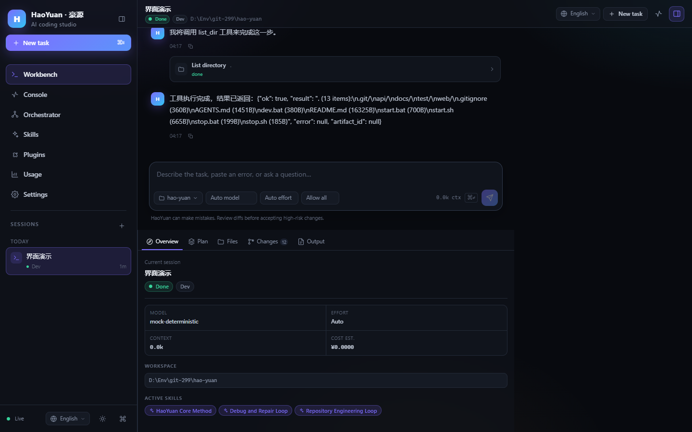
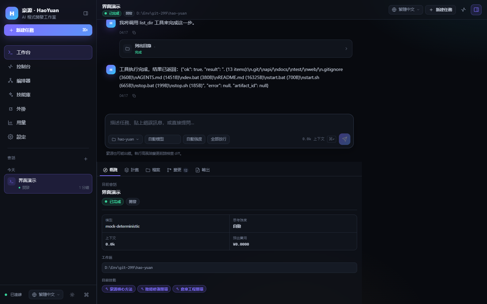

# 豪源 · HaoYuan

[簡體中文](../../README.md) · **繁體中文** · [English](README.en.md)

> 個人指揮 AI 實現多個 AI 員工非同步並行工作的 AI 工作室。  
> 一個核心，一組可安裝外掛，一套可驗證的長程任務閉環。

豪源以 **agent-harness** 為後端參考底座重寫，保留並強化了 AI 助理的程式設計專長，同時用外掛化架構重新組織了會話、工具、Agent、路由、技能、監督與編排。前端完全重寫，目標是把「AI 協作」從聊天視窗升級為可指揮、可觀察、可干預的工作臺。


---

## 1. 核心特性

### 1.1 真正可用的編碼閉環

| 能力 | 實現 |
|---|---|
| 倉庫感知 | `project_scan`、`repo_map`、符號索引、`search_symbol` |
| 精準讀取 | `read_file`、`read_range`、行號定位 |
| 最小編輯 | `apply_patch`（unified diff / SEARCH-REPLACE）、`edit_file`、`multi_edit` |
| 檔案操作 | `write_file`、`glob`、`grep`、`list_dir`、`delete_path`、`move_path` |
| 命令驗證 | `run_shell`（UTF-8、超時、結構化錯誤摘要）、`git` 封裝 |
| 驗證門禁 | 程式碼寫完後強制要求跑測試/lint/build，避免「只改不驗」 |
| 測試修復環 | pytest 失敗結構化解析 → 定位行 → 最小修復 → 失敗指紋升級策略 |
| 子代理 | `task` 在獨立上下文偵察，只回填結論，避免汙染主上下文 |
| 上下文治理 | 工具結果老化、結構化摘要、輪內壓縮、硬預算裁剪 |
| 上下文預裝 | 需求感知 `repo_map` 排序 + 複雜題相關原始碼 `context_pack`（最多約 30KB），減少重複整讀 |
| 長程任務 | 步數預算、自動續跑、檢查點、冪等副作用登記（寫操作不重複施加） |
| 人機協同 | 高風險寫操作/命令彈出 diff 預覽，批准或拒絕後才執行 |

會話意圖分層：寒暄、閒聊與通用問答直接回答，不掃描工作區、不觸發工具或寫入；只有編碼、改檔案、跑命令等明確任務才進入編碼閉環。

### 1.2 多會話非同步並行

- 一個會話 = 一個後臺 `asyncio.Task`，切窗、關頁、斷線都不會停止任務。
- 全域性併發閘 + FIFO 排隊；等待人工審批時自動讓出併發槽。
- 會話狀態機：`idle → queued → running ⇄ waiting_input → done / error`。
- 工作臺頂部會話標籤欄：新建或開啟會話自動生成標籤，點選即可橫向切換，`×` 僅關閉檢視不刪除會話，重新整理後保留。
- 新會話的首條訊息會由模型按當前介面語言生成短標題；舊會話若仍是預設標題，則按首條訊息自動顯示摘要。
- 每個會話擁有獨立地址 `/#/s/<session-id>`，可直接複製、重新整理、分享或直接在位址列切換。
- 重新整理頁面後從 SQLite 恢復訊息、事件、計劃、審批與產物。
- 前端實時事件主通道使用 SSE（斷線重連、遊標續傳、無需 WebSocket 也能流式輸出）；WebSocket 端點保留用於相容；REST 支援事件回放。

### 1.3 AI 總管與多智慧體編排

- **Supervisor**：跨會話健康巡檢、卡死告警、自動中斷、控制檯對話與排程動作。
- **Orchestrator**：目標 → 任務 DAG → 每個員工獨立 git worktree → 並行執行 → 合併驗收。
- 員工會話共享契約檔案與共享黑板，失敗不阻塞同層其它任務。

### 1.4 技能庫（Skills）

- Markdown + front-matter，宣告 `name / title / description / kinds / triggers`。
- 按任務型別與關鍵詞自動匹配；技能多了自動切 BM25 排序。
- 內建：核心方法論、倉庫工程閉環、Debug 閉環、網頁交付、方案寫作。
- 支援在 UI 中新建、編輯、刪除技能，儲存即生效。

### 1.5 方案文件

- `make_plan`：生成獨立 HTML 方案/計劃書，含 KPI、章節、表格、風險、里程碑。
- 產物登記到 `api/data/artifacts/`，工作臺右側可直接預覽/下載。

### 1.6 外掛化架構

豪源不是「一個巨大的單體」，而是：

```
Kernel（會話 / 事件 / 工具註冊 / 策略 / 模型閘道器 / 審批）
        │
        ├── coding      編碼 Agent + 工程工具 + 技能
        ├── plans       方案工具 + Planner Agent
        ├── supervisor  巡檢 + 控制檯路由
        ├── orchestrator 任務 DAG + worktree + 合併
        └── embodied    具身 Agent Harness（預設關閉，可安裝啟用）
```

外掛可以貢獻：工具、Agent、HTTP 路由、技能目錄、事件訂閱、生命週期鉤子、前端導航/命令後設資料。單個外掛載入失敗不會拖垮核心。


### 1.7 三語言、淺色預設與可收起側欄

- 預設 **淺色（白色）主題**，可在設定頁或側欄底部切換為深色。
- 預設 **簡體中文**，可在 **簡體中文 / 繁體中文 / English** 之間切換。
- 語言入口放在三個顯眼位置：工作臺頂欄、側欄底部（所有頁面可用）、設定頁「外觀」。
- 選擇持久化到 `localStorage`，重新整理和重啟後保持；同時更新 `document.lang` 與頁面標題。
- 側欄可收起為 76px 圖示欄；收起後頂部保留明確的「展開側欄」按鈕，會話列表自動隱藏，恢復後完整還原。
- 右側洞察面板預設收起，給對話區留出更多空間；點選右上角按鈕開啟，使用者選擇會持久化。
- 內建技能標題、描述，外掛標題、描述，狀態、按鈕、提示、審批、計劃、用量、編排等 UI 文案均已完成三語言覆蓋。

---

## 2. 快速開始

### 匿名使用統計（透明宣告）

豪源內建一個**完全匿名**的使用統計心跳，用於統計線上裝置數與版本分佈：

- **上報內容**：本地隨機生成的 `install_id`（UUID）、客戶端版本號、作業系統型別（如 `Windows 11`）。不含使用者名稱、郵箱、檔案內容、工作區路徑、對話內容等任何個人資料。
- **上報頻率**：啟動後及執行期間每 5 分鐘一次（僅一次輕量 POST 請求）。
- **完全可關閉**：啟動前設定環境變數 `HAOYUAN_TELEMETRY=0` 即永久關閉，所有功能不受影響。
- **隱私保障**：服務端只記錄 IP 的單向雜湊，不存明文 IP；資料保留 90 天。
- **完整宣告**：見外掛中心隱私介面 `GET {外掛中心地址}/api/plugin-center/privacy`，或原始碼 `api/core/telemetry.py`（約 100 行，可自行審計）。

### 環境要求

- Python 3.10+
- Node.js 18+
- Windows / Linux / macOS

### npm 安裝（推薦）

```bash
# 前提：Node.js 18+、Python 3.10+
npm install -g haoyuan

# 國內加速：
npm install -g haoyuan --registry=https://registry.npmmirror.com

# 終端對話（首次自動建立 venv、安裝依賴）
haoyuan

# 啟動服務並自動開啟網頁
haoyuan web
```

| 命令 | 作用 |
|---|---|
| `haoyuan` | 終端對話（流式輸出、工具呼叫、審批確認） |
| `haoyuan --model x/y` | 以指定模型啟動對話（如 `--model deepseek/deepseek-flash`） |
| `haoyuan web` | 啟動服務並自動開啟網頁 |
| `haoyuan web --no-open` | 啟動服務但不開啟瀏覽器 |
| `haoyuan --version` / `-V` | 檢視版本號 |
| `haoyuan config` | 全域性配置檔案（模型 Key 等），`--open` 直接開啟編輯 |
| `haoyuan login` / `haoyuan logout` | 賬號保護開啟時登入 / 清除本地令牌 |
| `haoyuan setup` | 僅預裝依賴 |
| `haoyuan help` | 顯示幫助 |

終端內命令：`/models` 檢視/選擇模型（序號選擇，`/model x/y` 直選）、`/new` 新建會話、`/web` 在瀏覽器開啟當前會話、`/cancel` 取消當前任務、`/exit` 退出（Ctrl+C 同樣有效）。

網頁預設地址 `http://127.0.0.1:8030`，埠被佔用自動 +1。未配置模型 Key 時使用內建 `mock` 模型，會話、工具呼叫、審批與前端均可完整執行。

### Windows 一鍵啟動

```bat
start.bat
```

指令碼會自動：停止 8030 上的舊程序 → 建立 `api/env1` → 安裝 Python 依賴 → （僅當缺少 `web/dist` 時）安裝前端依賴並構建 → 啟動 API，並自動開啟產品網頁。npm 安裝包已內建預構建前端，因此內網/離線環境也能在依賴裝好後直接啟動。若上次 `npm install` 因網路中斷留下了不完整的 `web/node_modules`，指令碼會自動識別並清理重灌，無需手動刪除目錄。

**埠自動順延**：後端預設 `8030`、前端預設 `8130`；啟動時若埠被佔用會自動 +1（8031、8032…）直到繫結成功。實際埠寫入 `api/data/runtime.json`，啟動指令碼會讀取後直接開啟正確地址。也可用環境變數 `HAOYUAN_PORT` / `HAOYUAN_WEB_PORT`（前端）、`HAOYUAN_API_PORT`（前端代理目標）顯式指定基準埠。

停止：

```bat
stop.bat
```

### 桌面控制檯（desktop.exe）

雙擊根目錄的 `desktop.exe` 開啟圖形化控制檯（約 20 KB，僅依賴 Windows 自帶的 .NET Framework 4.x）：

- **全部啟動 / 全部關閉**：一鍵管理後端與前端開發服務，啟動後自動開啟產品網頁
- **啟動 / 停止後端**（預設 8030）、**啟動 / 停止前端**（預設 8130）
- **埠設定**：可直接修改後端 / 前端埠，點選「應用埠並重啟」儲存配置並自動重啟兩個服務；埠被佔用時服務仍會自動 +1 順延
- **開啟產品網頁**：自動開啟後端實際埠（`api/data/runtime.json`），僅前端執行時回退前端埠
- **構建前端**、**開啟專案目錄**、每秒重新整理的服務狀態與實時執行日誌

關閉控制檯視窗不會停止服務，如需停止請點選「全部關閉」或對應的停止按鈕。原始碼位於 `desktop/`，修改後執行 `desktop\build.bat` 可重新編譯。

### Linux / macOS

```bash
bash start.sh
bash stop.sh
```

內網或自定義映象環境可顯式指定下載源（不指定時自動使用 `~/.npmrc`、`pip.conf` 裡已配置的源）：

```bash
export HAOYUAN_NPM_REGISTRY=http://your-intranet/npm/
export HAOYUAN_PIP_INDEX_URL=http://your-intranet/pypi/simple
bash start.sh
```

Windows 對應：

```bat
set HAOYUAN_NPM_REGISTRY=http://your-intranet/npm/
set HAOYUAN_PIP_INDEX_URL=http://your-intranet/pypi/simple
start.bat
```

前端或 Python 依賴殘缺（例如上次安裝被 `ECONNRESET` 中斷）時，`start.sh` / `start.bat` / `haoyuan setup` 會自動檢測、清理 `web/node_modules` 並重灌，缺少後端包時自動補裝；構建失敗時也會回退到已有的 `web/dist`。

`web/package-lock.json` 不再寫死外網映象地址；`web/.npmrc` 的 `replace-registry-host=always` 會確保安裝始終走當前 npm 配置的 registry，因此不會被鎖檔案劫持到不可達的外網。

### 手動啟動

```bash
# 後端
cd api
python -m venv env1
env1\Scripts\activate           # Linux: source env1/bin/activate
pip install -r requirements.txt
python main.py                  # http://127.0.0.1:8030，被佔用時自動 +1

# 前端開發模式（熱更新，可選）
cd web
npm install
npm run dev                     # http://localhost:8130，被佔用時自動 +1；/api 與 /ws 代理到後端實際埠
```

生產模式由後端直接託管 `web/dist`，只需要訪問後端實際埠。埠可透過環境變數覆蓋：`HAOYUAN_PORT`（後端，預設 8030）、`HAOYUAN_WEB_PORT`（前端，預設 8130）、`HAOYUAN_API_PORT`（前端代理目標，預設讀取 `api/data/runtime.json`）。

### 配置模型

**全域性配置檔案（推薦）** —— 固定使用者級路徑，重灌/升級不受影響：

```bash
haoyuan config          # 首次執行自動建立配置檔案並顯示路徑
haoyuan config --open   # 直接在編輯器中開啟
```

路徑：`~/.config/haoyuan/config.json`（Windows 即 `C:\Users\<你>\.config\haoyuan\config.json`，可用環境變數 `HAOYUAN_CONFIG` 覆蓋）：

首次啟動（或 npm 安裝時的 postinstall）會自動生成該檔案，目錄不存在也會自動建立。

```json
{
  "PROVIDER": "",
  "MODEL": "",
  "DEEPSEEK_API_KEY": "",
  "DEEPSEEK_BASE_URL": "https://api.deepseek.com",
  "DEEPSEEK_MODEL": "deepseek-flash",
  "ZHIPU_API_KEY": "",
  "ZHIPU_BASE_URL": "https://open.bigmodel.cn/api/coding/paas/v4",
  "ZHIPU_MODEL": "glm-5.3-flash",
  "MIMO_API_KEY": "",
  "MIMO_BASE_URL": "https://token-plan-cn.xiaomimimo.com/v1",
  "MIMO_MODEL": "mimo-v2.6-flash",
  "providers": {}
}
```

- 內建渠道可增加 `DEEPSEEK_MODELS` / `ZHIPU_MODELS` / `MIMO_MODELS`（逗號分隔）來完全自定義模型列表；`*_THINKING_MODELS`、`*_MAX_OUTPUT`、`*_SUPPORTS_THINKING` 可選。
- 任意 OpenAI 相容渠道寫入 `providers` 物件即可，不限於內建的 3 家：

```json
{
  "providers": {
    "my-intranet": {
      "base_url": "http://llm.intranet/v1",
      "api_key": "sk-...",
      "models": ["qwen-max", "qwen-plus"],
      "default_model": "qwen-max",
      "supports_thinking": false,
      "max_output_tokens": 8192
    }
  }
}
```

- `PROVIDER` / `MODEL` 可鎖定預設模型（如 `"MODEL": "deepseek-v4-pro"` 或 `"MODEL": "my-intranet/qwen-max"`，留空則按已配置 Key 自動選擇）。
- **網頁設定頁 ↔ 配置檔案雙向同步**：在「設定 → 模型配置」中新增/編輯渠道、模型與預設模型後，會立即寫回該檔案；直接編輯檔案儲存後，服務會在下一次請求時自動重新載入（無需重啟）。

**包內配置（可選）**：

```bash
copy api\configs\secrets_example.py api\configs\secrets_local.py
```

編輯 `api/configs/secrets_local.py`，欄位同上（Python 常量格式）。適用於原始碼部署；npm 全域性安裝時該檔案位於包目錄內，升級會被清除，建議優先用全域性配置。

**環境變數**（優先順序最高）：

```powershell
$env:DEEPSEEK_API_KEY="sk-..."
```

優先順序：環境變數 > 全域性配置檔案 > `secrets_local.py`。修改全域性配置檔案後無需重啟（服務自動熱載入）；服務健康檢查 `GET /api/health` 的 `key_source` 會顯示 Key 來源。

**未配置任何 Key 時自動使用本地 `mock` 模型**，完整跑通會話、工具呼叫、審批、事件與前端。

---

## 3. 介面

| 工作臺（淺色，預設） | 工作臺（英文） |
|---|---|
|  |  |

| 工作臺（繁體中文） | 工作臺（深色） |
|---|---|
|  |  |

| 總管控制檯 | 技能庫 |
|---|---|
|  |  |

| 設定與語言入口 | 側欄收起後的展開按鈕 |
|---|---|
|  |  |

移動端右側洞察面板：  


主要互動：

- 頂部會話標籤：點選切換對話方塊，`×` 關閉標籤（不影響會話資料）
- 新建任務不再提供預設問題，直接在輸入框描述即可；會話標題會自動摘要
- 位址列路由：`/#/s/<session-id>` 對應具體會話，可直接複製、重新整理或在新視窗開啟
- `Ctrl / Cmd + K`：命令面板（導航、會話、動作）
- `Ctrl / Cmd + N`：新建任務
- `Ctrl / Cmd + B`：摺疊 / 展開側欄
- `Enter`：傳送；`Shift + Enter`：換行（`Ctrl / Cmd + Enter` 同樣傳送）
- 審批卡片：`A` 批准、`R` 拒絕
- 語言切換：工作臺右上角、任意頁面側欄底部、設定頁「外觀」
- 會話執行中繼續輸入：作為「追加指令」合併進當前執行，不打斷任務
- 右側面板預設收起；點選右上角按鈕展開，包含概覽 / 計劃 / 檔案 / 變更 / 產物，支援拖拽調整寬度
- 檔案與 diff 使用大尺寸預覽彈層，避免窄欄閱讀程式碼

---

## 4. 架構

```text
hao-yuan/
├── api/
│   ├── main.py                    FastAPI 入口（擴充套件路由 + 外掛路由 + 靜態前端）
│   ├── configs/                   配置、模型註冊、金鑰
│   ├── core/
│   │   ├── contracts.py           Tool / Agent / Policy / ToolContext
│   │   ├── storage.py             SQLite (WAL) 儲存層
│   │   ├── events.py              事件匯流排（廣播 + 批次落庫 + 回放）
│   │   ├── gateway.py             模型閘道器（流式 + 降級 + fallback）
│   │   ├── context.py             上下文壓縮 / 老化 / 硬預算
│   │   ├── runtime.py             Agent 主迴圈
│   │   ├── session_manager.py     併發閘 / 排隊 / 審批 / 續跑
│   │   ├── policy.py              許可權門禁
│   │   ├── tools.py               工具註冊與執行
│   │   ├── agents.py              Agent 註冊
│   │   └── plugin.py              外掛發現 / 依賴 / 生命週期
│   ├── harness/                   沙箱 / 技能 / 符號索引 / 修復環 / 監督 / 編排 / 具身
│   ├── tools/                     builtin / dev / plan
│   ├── adapters/providers/        deepseek / mimo / mock
│   ├── plugins/                   coding / plans / supervisor / orchestrator / embodied
│   ├── extensions/                系統 / 會話 / 技能 / 設定 / 檔案 / 用量 / 外掛 / 審批 / 實時事件（SSE / WebSocket）
│   ├── skills/                    核心技能
│   ├── tests/                     28 個後端測試
│   └── data/                      執行時資料（gitignore）
├── web/                           Vue 3 + Vite
├── docs/screenshots/              介面截圖
├── start.bat / stop.bat
├── start.sh / stop.sh
├── dev.bat
├── desktop.exe                    圖形化桌面控制檯（啟停服務 / 開啟網頁）
└── desktop/                       desktop.exe 原始碼與構建指令碼
```

### 資料與邊界

- 資料庫：`api/data/haoyuan.db`（WAL）
- 產物：`api/data/artifacts/<session_id>/`
- 執行時埠：`api/data/runtime.json`（後端寫 `api_port`、前端寫 `web_port`、桌面控制檯寫 `api_port_config` / `web_port_config`）
- 所有檔案工具都受會話工作區白名單約束，拒絕 `../` 與絕對路徑越界。
- 高風險工具（寫檔案、patch、刪除、移動、shell、git、機器人運動）必須經審批。
- `run_shell` 對災難性命令做硬阻斷（如 `rm -rf /`、磁碟格式化、關機）。
- 產物 HTML 透過帶沙箱 CSP 的介面預覽，避免模型生成頁面讀取本地憑據。
- 金鑰只從環境變數或 `secrets_local.py` 讀取，不入庫、不返回明文。
- 真實 Key 存放在 `api/configs/secrets_local.py`，已被 `.gitignore` 忽略；`git add --dry-run` 驗證不會進入倉庫。

---

## 5. 外掛開發

在 `api/plugins/` 下新建目錄：

```
api/plugins/my-plugin/
├── plugin.json
├── plugin.py
├── routes.py        # 可選
└── skills/          # 可選
    └── my-skill.md
```

`plugin.json`：

```json
{
  "name": "my-plugin",
  "title": "My Plugin",
  "version": "1.0.0",
  "description": "What this plugin adds",
  "author": "you",
  "requires": ["coding"],
  "default_enabled": true,
  "backend": "plugin.py",
  "routes": "routes.py",
  "contributes": {
    "tools": ["my_tool"],
    "agents": ["my_agent"],
    "skills": true
  },
  "frontend": {
    "nav": [{ "label": "My Plugin", "path": "/my-plugin", "icon": "puzzle" }],
    "commands": [{ "id": "my-plugin.run", "title": "Run my plugin" }]
  }
}
```

`plugin.py`：

```python
from core.contracts import AgentSpec, ToolSpec


async def my_tool(ctx, args):
    return {"echo": args.get("text", "")}


def register(ctx):
    ctx.register_tool(
        ToolSpec(
            name="my_tool",
            description="Echo text",
            input_schema={
                "type": "object",
                "properties": {"text": {"type": "string"}},
                "required": ["text"],
            },
        ),
        my_tool,
    )
    ctx.register_agent(
        AgentSpec(
            name="my_agent",
            title="My Agent",
            instructions="You are ...",
            tools=["my_tool"],
            kind="dev",
        )
    )
    ctx.add_skill_dir("skills")


async def startup(ctx):
    ...


async def shutdown(ctx):
    ...
```

外掛能力：

- `requires` 依賴排序；缺失依賴會被隔離並記錄錯誤。
- `startup / shutdown` 生命週期。
- `ctx.events.subscribe(sink)` 訂閱全域性事件（編排器就是這樣接收員工完成事件的）。
- 啟用/禁用狀態持久化在 SQLite；啟用/禁用後需重啟 API 以載入/解除安裝路由。
- 前端透過 `/api/plugins` 獲取 `contributes` 與 `frontend` 後設資料。

### 為什麼這樣設計

參考了 WordPress 的「小核心 + 可安裝外掛」：核心只負責會話、事件、策略、模型與工具協議；業務能力全部下沉為外掛。  
也吸收了 DeepSeek Harness 的「harness 本身可插拔」思路：具身 Agent 就是一個獨立 harness 外掛，可以繼續安裝小車、機械臂、人形機器人等不同 harness，而不改核心。

---

## 6. 自測結果

在本次交付環境中已執行：

```bash
cd api
python -m pytest -q
# 28 passed, 1 warning

cd ../web
npm run build
# ✓ built, 83 modules transformed
```

測試覆蓋：

- 健康檢查、模型、技能、外掛、審批列表
- mock 模型完整會話（訊息 → 事件 → done）
- 編碼會話寫檔案 → 工具事件 → artifact → 工作區樹讀取
- 人工審批流程：pending → 批准 → 工具執行 → 檔案落盤
- 會話改名 / 隱藏 / 恢復 / 清空 / 徹底刪除
- 全域性門禁與預設工作區設定、用量與 CSV 匯出
- 外掛啟用狀態持久化
- Orchestrator git worktree 端到端（建立 → 派發 → 完成 → 合併）
- 工具級：沙箱越界、讀寫/編輯/patch/multi_edit、glob/grep/符號、shell、刪除/移動
- 危險 shell 命令硬阻斷
- 符號索引、repo map、pytest 解析、修復指引
- 方案 HTML 產物生成
- 意圖分流：寒暄、閒聊與通用問答（如「你好嗎」「今天天氣不錯」「什麼是依賴注入」）直接回復，不掃描工作區、不觸發工具或寫入（含真實 deepseek-flash 驗證）
- 首條訊息自動生成會話標題（跟隨介面語言；mock 覆蓋回退與真實模型驗證）
- 會話獨立路由：`/#/s/<session-id>` 深鏈、標籤切換、位址列編輯、重新整理恢復與關閉回退

另外用 Playwright + 本機 Chrome 對生產構建做了真實瀏覽器巡檢：

- 工作臺 / 控制檯 / 技能 / 外掛 / 設定 / 用量 / 編排頁全部載入
- 頂部會話標籤與獨立路由：開啟、切換、關閉、位址列深鏈、重新整理恢復
- 預設標題自動摘要、右上角語言選單（English / 簡體中文切換）與無預設問題的空狀態
- 簡體中文、繁體中文、English 三語言切換正常，重新整理後語言保持
- 語言入口覆蓋工作臺頂欄、側欄底部、設定頁三處
- 側欄 286px ↔ 76px 收起/展開正常，收起後會話列表隱藏且展開按鈕可見
- 右側洞察面板預設收起，展開/收起狀態持久化
- 輸入框 `Enter` 提交、`Shift + Enter` 換行正常，中文輸入法組合態不會誤提交
- 深色 / 淺色主題正常
- 430px 移動端佈局、側欄抽屜、右側洞察抽屜正常
- SSE 實時流：真實 DeepSeek 的思考過程與正文增量在 `done` 之前可見
- 控制檯無 JS 錯誤、無資源 404、無 WebSocket 404（前端實時流主通道已改為 SSE）

> 本次已使用 AI 助理參考的 DeepSeek Key 完成真實線上驗證：`deepseek-flash` 返回 `OK`，usage provider/model = `deepseek/deepseek-flash`。Key 僅存放在 `api/configs/secrets_local.py`，已被 `.gitignore` 忽略；倉庫只提交 `secrets_example.py` 模板。Mock 迴歸測試仍保留，斷網或無 Key 時可自動降級。

---

## 7. Harness 公平評測結果

> 最新報告：[test/testing/index-2026-10-27.html](../../test/testing/index-2026-10-27.html)（2026-10-27，mimo-v2.6-flash）  
> 歷史報告：[test/testing/index-2026-10-25.html](../../test/testing/index-2026-10-25.html)（2026-10-25，deepseek-flash）

### 7.1 MiMo 公平評測（最新）

**方法**：5 個可自動判分的任務（基礎自適應 1 + 定位 / 效能 / 長程 / 併發 4）× 3 個工具；統一 `mimo-v2.6-flash`、提示詞、種子倉庫與預算。執行結束後注入隱藏測試，並對 `tests/`、`pyproject.toml` 做 SHA-256 校驗，篡改即 0 分。t1/d1/d3 使用 official-r1 交錯批次，d4/d6 使用凍結程式碼後的獨立復跑批次。

| 排名 | 工具 | 綜合（產品加權） | 正確率 | 速度 | 成本 | 工程紀律 | 等權 |
|---|---|---|---|---|---|---|---|
| 1 | **豪源 HaoYuan** | **98.8** | 100.0 | 94.4 | 96.9 | 100.0 | **98.3（第 1）** |
| 2 | OpenCode | 90.5 | 100.0 | 67.8 | 53.5 | 100.0 | 84.3（第 2） |
| 3 | Claude Code | 88.9 | 100.0 | 65.1 | 40.9 | 100.0 | 81.2（第 3） |

綜合 = 0.65 × 正確率 + 0.15 × 速度 + 0.10 × 成本 + 0.10 × 工程紀律；等權口徑為 0.40 / 0.20 / 0.20 / 0.20。

- 三者正確率均為 100%；豪源產品加權 **98.8**、等權 **98.3**，兩種口徑均為第一。
- 分任務：豪源在 t1（63.8s）、d3（220.6s）、d4（469.6s）最快；OpenCode 拿下 d1（111.3s），Claude Code 拿下 d6（254.5s）。
- 成本：5 題總成本豪源 **$3.33**、OpenCode $6.56、Claude Code $9.04；單任務成本分別為 $0.666 / $1.313 / $1.809。
- 自適應強度：t1 簡單題 63.8s / 11 次呼叫，未啟動計劃或子代理；d4 長程題透過預裝相關原始碼減少重複探索（從 1200s 超時降到 469.6s）。
- 關鍵修復：補齊 MiMo provider（此前 `resolve("mimo", ...)` 會靜默回退 deepseek）、需求感知 repo map、複雜題 30KB context pack、程序樹回收、嚴格 provider + 單次呼叫上限 + 同模型重試、簡單題 lite 路由。
- 侷限：正式對照每題 1 輪；d4/d6 為獨立復跑批次；模型延遲方差較大（Claude d3 先前 623s、本次 884s）；d5 區分度不足未入榜；自建任務，不能替代 SWE-bench 等公開基準。

復現：

```bash
cd test/bench
python harness_bench.py run --batch official-r1 --tools haoyuan,claude,opencode --tasks t1_multisite_bugfix,d1_needle_regress,d3_perf_cliff --resume
python harness_bench.py run --batch official-r1 --tools haoyuan,claude,opencode --tasks d4_multilayer_feature,d6_concurrency_fix --resume
python make_report_mimo_final.py
```

### 7.2 deepseek-flash 深度評測（歷史）

**方法**：8 個可自動判分的編碼任務（5 基礎 + 3 困難）× 每任務 3 輪 × 3 個工具；統一 deepseek-flash、提示詞、種子倉庫與預算；執行結束後注入隱藏測試，並對 `tests/`、`pyproject.toml` 做 SHA-256 校驗，篡改即 0 分。

| 排名 | 工具 | 綜合得分（產品加權） | 正確率 | 典型速度 | 尾延遲 | 成本 | 等權得分 |
|---|---|---|---|---|---|---|---|
| 1 | **豪源 HaoYuan** | **96.6** | 100.0 | 100.0（中位 30.3s） | 67.6（P90 159.4s） | 82.2（$0.364） | 95.0（第 2） |
| 2 | OpenCode | 95.1 | 100.0 | 67.6（中位 44.8s） | 100.0（P90 107.7s） | 100.0（$0.299） | 96.8（第 1） |
| 3 | Claude Code | 90.7 | 100.0 | 70.6（中位 42.9s） | 90.7（P90 118.7s） | 55.4（$0.540） | 91.7（第 3） |

綜合 = 0.70 × 正確率 + 0.15 × 典型速度 + 0.05 × 尾延遲 + 0.10 × 成本；等權口徑將後兩項改為 0.10 / 0.10。

- 三者正確率均為 100%，差異集中在速度、尾延遲與 token 成本；豪源產品加權第一，OpenCode 等權反超。
- 豪源任務中位耗時 30.3s 最短，T1/T2/T3/H1 四題中位最快；24 次執行完整性 100%。OpenCode 尾延遲與單任務成本最優；Claude Code token 成本最高。
- 短板：H2 版本遷移中位 159.4s（OpenCode 101.1s），H3 出現過 260s 長尾；後續繼續壓縮遷移審計與自測回合。
- 侷限：僅覆蓋 deepseek-flash、每任務 3 輪，任務為自建，不能替代 SWE-bench 等公開基準。
- 自迭代：評測期間修復 Windows 管道適配、空回覆/未寫入保護、遷移驗收審計、輕量 git diff 審計、完成態順序，並回滾一次「過度自測」的負最佳化。

復現：

```bash
cd test/bench
python harness_bench.py run --batch final-r1 --tools haoyuan,claude,opencode --tasks all
python aggregate.py
python make_report.py
```

---

## 8. 與 AI 助理的功能對齊

| 能力 | 豪源 | 說明 |
|---|---|---|
| 編碼工具鏈 | ✅ | 定位、最小 patch、驗證、修復環、子代理 |
| 上下文壓縮 / 長程 | ✅ | 輪內壓縮、老化、硬預算、檢查點、冪等續跑 |
| 多會話並行 | ✅ | 併發閘、FIFO、後臺任務與前端解耦 |
| 許可權門禁 / diff 審批 | ✅ | 審批卡片、預覽、超時、併發槽讓出 |
| 技能庫 | ✅ | front-matter + 規則/BM25 + UI 編輯 |
| 方案計劃書 | ✅ | 獨立 HTML 產物 |
| AI 總管 | ✅ | 快照、告警、控制檯對話、排程動作 |
| 多智慧體編排 | ✅ | 任務 DAG + git worktree + 合併指標 |
| Token / 成本統計 | ✅ | 日聚合、按模型、CSV 匯出 |
| 外掛機制 | ✅ 增強 | 清單、依賴、生命週期、工具/Agent/路由/技能/前端後設資料 |
| 飛書遠端指揮 | ⏳ 未納入本版 | 介面層已解耦，可作為外掛補充 |
| ASR / TTS / 影片渲染 | ⏳ 未納入本版 | 當前聚焦 AI 程式設計主鏈路 |
| 權威 Benchmark | ⏳ 公開基準未跑 | 已完成自建評測：5 任務 MiMo 公平評測 + 8 任務 deepseek 深度評測（見第 7 節）；SWE-bench 等公開基準未重跑 |

---

## 9. 後續路線（已預留架構）

### 9.1 面向 16GB 視訊記憶體本地訓練的 Skills 庫

計劃內建：

- Qwen3.5-0.8B 的 SFT 資料構造與訓練指令碼
- RL（偏好最佳化 / 可驗證獎勵）訓練指令碼
- 視訊記憶體友好配置：LoRA / QLoRA、梯度累積、小 batch、序列長度控制
- 以「技能」為單位組織：資料模板、訓練配置、評估用例、部署說明

豪源當前的 Skill 機制已經是檔案級、可版本化的，後續可直接把訓練方法論文件作為 Skill 注入 Agent。

### 9.2 外掛化具身 Harness

`plugins/embodied` 已演示：

- 機器人狀態 / 感測器 / 移動 / 轉向 / 急停工具
- 高風險動作審批
- HTTP 演示橋

後續可以在不改核心的前提下增加：

- `embodied-ros2`（ROS2 話題 / 服務）
- `embodied-serial`（Arduino / ESP32）
- `embodied-smolvla`（視覺語言動作模型）
- 小車、機械臂、人形機器人各自的 harness 外掛

---

## 10. API 速覽

統一字首 `/api`，響應格式 `{ code, data, message }`。

| 分組 | 主要端點 |
|---|---|
| 系統 | `GET /health`、`GET /info`、`GET /models`、`GET /agents`、`GET /tools` |
| 會話 | `POST /sessions`、`GET /sessions`、`GET /sessions/{id}`、`PATCH /sessions/{id}` |
| 訊息 | `POST /sessions/{id}/messages`、`GET /sessions/{id}/messages` |
| 事件 | `GET /sessions/{id}/events?after_id=`、`GET /sessions/{id}/stream`、`WS /ws` |
| 審批 | `GET /approvals`、`POST /approvals/{id}/resolve`、`POST /sessions/{id}/confirm` |
| 技能 | `GET/POST /skills`、`GET/PUT/DELETE /skills/{name}` |
| 檔案 | `GET /workspace/tree`、`GET /workspace/file`、`GET /workspace/changes`、`GET /workspace/diff` |
| 設定 | `GET/PUT /settings`、`PUT /settings/gate`、`PUT /settings/workspace` |
| 用量 | `GET /usage/today`、`GET /usage/daily`、`GET /usage/by-model`、`GET /usage/export.csv` |
| 外掛 | `GET /plugins`、`POST /plugins/{name}/toggle` |
| 總管 | `GET /supervisor/overview`、`GET /supervisor/console`、`POST /supervisor/act`、`POST /supervisor/chat` |
| 編排 | `POST /orchestrations`、`GET /orchestrations`、`GET /orchestrations/{id}` |

互動式文件：<http://127.0.0.1:8030/docs>（埠順延後以後端日誌或 `api/data/runtime.json` 為準）

---

## 11. 開發與測試

```bash
cd api
python -m pytest -q

cd ../web
npm run build
npm run dev        # 開發模式，/api 與 /ws 自動代理到後端實際埠
```

建議在 `AGENTS.md` 中記錄團隊的 lint / test / build 命令，豪源會自動把專案記憶注入上下文。

---

## License

本專案基於 [MIT License](../../LICENSE) 開源釋出，可自由使用、修改與分發。
